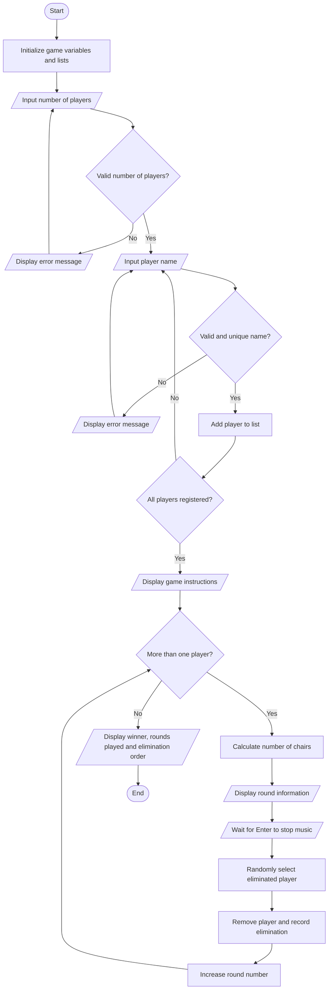

# PROG 1700 — Foundations Practical Test Evaluation (PTE)

## Practice 01 — Musical Chairs

**Student edition | Fall 2026**
**Instructor:** Davis Boudreau | **Time:** 90 minutes | **Evaluation:** Formative, 25 points
**Tools:** Python 3, VS Code, Run & Debug | **File:** `musical_chairs.py`
**Student ID:** ____________________ **Name:** ____________________

## 1. Purpose and scenario

Develop a procedural Python console application that simulates Musical Chairs. Register players, randomly eliminate one player per round, and announce the winner when only one remains. Interpret the supplied flowchart and independently develop, test and debug your solution.

**Key concepts:** Variables, data types, input/output, arithmetic, Boolean expressions, conditional logic, exception handling, loops, lists, random selection, counters and debugging.

## 2. Requirements

- Request a whole-number player count of at least two. Handle invalid conversions and out-of-range values without crashing; re-prompt until valid.
- Register exactly that many players. Trim surrounding whitespace and reject blank or duplicate names (case-sensitive).
- Maintain lists of active and eliminated players. Start the round counter at one.
- Each round, display the round number, active players and chair count (one fewer than active players). Wait for Enter to simulate the music stopping.
- Randomly select one active player, announce the elimination, remove the player, record the elimination and display the remaining count. Advance the round counter.
- Stop when one player remains. Display the winner, actual rounds played and chronological elimination history. Account for every registered player exactly once in the final results.

Use basic procedural Python and the standard random module. Custom functions, classes and real audio are not required. No solution code is supplied.

## 3. Supplied flowchart

## 4. Problem-solving guide

**READ → ORGANIZE → DECIDE → FOLLOW → BUILD → TRACE → TEST → IMPROVE**

| Step        | What to do                                                                                    | Tool or pattern                                                   |
| ----------- | --------------------------------------------------------------------------------------------- | ----------------------------------------------------------------- |
| 1. READ     | Identify the goal, rules and success criteria.                                                | Problem analysis                                                  |
| 2. ORGANIZE | Identify inputs, processing, outputs, variables and data types.                               | IPO and variable planning                                         |
| 3. DECIDE   | Identify valid and invalid inputs and compound conditions.                                    | Truth and decision tables                                         |
| 4. FOLLOW   | Read the flowchart along both branches of each decision; identify repetition and termination. | Flowchart and brief pseudocode                                    |
| 5. BUILD    | Implement one logical block at a time; run each before moving on.                             | Initialization, validation, selection, iteration, list operations |
| 6. TRACE    | Predict and observe changes to game state.                                                    | Trace table, breakpoints, F5, F10                                 |
| 7. TEST     | Compare expected and observed behaviour.                                                      | Normal, boundary and invalid tests                                |
| 8. IMPROVE  | Correct defects, simplify where appropriate and retest.                                       | Debugging and refinement                                          |

### Quick planning workspace

| Inputs | Processing | Outputs |
| ------ | ---------- | ------- |
|        |            |         |

Complete the Boolean truth table for accepting a name (abstract conditions; some combinations may not arise in practice):

| Nonblank name | Unique name | Accept? |
| ------------- | ----------- | ------- |
| False         | False       |         |
| False         | True        |         |
| True          | False       |         |
| True          | True        |         |

**Flowchart rules of thumb:** Input/output symbols indicate interaction; rectangles indicate processing; diamonds indicate conditions; returning arrows often indicate loops. Determine what changes each iteration and what causes each loop to stop. Distinguish a failed type conversion from a valid number outside the allowed range.

## 5. Practical tasks

| Task              | Implementation focus                                                    |             Time |
| ----------------- | ----------------------------------------------------------------------- | ---------------: |
| 1 — Setup        | Plan data, initialize and request player count.                         |           15 min |
| 2 — Validation   | Handle exceptions, validate count and register names.                   |           25 min |
| 3 — Processing   | Implement game loop, chair calculation, random elimination and history. |           30 min |
| 4 — Verification | Display final results, test, debug and explain.                         |           20 min |
| **Total**   |                                                                         | **90 min** |

## 6. Testing and debugging

| Test            | Input / scenario                        | Expected behaviour                                | Actual / pass-fail |
| --------------- | --------------------------------------- | ------------------------------------------------- | ------------------ |
| Boundary        | Two distinct players                    | One chair, one round, one elimination             |                    |
| Normal          | Five distinct players                   | Four rounds; chairs decrease from four to one     |                    |
| Invalid type    | Blank, abc, 2.5                         | Reject and re-prompt                              |                    |
| Invalid range   | -1, 0, 1                                | Reject and re-prompt                              |                    |
| Invalid name    | Blank or spaces only                    | Reject without adding                             |                    |
| Duplicate       | Alex, then Alex with surrounding spaces | Reject duplicate after trimming                   |                    |
| Final integrity | Any valid game                          | Winner not in history; every player accounted for |                    |

Use a three-player game. Set a breakpoint near elimination, start with F5 and step with F10. Record the actual values; random outcomes may differ.

| Checkpoint                                    | Round | Active players | Chairs | Eliminated players |
| --------------------------------------------- | ----- | -------------- | ------ | ------------------ |
| Before elimination                            |       |                |        |                    |
| After elimination, before counter increment   |       |                |        |                    |
| Start of next round (after chair calculation) |       |                |        |                    |

Explain why the game terminates and how invalid input is handled.

## 7. Deliverables

Save `musical_chairs.py`, complete the planning and testing notes for practice, and demonstrate the working program and debugger. Commit/push technical evidence and submit to Brightspace only as directed. Follow instructor directions for permitted resources and AI use.

## 8. Practical Test Evaluation rubric

The instructor evaluates overall performance using five criteria. Each criterion is scored **5, 4, 3, 1, or 0**.

| Criterion                                   | Exceeded (5)                                                                | Meets (4)                                        | Approaching (3)                      | Does Not Meet (1)                                          | Not Attempted (0) |
| ------------------------------------------- | --------------------------------------------------------------------------- | ------------------------------------------------ | ------------------------------------ | ---------------------------------------------------------- | ----------------- |
| **Problem-Solving (Troubleshooting)** | Independently diagnoses and resolves issues systematically                  | Resolves most issues with appropriate techniques | Resolves some issues with difficulty | Limited ability to diagnose or correct issues              | No attempt        |
| **Accessing Information Resources**   | Independently locates and applies permitted, relevant resources effectively | Uses permitted resources appropriately           | Uses resources with some difficulty  | Struggles to find or apply relevant resources              | No attempt        |
| **Knowledge**                         | Demonstrates strong understanding of the required logic and Python concepts | Demonstrates sound understanding                 | Demonstrates partial understanding   | Demonstrates limited understanding                         | No attempt        |
| **Hands-On Skills**                   | Produces and tests a complete, accurate working program                     | Produces a substantially functional program      | Produces a partially working program | Produces a minimally working or largely incomplete program | No attempt        |

**Practice score:** ____ / 25 (formative only).

Use the same five criteria as the Foundations PTE to identify areas requiring further practice.
