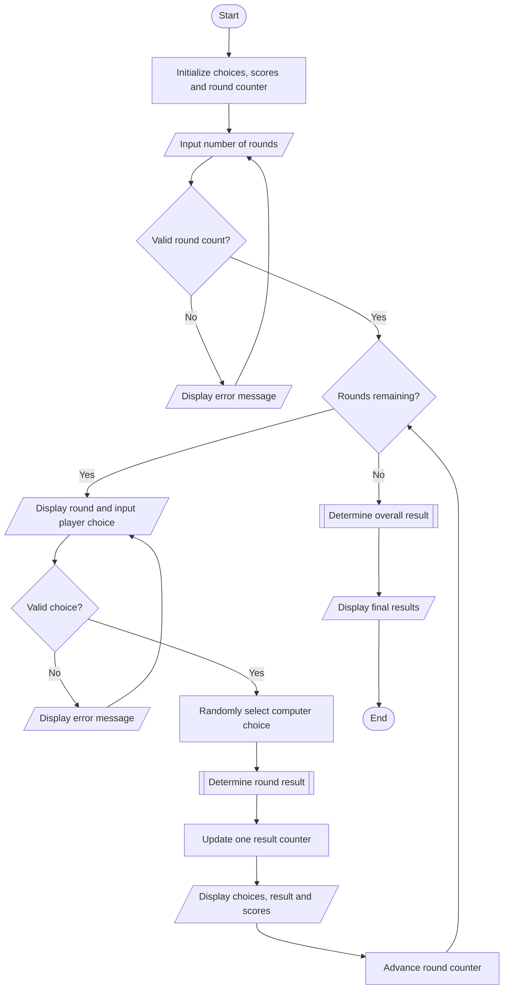

# PROG 1700 — Foundations Practical Test Evaluation (PTE)
## Practice 02 — Rock, Paper, Scissors

**Student edition | Fall 2026**  
**Instructor:** Davis Boudreau | **Time:** 90 minutes | **Evaluation:** Formative, 25 points  
**Tools:** Python 3, VS Code, Run & Debug | **File:** `rock_paper_scissors.py`  
**Student ID:** ____________________ **Name:** ____________________

## 1. Purpose and scenario

Develop a procedural Python console application in which a player competes against the computer in Rock, Paper, Scissors. Play a specified number of rounds, determine each round's result and announce the overall winner. Interpret the flowchart and independently develop, test and debug your solution.

**Key concepts:** Variables, strings, integers, input/output, exception handling, validation, Boolean expressions, conditional selection, loops, lists, random selection, counters and debugging.

## 2. Requirements

- Request a whole-number round count of at least one. Reject invalid conversions and numbers below one; re-prompt until valid.
- Initialize player wins, computer wins and ties to zero. Start the round counter at one.
- Maintain a list containing the three legal choices: rock, paper and scissors.
- For each round, display the round number and request the player's choice. Trim whitespace and normalize case. Reject blank or unrecognized choices without consuming a round.
- Randomly select the computer's choice from the legal choices after the player's choice is valid. Display both choices.
- Determine the round result: rock beats scissors, scissors beats paper, paper beats rock, and identical choices tie.
- Increment exactly one result counter, display the result and running scores, and advance the round counter. Ties count as completed rounds.
- After the requested number of rounds, display rounds played, player wins, computer wins and ties. Announce the player as winner if player wins exceed computer wins, the computer if the reverse is true, or an overall tie if scores are equal.

Use basic procedural Python and the standard random module. Custom functions and classes are not required. No solution code is supplied.

## 3. Supplied flowchart

Double-sided rectangles represent predefined processes. Work out their internal decisions using the game rules and tables below.

## 4. Problem-solving guide

**READ → ORGANIZE → DECIDE → FOLLOW → BUILD → TRACE → TEST → IMPROVE**

| Step | What to do | Tool or pattern |
|---|---|---|
| 1. READ | Identify the goal, rules and success criteria. | Problem analysis |
| 2. ORGANIZE | Identify inputs, processing, outputs, variables and data types. | IPO and variable planning |
| 3. DECIDE | Identify valid and invalid inputs and compound conditions. | Truth and decision tables |
| 4. FOLLOW | Read the flowchart along both branches of each decision; identify repetition and termination. | Flowchart and brief pseudocode |
| 5. BUILD | Implement one logical block at a time; run each before moving on. | Initialization, validation, selection, iteration, score updates |
| 6. TRACE | Predict and observe changes to game state. | Trace table, breakpoints, F5, F10 |
| 7. TEST | Compare expected and observed behaviour. | Normal, boundary and invalid tests |
| 8. IMPROVE | Correct defects, simplify where appropriate and retest. | Debugging and refinement |

### Quick planning workspace

| Inputs | Processing | Outputs |
|---|---|---|
| | | |

**Decision table:** Complete all nine combinations using Player wins, Computer wins or Tie.

| Player choice | Computer: Rock | Computer: Paper | Computer: Scissors |
|---|---|---|---|
| Rock | | | |
| Paper | | | |
| Scissors | | | |

**Truth table:** For the rule “player chooses rock AND computer chooses scissors,” determine whether that particular winning condition is true.

| Player chooses rock | Computer chooses scissors | Condition true? |
|---|---|---|
| False | False | |
| False | True | |
| True | False | |
| True | True | |

Identify the other two player-winning conditions. Explain how they can be combined using OR, and how you will distinguish a tie from a computer win.

**Flowchart rules of thumb:** Input/output symbols indicate interaction; rectangles indicate processing; diamonds indicate decisions; returning arrows often indicate loops. Identify which loop handles invalid input and which handles completed rounds. Determine what changes each iteration and what causes the loop to stop. Use a counter for each possible result; only one should change per completed round.

## 5. Practical tasks

| Task | Implementation focus | Time |
|---|---|---:|
| 1 — Setup | Plan data, initialize choices and counters, request round count. | 15 min |
| 2 — Validation | Handle conversion errors, validate round count and normalize player choices. | 25 min |
| 3 — Processing | Implement rounds, random choice, decision logic and score updates. | 30 min |
| 4 — Verification | Report final results, test, debug and explain. | 20 min |
| **Total** | | **90 min** |

## 6. Testing and debugging

| Test | Input / scenario | Expected behaviour | Actual / pass-fail |
|---|---|---|---|
| Boundary | One round | Exactly one completed round | |
| Normal | Five rounds | Exactly five completed rounds | |
| Invalid type | Blank, abc, 2.5 for round count | Reject and re-prompt | |
| Invalid range | -1, 0 rounds | Reject and re-prompt | |
| Invalid choice | Blank, lizard | Reject without advancing round or scores | |
| Normalization | ` ROCK ` | Accept as rock | |
| Round logic | All nine choice combinations | Match completed decision table | |
| Overall result | Player leads, computer leads, equal wins | Correct overall outcome in each case | |
| Final integrity | Any valid game | Wins + losses (computer wins) + ties = rounds played | |

For repeatable logic tests, temporarily replace the random computer choice with a selected legal choice. Restore random selection before the final demonstration. Test the three overall outcomes with controlled sequences of choices.

Use a three-round game. Set a breakpoint after the computer choice and before the score update, start with F5 and step with F10. Record actual values after the score update but before advancing the round counter.

| Round | Player choice | Computer choice | Result | Player wins | Computer wins | Ties |
|---|---|---|---|---|---|---|
| Initial | — | — | — | | | |
| 1 | | | | | | |
| 2 | | | | | | |
| 3 | | | | | | |

Explain why only one counter changes per valid round, why invalid choices do not consume rounds, and how the program terminates.

## 7. Deliverables

Save `rock_paper_scissors.py`, complete the planning and testing notes for practice, and demonstrate the working program and debugger. Commit/push technical evidence and submit to Brightspace only as directed. Follow instructor directions for permitted resources and AI use.

## 8. Practical Test Evaluation rubric

The instructor evaluates overall performance using five criteria. Each criterion is scored **5, 4, 3, 1, or 0**.

| Criterion | Exceeded (5) | Meets (4) | Approaching (3) | Does Not Meet (1) | Not Attempted (0) |
|---|---|---|---|---|---|
| **Time Management** | Plans effectively and completes all requirements accurately within the allotted time | Completes required work within the allotted time | Some requirements incomplete at time limit | Significant difficulty progressing within the time limit | No attempt |
| **Problem-Solving (Troubleshooting)** | Independently diagnoses and resolves issues systematically | Resolves most issues with appropriate techniques | Resolves some issues with difficulty | Limited ability to diagnose or correct issues | No attempt |
| **Accessing Information Resources** | Independently locates and applies permitted, relevant resources effectively | Uses permitted resources appropriately | Uses resources with some difficulty | Struggles to find or apply relevant resources | No attempt |
| **Knowledge** | Demonstrates strong understanding of the required logic and Python concepts | Demonstrates sound understanding | Demonstrates partial understanding | Demonstrates limited understanding | No attempt |
| **Hands-On Skills** | Produces and tests a complete, accurate working program | Produces a substantially functional program | Produces a partially working program | Produces a minimally working or largely incomplete program | No attempt |

**Practice score:** ____ / 25 (formative only).

Use the same five criteria as the Foundations PTE to identify areas requiring further practice.
