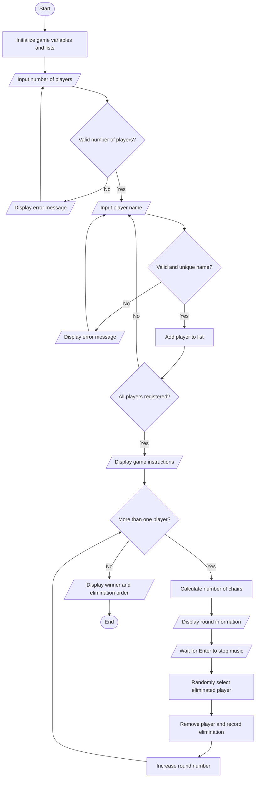

# PROG 1700 — Foundations Practical Test Evaluation (PTE)

## Sample Practical Test — Musical Chairs

**Student edition | Fall 2026**  
**Instructor:** Davis Boudreau  
**Time:** 90 minutes (suggested practice time)  
**Assessment:** Individual practice, formative — no course grade  
**Coverage:** WS00–WS06; LO1, LO2, LO3, LO4, LO6, LO7  
**Tools:** Python 3, VS Code, Run & Debug  
**Student name:** ____________________

## Purpose

Interpret a supplied flowchart and independently translate it into a working procedural Python console application. Demonstrate input/output, variables, expressions, conditional logic, error handling, loops, lists and debugging. No solution code is supplied.

## Scenario

A campus activity organizer needs a terminal-based Musical Chairs game. The organizer registers players, then starts the game. Each round has one fewer chair than active players. When the organizer presses Enter, the music stops and one randomly selected player is eliminated. The game continues until only one player remains. Display the winner, number of rounds played and elimination history.

### Business rules

1. Request a whole-number player count of at least two. Reject blank input, text, decimal values and numbers below two. Re-prompt without crashing.
2. Register exactly the requested number of players. Trim surrounding whitespace; reject blank names and duplicates. Duplicate matching is case-sensitive for this sample, consistent with the review program.
3. Maintain two lists: active players and eliminated players. Invalid registration attempts must not add a player.
4. Start the round counter at one. Before each round, display its number, active players and chair count (active player count minus one).
5. Wait for Enter to simulate the music stopping, then randomly select one active player using Python's standard random module.
6. Announce the eliminated player, remove that player from the active list, record them in the elimination list and display the remaining player count. Increase the round counter.
7. Repeat until exactly one player remains. Display the winner, actual rounds played and eliminated players in chronological order.
8. The winner must not appear in the elimination history. Each originally registered player must appear exactly once across the winner and elimination history.

Use basic procedural Python. Custom functions, classes, GUI, real audio, external files and third-party packages are not required. Do not hard-code the winner or require a specific random elimination order.

## Supplied flowchart



## Four practical tasks

### Task 1 — Problem analysis, input and setup (15 minutes)

Create `musical_chairs.py`. Review the flowchart, identify necessary variables and collections, display a welcome message and request the player count. Initialize game state at an appropriate point before use.

**Evidence:** Appropriate data types, lists, and initialization; readable input/output.

### Task 2 — Decisions, validation and registration (25 minutes)

Implement safe conversion of numerical input with exception handling. Validate the count and register names, repeating prompts for invalid entries. Use the decision points and return arrows in the flowchart to guide your control structures.

**Evidence:** Invalid counts and names are rejected; exactly the requested number of unique names are stored.

### Task 3 — Game loops and list processing (30 minutes)

Translate the game loop into Python. Calculate chairs, display each round, pause for Enter, randomly eliminate one active player and maintain the elimination history. Ensure the loop progresses toward termination.

**Evidence:** One elimination per round; correct chair count; no duplicate eliminations; final active list contains exactly one player.

### Task 4 — Results, testing and debugging (20 minutes)

Display the winner, rounds played and elimination order. Run the supplied test cases and correct any defects. Set a breakpoint near elimination, use F5 and F10, and inspect the active list, elimination list, chairs and round counter before and after removing a player. Be prepared to explain why the loop ends.

**Evidence:** Correct final report, successful tests and an observable debugger demonstration.

## Optional planning workspace (recommended for practice)

Use the course problem-solving guide: **READ → ORGANIZE → DECIDE → FOLLOW → BUILD → TRACE → TEST → IMPROVE**. Planning is encouraged but no separate planning submission is required.

| IPO | Your notes |
|---|---|
| Inputs | |
| Processing | |
| Outputs | |

Complete the truth table for accepting a player name. Treat the conditions as Boolean inputs; not every combination necessarily occurs in a correctly maintained list.

| Name is nonblank | Name is not already registered | Accept name? |
|---|---|---|
| False | False | |
| False | True | |
| True | False | |
| True | True | |

Identify the three repeated activities in the flowchart. For each, note its continuation condition and what changes on each successful iteration. Write brief pseudocode if useful.

## Example console interaction

One possible run (random results may differ):

```text
WELCOME TO MUSICAL CHAIRS!
Number of players: 3
Enter player name: Alex
Enter player name: Jordan
Enter player name: Taylor

Round: 1
Players: Alex, Jordan, Taylor
Number of chairs: 2
Music playing... Press Enter to stop the music!
Jordan did not get a chair.
Players remaining: 2

Round: 2
Players: Alex, Taylor
Number of chairs: 1
Music playing... Press Enter to stop the music!
Alex did not get a chair.
Players remaining: 1

GAME OVER!
Winner: Taylor
Rounds played: 2
Elimination order:
- Jordan
- Alex
```

Exact wording and layout need not match this sample.

## Test cases

For each successful registration, press Enter once per round until the game finishes. Record actual behaviour and pass/fail. Do not compare a random winner to a predetermined name.

| Test | Inputs | Expected behaviour | Actual / pass-fail |
|---|---|---|---|
| 1. Minimum players | 2; Alex, Jordan | One chair, one round, one winner and one elimination | |
| 2. Normal game | 5; Alex, Jordan, Taylor, Morgan, Casey | Chair counts 4, 3, 2, 1; four rounds and four eliminations | |
| 3. Invalid type | abc, blank, 2.5, then 2; Alex, Jordan | Reject first three counts; game runs normally | |
| 4. Invalid range | -3, 0, 1, then 2; Alex, Jordan | Reject first three counts; game runs normally | |
| 5. Blank names | 2; blank, spaces only, Alex, Jordan | Reject blank names; register two valid names | |
| 6. Duplicate name | 2; Alex, Alex, Jordan | Reject second Alex; register two valid names | |
| 7. Trim whitespace | 2; Alex with surrounding spaces, Alex, Jordan | Store Alex without spaces; reject duplicate | |
| 8. History integrity | 4; four distinct names | Three distinct eliminated names; winner not in history; all four names accounted for | |

## Debugging trace

Use a three-player game and record actual values. The eliminated name may vary.

| Checkpoint | Round number | Active players | Chairs | Elimination history |
|---|---|---|---|---|
| Before first elimination | | | | |
| After first removal and history update (before increment) | | | | |
| Before second elimination | | | | |
| After second removal and history update (before increment) | | | | |

## Submission

For practice, save `musical_chairs.py` and demonstrate your program and debugger in VS Code. Commit and push your technical evidence to your workshop repository if directed by the instructor. Submit to Brightspace only if requested. Follow instructor directions regarding permitted resources, collaboration and AI tools.

## Practical Test Evaluation (PTE) rubric


The instructor evaluates overall performance using five criteria. Each criterion is scored **5, 4, 3, 1, or 0**.

| Criterion | Exceeded (5) | Meets (4) | Approaching (3) | Does Not Meet (1) | Not Attempted (0) |
|---|---|---|---|---|---|
| **Time Management** | Plans effectively and completes all requirements accurately within the allotted time | Completes required work within the allotted time | Some requirements incomplete at time limit | Significant difficulty progressing within the time limit | No attempt |
| **Problem-Solving (Troubleshooting)** | Independently diagnoses and resolves issues systematically | Resolves most issues with appropriate techniques | Resolves some issues with difficulty | Limited ability to diagnose or correct issues | No attempt |
| **Accessing Information Resources** | Independently locates and applies permitted, relevant resources effectively | Uses permitted resources appropriately | Uses resources with some difficulty | Struggles to find or apply relevant resources | No attempt |
| **Knowledge** | Demonstrates strong understanding of the required logic and Python concepts | Demonstrates sound understanding | Demonstrates partial understanding | Demonstrates limited understanding | No attempt |
| **Hands-On Skills** | Produces and tests a complete, accurate working program | Produces a substantially functional program | Produces a partially working program | Produces a minimally working or largely incomplete program | No attempt |


**Practice score:** ____ / 25 (formative only).

Use the same five criteria as the Foundations PTE to identify areas requiring further practice.
