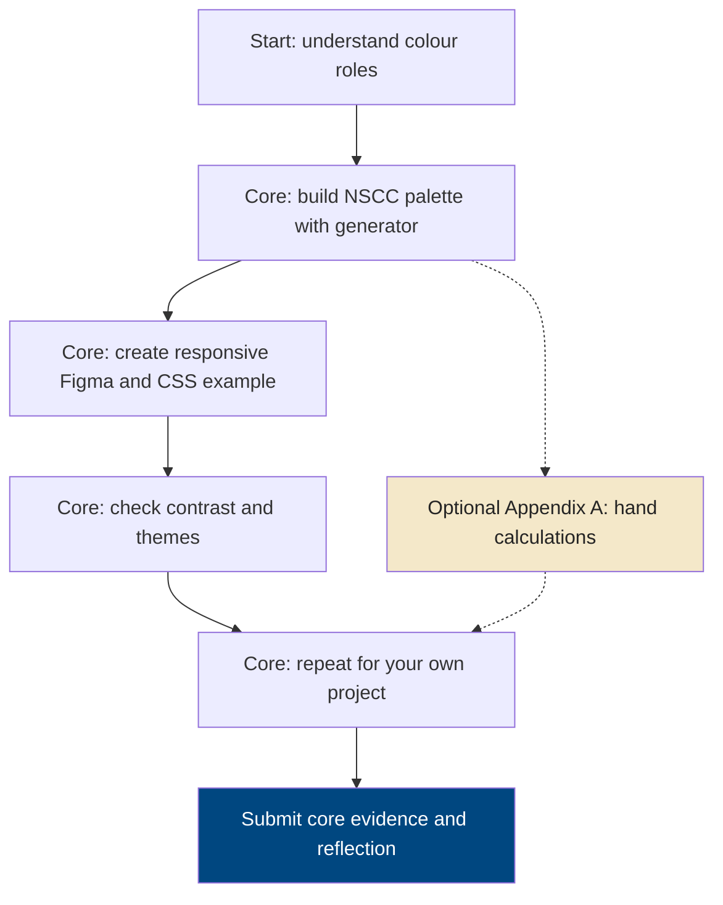
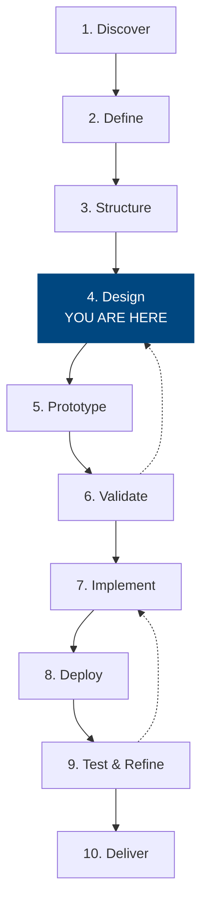
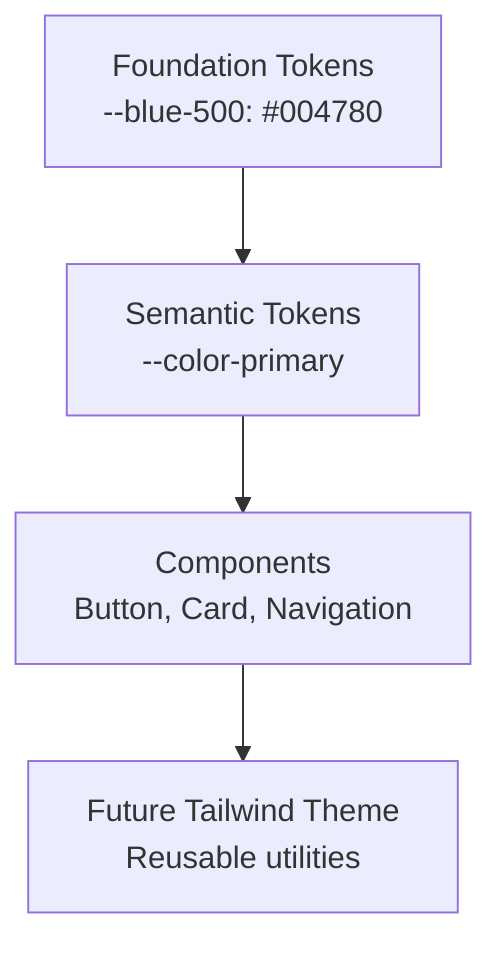
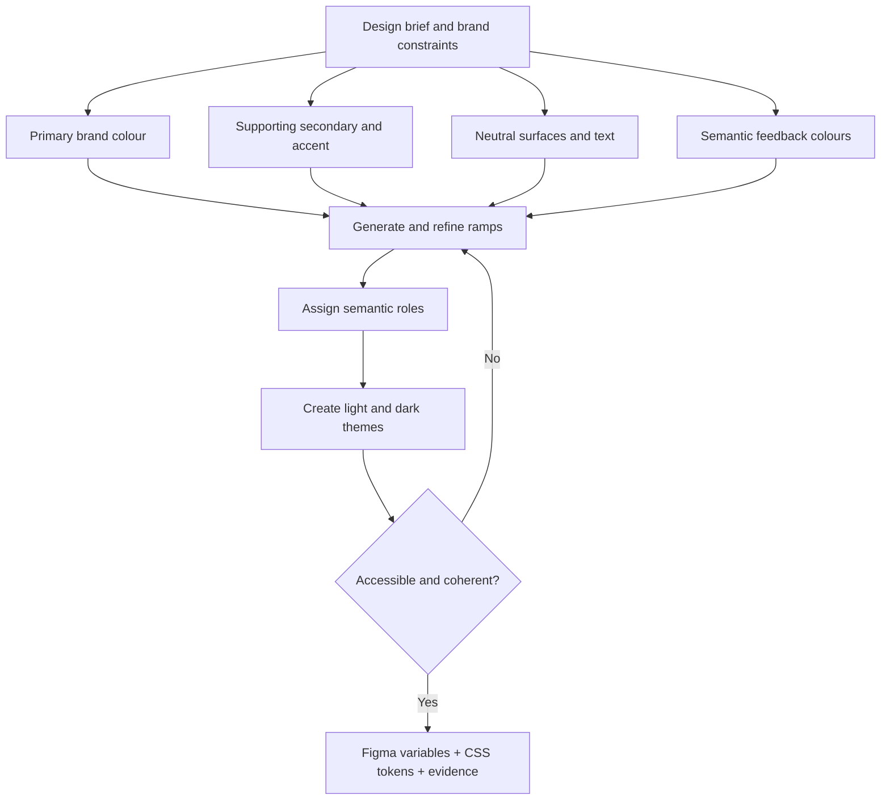
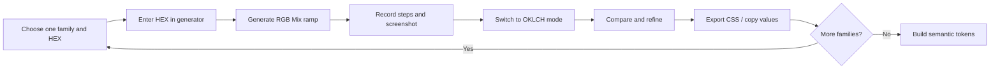
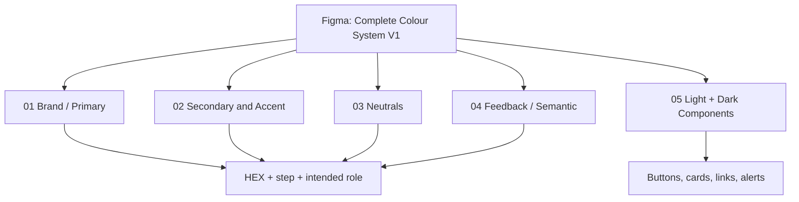
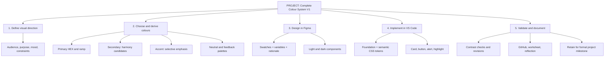
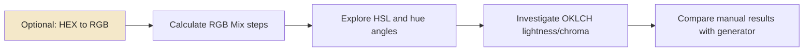

# WEBD 3100 — Workshop 03A
## Complete Colour Design — Brand, Supporting Palettes, Responsive Tokens & Themes

**Student Workshop Guide | Fall 2026**

This workshop connects the visual design skills you have learned in Figma with modern CSS development. You will learn how colour choices become reusable design tokens, how those tokens support light and dark themes, and how a consistent colour system can be used across an entire website.

### Workshop Details

| Field | Details |
|---|---|
| **Course** | WEBD 3100 — Web Design Fundamentals |
| **Instructor** | Davis Boudreau |
| **Workshop** | 03A — Colour Theory, Design Tokens & CSS Themes |
| **Duration** | Core track: approximately 3–4 hours total, including independent project application; optional calculation appendix adds 1–2 hours |
| **Prerequisite** | Workshop 02 — Visual Design Principles & Usability Heuristics |
| **Tools** | Figma, VS Code, browser, Live Server, GitHub, **WEBD3100 Colour Ramp & Theme Generator** |
| **Assessment** | Part of Workshop 03 (03A + 03B), combined 4% |
| **Submission** | Student Submission Template, Figma link, GitHub evidence, reflection via Brightspace |


## Choose your learning track

**Everyone completes the Core Track (required and assessed).** Use the supplied **Colour Ramp & Theme Generator** to create and compare ramps, select a complete palette, test contrast, build a responsive NSCC example, and apply the same workflow to your own integrated project. You must be able to **explain what the generator does**, but you do **not** have to calculate RGB channels, OKLCH values, or hue angles by hand.

**Optional Deep-Dive Track (Appendix A; not graded).** Work through the arithmetic, worksheets and manual hue calculations if you enjoy investigating how the generator works. **No marks are attached to Appendix A**, and omitting it does not reduce your workshop grade.

| Track | Expected time | What you produce | Grading |
|---|---|---|---|
| **Core — required** | **3–4 hours** | NSCC guided colour system, your own Colour System V1, responsive demo, contrast evidence, reflection | Assessed as part of Workshop 03A/03B |
| **Appendix A — optional** | **Additional 1–2 hours** | Worked RGB, OKLCH and hue calculation worksheets | **Not graded** |



**Responsive-first rule for WEBD 3100:** 
Every HTML/CSS example and student project component must work at narrow mobile widths, tablet widths and desktop widths. Use **CSS Grid** for two-dimensional card/page layouts, **Flexbox** for one-dimensional controls/navigation, fluid sizing (`min()`, `max()`, `clamp()`, percentages), and media queries only where content needs them. Never rely on fixed-width layouts or horizontal scrolling to fit a page.

## 1. Where are you in the design process?

Professional web design follows a process. Each workshop helps you develop the knowledge and skills needed for one or more steps.



Your six-phase learning journey is:

**Understand → Plan → Design → Build → Evaluate → Deliver**

In this workshop, you are primarily learning the **Design** phase. You will also practise a small part of the Build phase by translating your Figma colour choices into CSS.

You are not expected to finalize your integrated project's entire design system today. **You are expected to apply the workshop techniques to your own project**, document your decisions, and retain the work for future formal project milestone evaluations.

## 2. Why are you learning this?

Imagine that you are designing an event-management application. You have a navigation bar, event cards, registration buttons, forms, and confirmation messages.

You decide that blue will be your primary colour.

But which blue should you use for buttons? Should headings use the same blue? What happens when a user switches to dark mode? How will you keep colours consistent across multiple pages?

A professional approach is to create a **colour system** rather than choosing individual colours independently.

By the end of this workshop, you will have **completed the guided NSCC colour-system case study** and **applied the same workflow to your own integrated project** in Figma and HTML/CSS. The project work is an early design iteration that you will refine and present as evidence during future formal project milestone evaluations.

## 3. Learning objectives

By completing this workshop, you should be able to:

- Explain hue, saturation, lightness, and basic colour relationships.
- Describe the purpose of colour ramps and OKLCH.
- Build and label a colour ramp in Figma.
- Distinguish foundation colour tokens from semantic colour tokens.
- Create reusable CSS custom properties.
- Apply colour tokens to a web interface.
- Demonstrate light and dark themes.
- Test text contrast and improve accessibility.
- Explain how your colour system can support future frameworks such as Tailwind CSS.
- Convert a chosen HEX colour to RGB and interpret HSL and OKLCH values.
- Explain how ramp steps are calculated, generated, and adjusted.
- Create and implement an original colour system for your integrated project.
- Distinguish workshop evidence from later formally assessed project milestones.
- Select and justify primary, secondary, accent, neutral and feedback colour families.
- Derive candidate supporting colours using HSL hue relationships, then refine by context.
- Produce a complete Colour System V1, with named Figma variables and semantic CSS tokens.

## 4. Before you begin — Set up your Figma workspace

Your Figma design file is a working record of your progress throughout the course. Your instructor will use the shared file to review your work and provide feedback during workshop activities.

**Required Figma sharing**

1. Open your WEBD 3100 Figma design file.
2. Select **Share**.
3. Invite **davis.boudreau@nscc.ca**.
4. Grant **Can view** access, unless your instructor requests another permission.
5. Send the invitation.
6. Verify that your instructor has access.
7. Create a page named `Workshop 03A — Colour Systems`.

If you have not yet created a course design file, name it `WEBD3100 — Your Name — Design Workspace`.

Keep your Figma work organized with clearly named pages and frames. You will include your Figma file link in your submission template.

---

# Part A — Observe and understand colour

## 5. Activity 1 — Colour observation

*Estimated time: 10 minutes*

Open a website you regularly use. Examine its homepage and at least one additional page.

Look for colours used in navigation, headings, buttons, links, backgrounds, cards, and status messages.

Record your observations in the submission template.

| Question | Your observation |
|---|---|
| What colour dominates the interface? | |
| Which colour attracts attention first? | |
| How are important actions identified? | |
| Are colours used consistently? | |
| What is one colour-related improvement you would suggest? | |

**Reflection checkpoint:** Did you evaluate what the colours were communicating, or did you mainly judge whether you liked them?

## 6. Colour theory fundamentals

Colour theory helps you understand how colours relate to each other and how they influence visual communication.

| Property | Guiding question | Illustration |
|---|---|---|
| **Hue** | Which colour family? | Red → Orange → Yellow → Green → Blue → Purple |
| **Saturation** | How vivid or muted? | Muted blue → vivid blue |
| **Lightness** | How light or dark? | Pale blue → dark blue |

Traditional art colour theory often uses the RYB model (Red, Yellow, Blue), with Orange, Green, and Purple as secondary colours. Digital screens use RGB (Red, Green, Blue), with Cyan, Magenta, and Yellow as additive secondary colours.

You may also encounter monochromatic, analogous, and complementary colour relationships.

| Relationship | Meaning | Example |
|---|---|---|
| **Monochromatic** | Variations of one hue | Light blue, medium blue, dark blue |
| **Analogous** | Neighbouring hues | Blue, cyan, teal |
| **Complementary** | Opposing hues | Blue and orange |


### Visual Colour Properties — HTML Swatches

> **Preview note:** The swatches below use embedded HTML with inline CSS. They display in Markdown viewers that permit inline styles (for example, some VS Code preview extensions). GitHub strips inline styles, so the accompanying Markdown descriptions remain important.

**Hue — different colour families**

<div style="display:flex;gap:4px;margin:10px 0 18px 0;">
  <div title="Red #F44336" style="flex:1;height:54px;background-color:#F44336;border-radius:4px;"></div>
  <div title="Orange #FF9800" style="flex:1;height:54px;background-color:#FF9800;border-radius:4px;"></div>
  <div title="Yellow #FFEB3B" style="flex:1;height:54px;background-color:#FFEB3B;border-radius:4px;"></div>
  <div title="Green #4CAF50" style="flex:1;height:54px;background-color:#4CAF50;border-radius:4px;"></div>
  <div title="Blue #2196F3" style="flex:1;height:54px;background-color:#2196F3;border-radius:4px;"></div>
  <div title="Purple #9C27B0" style="flex:1;height:54px;background-color:#9C27B0;border-radius:4px;"></div>
</div>

**Saturation — muted to vivid blue**

<div style="display:flex;gap:4px;margin:10px 0 18px 0;">
  <div style="flex:1;height:54px;background-color:#B7C3CE;border-radius:4px;"></div>
  <div style="flex:1;height:54px;background-color:#8FAAC2;border-radius:4px;"></div>
  <div style="flex:1;height:54px;background-color:#6799C2;border-radius:4px;"></div>
  <div style="flex:1;height:54px;background-color:#3F89C2;border-radius:4px;"></div>
  <div style="flex:1;height:54px;background-color:#1779C2;border-radius:4px;"></div>
</div>

**Lightness — pale to dark blue**

<div style="display:flex;gap:4px;margin:10px 0 18px 0;">
  <div style="flex:1;height:54px;background-color:#E5F1FA;border-radius:4px;"></div>
  <div style="flex:1;height:54px;background-color:#A3C9E5;border-radius:4px;"></div>
  <div style="flex:1;height:54px;background-color:#619BC7;border-radius:4px;"></div>
  <div style="flex:1;height:54px;background-color:#256A9E;border-radius:4px;"></div>
  <div style="flex:1;height:54px;background-color:#003C70;border-radius:4px;"></div>
</div>

### Visual Colour Relationships — HTML Swatches

**Monochromatic — one hue, different lightness values**

<div style="display:flex;gap:4px;margin:8px 0 18px 0;">
  <div style="flex:1;height:55px;background-color:#B7DAF5;border-radius:4px;"></div>
  <div style="flex:1;height:55px;background-color:#438BC3;border-radius:4px;"></div>
  <div style="flex:1;height:55px;background-color:#004780;border-radius:4px;"></div>
</div>

**Analogous — neighbouring blue, cyan, and teal hues**

<div style="display:flex;gap:4px;margin:8px 0 18px 0;">
  <div style="flex:1;height:55px;background-color:#2563EB;border-radius:4px;"></div>
  <div style="flex:1;height:55px;background-color:#0891B2;border-radius:4px;"></div>
  <div style="flex:1;height:55px;background-color:#0D9488;border-radius:4px;"></div>
</div>

**Complementary — blue and orange**

<div style="display:flex;gap:4px;margin:8px 0 18px 0;">
  <div style="flex:1;height:55px;background-color:#2563EB;border-radius:4px;"></div>
  <div style="flex:1;height:55px;background-color:#F59E0B;border-radius:4px;"></div>
</div>

## 7. Activity 2 — Experiment in Figma

*Estimated time: 15 minutes*

1. On your Workshop 03A Figma page, create a frame named `Colour Exploration`.
2. Draw five equal-sized rectangles.
3. Give them the same starting colour.
4. Change the hue of one rectangle.
5. Reduce the saturation of another.
6. Make one rectangle lighter and another darker.
7. Label each swatch to explain the change.

Capture a screenshot and answer:

**Which adjustment had the strongest effect on your attention, and how might you use that effect in an interface?**

---

# Part B — Build a professional colour ramp

## 8. What is a colour ramp?

A colour ramp is an organized set of related colours, typically moving from lighter to darker variants.

Professional design systems use ramps to provide colour options for surfaces, borders, headings, buttons, and interactive states.

Here is an example based on NSCC Blue (`#004780`).

### NSCC Blue — Example Colour Ramp

**Visual ramp — HTML swatches**

<div style="display:flex;flex-wrap:wrap;gap:7px;margin:12px 0;">
  <div style="width:88px;text-align:center;font-family:system-ui,sans-serif;">
    <div title="Step 50: #E6F1FA" style="height:62px;background-color:#E6F1FA;border:1px solid #999;border-radius:5px;"></div>
    <div style="font-size:12px;font-weight:600;margin-top:5px;">50</div>
    <div style="font-size:11px;">#E6F1FA</div>
  </div>
  <div style="width:88px;text-align:center;font-family:system-ui,sans-serif;">
    <div title="Step 100: #CCE3F5" style="height:62px;background-color:#CCE3F5;border:1px solid #999;border-radius:5px;"></div>
    <div style="font-size:12px;font-weight:600;margin-top:5px;">100</div>
    <div style="font-size:11px;">#CCE3F5</div>
  </div>
  <div style="width:88px;text-align:center;font-family:system-ui,sans-serif;">
    <div title="Step 200: #99C7EB" style="height:62px;background-color:#99C7EB;border:1px solid #999;border-radius:5px;"></div>
    <div style="font-size:12px;font-weight:600;margin-top:5px;">200</div>
    <div style="font-size:11px;">#99C7EB</div>
  </div>
  <div style="width:88px;text-align:center;font-family:system-ui,sans-serif;">
    <div title="Step 300: #66ABE0" style="height:62px;background-color:#66ABE0;border:1px solid #999;border-radius:5px;"></div>
    <div style="font-size:12px;font-weight:600;margin-top:5px;">300</div>
    <div style="font-size:11px;">#66ABE0</div>
  </div>
  <div style="width:88px;text-align:center;font-family:system-ui,sans-serif;">
    <div title="Step 400: #338FD6" style="height:62px;background-color:#338FD6;border:1px solid #999;border-radius:5px;"></div>
    <div style="font-size:12px;font-weight:600;margin-top:5px;">400</div>
    <div style="font-size:11px;">#338FD6</div>
  </div>
  <div style="width:88px;text-align:center;font-family:system-ui,sans-serif;">
    <div title="Step 500: #004780" style="height:62px;background-color:#004780;border:1px solid #999;border-radius:5px;"></div>
    <div style="font-size:12px;font-weight:600;margin-top:5px;">500</div>
    <div style="font-size:11px;">#004780</div>
  </div>
  <div style="width:88px;text-align:center;font-family:system-ui,sans-serif;">
    <div title="Step 600: #003F73" style="height:62px;background-color:#003F73;border:1px solid #999;border-radius:5px;"></div>
    <div style="font-size:12px;font-weight:600;margin-top:5px;">600</div>
    <div style="font-size:11px;">#003F73</div>
  </div>
  <div style="width:88px;text-align:center;font-family:system-ui,sans-serif;">
    <div title="Step 700: #003060" style="height:62px;background-color:#003060;border:1px solid #999;border-radius:5px;"></div>
    <div style="font-size:12px;font-weight:600;margin-top:5px;">700</div>
    <div style="font-size:11px;">#003060</div>
  </div>
  <div style="width:88px;text-align:center;font-family:system-ui,sans-serif;">
    <div title="Step 800: #00244D" style="height:62px;background-color:#00244D;border:1px solid #999;border-radius:5px;"></div>
    <div style="font-size:12px;font-weight:600;margin-top:5px;">800</div>
    <div style="font-size:11px;">#00244D</div>
  </div>
  <div style="width:88px;text-align:center;font-family:system-ui,sans-serif;">
    <div title="Step 900: #00172F" style="height:62px;background-color:#00172F;border:1px solid #999;border-radius:5px;"></div>
    <div style="font-size:12px;font-weight:600;margin-top:5px;">900</div>
    <div style="font-size:11px;">#00172F</div>
  </div>
  <div style="width:88px;text-align:center;font-family:system-ui,sans-serif;">
    <div title="Step 950: #000C1A" style="height:62px;background-color:#000C1A;border:1px solid #999;border-radius:5px;"></div>
    <div style="font-size:12px;font-weight:600;margin-top:5px;">950</div>
    <div style="font-size:11px;">#000C1A</div>
  </div>
</div>


| Step | HEX value |
|---|---|
| 50 | `#E6F1FA` |
| 100 | `#CCE3F5` |
| 200 | `#99C7EB` |
| 300 | `#66ABE0` |
| 400 | `#338FD6` |
| 500 | `#004780` |
| 600 | `#003F73` |
| 700 | `#003060` |
| 800 | `#00244D` |
| 900 | `#00172F` |
| 950 | `#000C1A` |

*The 500 step is the example's base brand colour. These values illustrate a colour ramp; they are not a verified perceptually uniform OKLCH ramp.*

The numbers are naming conventions. They do not automatically indicate accessibility or guarantee equal visual differences between shades.

## 9. A brief introduction to OKLCH

Modern CSS supports a colour format called OKLCH.

```css
oklch(0.40 0.12 250)
```

Its three components are:

- `L` — Lightness
- `C` — Chroma (colourfulness)
- `H` — Hue

OKLCH can make it easier to build perceptually organized colour ramps than adjusting individual RGB channels.

You do not need to perform colour-space calculations or create a converter in this workshop.

### Understanding where ramp numbers come from

The labels `50`, `100`, `200` … `950` are **step names**, not percentages or mathematical colour values. The colour at each step must be calculated or selected. For example, step `100` does **not** mean 100% brightness, and `500` does **not** universally mean 50% lightness.

A colour can be represented in several ways:

| Representation | Example | What it describes |
|---|---|---|
| HEX | `#004780` | Three hexadecimal RGB channel values |
| RGB | `rgb(0 71 128)` | Red, green, and blue channels from 0 to 255 |
| HSL | Approximately `hsl(207 100% 25%)` | Hue angle, saturation, and HSL lightness |
| OKLCH | A value returned by a trusted converter | Perceptual lightness, chroma, and hue |

**Worked conversion — NSCC Blue:** `#004780` becomes `00`, `47`, `80` in hexadecimal. These convert to **0, 71, and 128** in decimal. For example, hexadecimal `47` means `4 × 16 + 7 = 71`; hexadecimal `80` means `8 × 16 + 0 = 128`.

For a beginner-friendly *calculation model*, HSL is useful because you can change one lightness percentage while keeping the hue and saturation fixed. It is **not** the same as perceptual OKLCH lightness, and a uniform HSL lightness increment will not look uniformly spaced to the eye.

### What the generator does (core understanding)

A HEX colour stores red, green and blue channels. The generator reads your chosen base colour, keeps it at **step 500**, and produces lighter and darker steps. **RGB Mix** blends channels toward white or black; **OKLCH** changes perceptual lightness and chroma before converting the result back to displayable HEX. The two methods may look different even with the same starting colour. **Generated ramps are design candidates, not automatically accessible palettes.**

**Core checkpoint:** In your own words, explain the difference between RGB Mix and OKLCH, and say why you selected your project's final ramp. No hand calculations are required. See **Appendix A** for the optional mathematics.

## 10. Activity 3 — Build your ramp in Figma

*Estimated time: 15 minutes*

1. Create a frame named `NSCC Blue Colour Ramp`.
2. Create eleven equal-sized colour swatches.
3. Apply the eleven HEX values shown above.
4. Label each swatch with its step number and HEX value.
5. Arrange them from lightest to darkest.
6. Examine how the colours might be used in an interface.

**Reflection:** Why would a professional design system benefit from several shades of one brand colour rather than using the same blue everywhere?

Capture a screenshot.

---

# Part C — From Figma to CSS design tokens

## 11. Why do we need design tokens?

Imagine you have twenty buttons across a website. If each button uses a separately entered HEX value, updating your brand colour becomes difficult.

Instead, you can define the colour once and reuse it.

A **design token** is a named value representing a reusable design decision.

We will use two levels:

**Foundation tokens** describe the actual colours.

**Semantic tokens** describe what those colours are used for.



## 12. Activity 4 — Create your CSS project

*Estimated time: 20 minutes*

Open VS Code and create the following project structure.

```text
web-design-project/
├── index.html
├── css/
│   ├── tokens.css
│   ├── base.css
│   └── components.css
└── README.md
```

Create each file using the VS Code Explorer. Make sure that `tokens.css`, `base.css`, and `components.css` are inside the `css` folder.

### Step 1 — Add foundation and semantic tokens

Open `css/tokens.css` and enter:

```css
:root {
  color-scheme: light;

  /* Foundation tokens */
  --blue-50: #e6f1fa;
  --blue-100: #cce3f5;
  --blue-200: #99c7eb;
  --blue-500: #004780;
  --blue-600: #003f73;
  --blue-700: #003060;
  --blue-900: #00172f;

  --neutral-white: #ffffff;
  --neutral-dark: #111827;

  /* Semantic tokens */
  --color-background: var(--neutral-white);
  --color-surface: var(--blue-50);
  --color-text: var(--neutral-dark);
  --color-border: var(--blue-200);
  --color-primary: var(--blue-500);
  --color-primary-hover: var(--blue-600);
  --color-on-primary: var(--neutral-white);
}
```

Notice that the semantic token `--color-primary` references `--blue-500`.

If you change the underlying value of `--blue-500`, every component using `--color-primary` can update automatically.

### Step 2 — Add global styles

Open `css/base.css`:

```css
* {
  box-sizing: border-box;
}

body {
  margin: 0;
  font-family: system-ui, sans-serif;
  background: var(--color-background);
  color: var(--color-text);
  line-height: 1.5;
}

/* Fluid page container: no fixed viewport-dependent width */
.page-shell {
  width: min(100% - 2rem, 72rem);
  margin-inline: auto;
  padding-block: clamp(1rem, 3vw, 3rem);
}

h1 { font-size: clamp(1.6rem, 4vw, 2.5rem); line-height: 1.2; }
img, svg { max-width: 100%; height: auto; }
```

### Step 3 — Add reusable component styles

Open `css/components.css`:

```css
.card {
  min-width: 0;
  padding: clamp(1rem, 2.5vw, 1.5rem);
  background: var(--color-surface);
  color: var(--color-text);
  border: 1px solid var(--color-border);
  border-radius: 0.75rem;
}

.card-grid {
  display: grid;
  grid-template-columns: repeat(auto-fit, minmax(min(100%, 18rem), 1fr));
  gap: 1rem;
}

.card-actions { display: flex; flex-wrap: wrap; gap: .75rem; }

.button {
  display: inline-flex;
  align-items: center;
  justify-content: center;
  min-height: 44px;
  padding: 0.75rem 1rem;
  background: var(--color-primary);
  color: var(--color-on-primary);
  border: 0;
  border-radius: 0.5rem;
  font: inherit;
  cursor: pointer;
}

.button:hover {
  background: var(--color-primary-hover);
}

.button:focus-visible {
  outline: 3px solid var(--color-primary);
  outline-offset: 3px;
}
```

### Step 4 — Create your HTML

Open `index.html`:

```html
<!DOCTYPE html>
<html lang="en">
<head>
  <meta charset="UTF-8">
  <meta name="viewport"
        content="width=device-width, initial-scale=1">
  <title>Colour System Demo</title>

  <link rel="stylesheet" href="css/tokens.css">
  <link rel="stylesheet" href="css/base.css">
  <link rel="stylesheet" href="css/components.css">
</head>
<body>
  <main class="page-shell">
    <h1>Event Management</h1>
    <section class="card-grid" aria-label="Featured events">
      <article class="card">
        <h2>Community Workshop</h2>
        <p>Explore upcoming events.</p>
        <div class="card-actions">
          <button class="button" type="button">View Events</button>
        </div>
      </article>
      <article class="card">
        <h2>Open House</h2>
        <p>Discover upcoming campus activities.</p>
        <div class="card-actions">
          <button class="button" type="button">Learn More</button>
        </div>
      </article>
    </section>
  </main>
</body>
</html>
```

### Responsive testing checkpoint (required)

In your browser's responsive device mode, test at **approximately 375 px, 768 px and 1280 px**. The card grid should become one column on narrow screens and expand into multiple columns when space allows; buttons must remain usable, text must wrap, and there must be no horizontal page scrolling. Take one mobile and one desktop screenshot. **CSS Grid is used for the cards and Flexbox for the actions**; explain this choice in your worksheet.

### Step 5 — Run and test

1. Save all files.
2. Right-click `index.html` in VS Code.
3. Select **Open with Live Server**.
4. Confirm that your browser displays a card with a heading, description, and button.
5. Change `--blue-500` in `tokens.css` to another valid HEX colour.
6. Save the file and observe what changes.
7. Restore the original value.

**Checkpoint:** You should have a working HTML page whose component colours come from reusable CSS variables.

**Reflection:** What advantage does changing a colour in one central location provide over editing every button individually?

---

# Part D — Light and dark themes

## 13. What is a theme?

A theme is a coordinated set of design values.

A light theme may use light backgrounds and dark text. A dark theme typically uses dark surfaces and light text.

The important idea is that **components do not need separate hard-coded colour values for each theme**.

They can continue using semantic tokens while the theme changes the values of those tokens.

## 14. Activity 5 — Add a dark theme

*Estimated time: 15 minutes*

At the bottom of `css/tokens.css`, add:

```css
[data-theme="dark"] {
  color-scheme: dark;

  --color-background: #0b1220;
  --color-surface: #162235;
  --color-text: #f1f5f9;
  --color-border: #52627a;

  --color-primary: var(--blue-100);
  --color-primary-hover: var(--blue-200);
  --color-on-primary: var(--blue-900);
}
```

Now open `index.html` and change the opening HTML element to:

```html
<html lang="en" data-theme="dark">
```

Save the file and view it in your browser.

Your interface should now use the dark theme.

Switch back to the light theme by removing `data-theme="dark"`.

**Checkpoint:** Confirm that the same HTML and component CSS work in both themes.

**Visual theme comparison — HTML previews**

<div style="display:flex;flex-wrap:wrap;gap:16px;margin:14px 0;">
  <div style="flex:1;min-width:220px;background:#FFFFFF;padding:16px;border:1px solid #D1D5DB;border-radius:10px;font-family:system-ui,sans-serif;">
    <div style="font-size:12px;color:#374151;margin-bottom:10px;font-weight:700;">LIGHT THEME</div>
    <div style="background:#E6F1FA;border:1px solid #99C7EB;padding:16px;border-radius:8px;color:#111827;">
      <div style="font-weight:700;font-size:17px;">Event Management</div>
      <p style="font-size:13px;margin:10px 0;">Explore upcoming events.</p>
      <div style="background:#004780;color:#FFFFFF;padding:10px 12px;border-radius:5px;display:inline-block;font-size:13px;">View Events</div>
    </div>
  </div>
  <div style="flex:1;min-width:220px;background:#0B1220;padding:16px;border:1px solid #52627A;border-radius:10px;font-family:system-ui,sans-serif;">
    <div style="font-size:12px;color:#CBD5E1;margin-bottom:10px;font-weight:700;">DARK THEME</div>
    <div style="background:#162235;border:1px solid #52627A;padding:16px;border-radius:8px;color:#F1F5F9;">
      <div style="font-weight:700;font-size:17px;">Event Management</div>
      <p style="font-size:13px;margin:10px 0;">Explore upcoming events.</p>
      <div style="background:#CCE3F5;color:#00172F;padding:10px 12px;border-radius:5px;display:inline-block;font-size:13px;">View Events</div>
    </div>
  </div>
</div>

**Light theme preview:** White page, pale blue card, dark text, deep blue button with white text.

**Dark theme preview:** Dark navy page, dark blue-grey card, light text, pale blue button with dark text.

These are illustrative previews of the two themes. You should verify your own implementation in the browser.

**Reflection:** Why might a colour that works well for a light theme need to be replaced or adjusted in a dark theme?

A future workshop may introduce automatic system preference detection with `prefers-color-scheme` and JavaScript-controlled theme selection. You do not need JavaScript for this exercise.

---

# Part E — Accessibility and testing

## 15. Colour must remain readable

Colour choices must support usability.

Under WCAG 2.x Level AA, normal text generally requires a contrast ratio of at least **4.5:1**, while large text requires at least **3:1**.

Do not rely on colour alone to communicate important information. Use visible text, labels, and other indicators as appropriate.

## 16. Activity 6 — Test your themes

*Estimated time: 15 minutes*

Use a contrast checker such as [WebAIM Contrast Checker](https://webaim.org/resources/contrastchecker/).

Test the following colour pairs in both themes:

| Combination | Light-theme result | Dark-theme result |
|---|---|---|
| Card text / card background | | |
| Button text / button background | | |

Record the contrast ratios and whether each combination passes the applicable WCAG AA text requirement.

If a combination fails, adjust your CSS token values, test again, and document the change.

**Reflection:** Did accessibility testing cause you to change a colour that initially looked acceptable?

---

# Part F — Preparing for future CSS frameworks

## 17. How does this connect to Tailwind CSS?

In PROG 2700, you may work with frameworks such as Tailwind CSS to build interactive applications.

Tailwind CSS v4 supports theme variables, which can connect your existing design-token approach to reusable utility classes.

For example, a future project could map your semantic CSS variables into a Tailwind theme:

```css
@import "tailwindcss";

@theme inline {
  --color-brand: var(--color-primary);
  --color-page: var(--color-background);
  --color-panel: var(--color-surface);
  --color-content: var(--color-text);
}
```

You could then use classes such as:

```html
<main class="bg-page text-content">
  <article class="bg-panel p-6 rounded-xl">
    <h1>Event Management</h1>
  </article>
</main>
```

This is an example of future framework integration, not a complete Tailwind project setup.

**You are not required to install Tailwind in Workshop 03A.**

The important lesson is that well-organized CSS design decisions can be reused when your project grows or adopts a framework.

---

# Part G — Apply the case study to your integrated project

## 18. Activity 7 — Choose and investigate your own base colour

*Estimated time: 15–20 minutes*

You have completed the **NSCC case study**. Now you will apply the same methods to your **own integrated project**. You must produce original project-specific evidence; changing only the title on the NSCC example is not sufficient.

1. Describe your project's purpose, intended users, and desired visual character (for example, calm, energetic, trustworthy, or playful).
2. Find inspiration in an existing interface, an image, or a palette you like. Record the source and what appeals to you; do not copy an entire brand identity without permission.
3. Select a starting HEX colour using Figma's colour picker or a trusted colour picker. Record the exact HEX value.
4. Convert the HEX value to RGB. Show **at least one** hexadecimal-to-decimal channel calculation.
5. Use a colour converter to identify the approximate HSL hue, saturation, and lightness. Record the values and tool used.
6. Write two sentences explaining why this colour might suit your users and application.

**Your evidence:** Base HEX, RGB, HSL, inspiration/source, and a short rationale.

## 18A. Required tool — WEBD 3100 Colour Ramp & Theme Generator

**File supplied by your instructor:** [`WEBD3100_Colour_Ramp_Generator_RGB_OKLCH_Contrast.html`](WEBD3100_Colour_Ramp_Generator_RGB_OKLCH_Contrast.html). Download both the workshop Markdown and this HTML file into the same folder, or use the instructor-provided course download. This is a standalone local HTML application; you do not need an account, build system, npm, or internet connection to run it.

### Open and inspect the generator (5 minutes)

1. In VS Code choose **File → Open Folder**, select the folder containing the downloaded HTML generator, and open the HTML file.
2. Right-click the file and choose **Open with Live Server**, or open the HTML file directly in a current browser. If using Live Server, check that the browser displays **Colour Ramp & Theme Generator**.
3. In **Base HEX colour**, keep `#004780` for the NSCC case study. The **Colour picker** is an alternative way to choose a colour.
4. Under **Ramp generation method**, choose **RGB mix (white / black)** and select **Generate ramp**.
5. Locate the **Generated 11-step colour ramp**, **Understand the numbers**, **CSS foundation tokens**, **Built-in WCAG text contrast checker**, and **Application theme previews** panels.
6. Change **Tool appearance** among **System**, **Light**, and **Dark**. This controls the generator's own interface, *not* the exported application themes. The application preview panels and generated CSS are separate.
7. Use **Copy CSS tokens** or **Download CSS** to export the ramp and starter light/dark semantic tokens. Save a copy for the NSCC case study.

**Checkpoint:** You can identify the starting HEX, current generation method, step 500, the contrast result, and the exported CSS. If the browser displays raw HTML instead of the tool, open the `.html` file rather than this `.md` document.

### The two generation methods — what changes?

| Method | What it calculates | Strength | Limitation |
|---|---|---|---|
| **RGB Mix** | Mixes each sRGB channel with white for lighter steps or black for darker steps | Easy to calculate by hand | Equal percentages do not guarantee equal perceived lightness |
| **OKLCH** | Converts base HEX → linear RGB → OKLab → OKLCH; changes perceptual lightness and chroma, holds hue approximately constant, then converts back to displayable sRGB | More useful for exploring perceptual lightness | Gamut mapping and rounding can alter output; steps are not guaranteed to be equally spaced or accessible |

Both methods use the **exact original HEX colour at step 500**. The generator's OKLCH mode is an educational implementation, not a certified colour-science or accessibility system.

### Step amounts used in this tool

| Step | Mix value | RGB interpretation | OKLCH interpretation |
|---|---:|---|---|
| 50 | +0.95 | 95% towards white | Move lightness 95% of the remaining distance towards 1 |
| 100 | +0.85 | 85% towards white | Move lightness 85% of the remaining distance towards 1 |
| 200 | +0.70 | 70% towards white | Move lightness 70% of the remaining distance towards 1 |
| 300 | +0.50 | 50% towards white | Move lightness 50% of the remaining distance towards 1 |
| 400 | +0.25 | 25% towards white | Move lightness 25% of the remaining distance towards 1 |
| 500 | 0 | Preserve original HEX | Preserve original HEX |
| 600 | −0.10 | 10% towards black | Reduce lightness by 10% |
| 700 | −0.25 | 25% towards black | Reduce lightness by 25% |
| 800 | −0.40 | 40% towards black | Reduce lightness by 40% |
| 900 | −0.65 | 65% towards black | Reduce lightness by 65% |
| 950 | −0.85 | 85% towards black | Reduce lightness by 85% |

**Note:** The earlier illustrative NSCC ramp in Section 8 is a visual example, *not* the exact generated output of either mode. Use the tool's current swatch values when recording experimental results.

## 19. Activity 8 — NSCC guided generator investigation

*Estimated time: 15–20 minutes in the core track.* Work with **NSCC Blue `#004780`**, not your own project colour yet.

### A. Understand HEX and RGB

HEX uses two base-16 digits per channel. `#004780` splits into `00`, `47`, `80`:

```text
Red:   0×16 + 0  = 0
Green: 4×16 + 7  = 71
Blue:  8×16 + 0  = 128
NSCC Blue = RGB(0, 71, 128)
```

For a channel `c` and positive mix `m`:

```text
Lighter = round(c + (255 - c) × m)
```

For negative mix `m`:

```text
Darker = round(c × (1 - |m|))
```

**Worked step 400, RGB Mix (`m = +0.25`):**

```text
R = round(0   + (255 - 0)   × .25) = 64
G = round(71  + (255 - 71)  × .25) = 117
B = round(128 + (255 - 128) × .25) = 160
Result = RGB(64,117,160) = #4075A0
```

**Worked step 600, RGB Mix (`m = −0.10`):**

```text
R = round(0   × .90) = 0
G = round(71  × .90) = 64
B = round(128 × .90) = 115
Result = RGB(0,64,115) = #004073
```

**Do:** Select RGB Mix, click **Generate ramp**, and verify steps **400**, **500**, and **600** against the calculations. Capture a screenshot of the swatches.

### B. Understand OKLCH calculations

The **Understand the numbers** panel shows the base colour's OKLCH components:

- **L (lightness):** from 0 (dark) to 1 (light).
- **C (chroma):** approximate colourfulness; 0 is neutral grey.
- **H (hue):** angle in degrees around the colour wheel.

The tool's educational OKLCH mode uses the following lightness rules, where `L₀` is the base lightness and `m` is the step amount:

```text
For m ≥ 0:  L_step = L₀ + (1 − L₀) × m
For m < 0:  L_step = L₀ × (1 + m)
```

It also reduces chroma to avoid extremely saturated endpoints:

```text
For m ≥ 0:  C_step = C₀ × max(0, 1 − 0.65 × m)
For m < 0:  C_step = C₀ × max(0, 1 + 0.35 × m)
H_step = H₀
```

For example, **if** a base colour had `L₀ = 0.40`, the target step 400 lightness would be `0.40 + (1 − 0.40) × 0.25 = 0.55`, and step 600 would be `0.40 × 0.90 = 0.36`. These numbers are a **calculation demonstration**, not the measured OKLCH values of NSCC Blue.

After conversion to RGB, the tool reduces chroma when necessary to fit the sRGB gamut and rounds RGB channels to integers. Therefore the final HEX values can differ from a simple theoretical OKLCH calculation.

**Do:** Change **Ramp generation method** to **OKLCH (perceptual lightness)**, click **Generate ramp**, and compare step 400 and 600 HEX values with RGB Mix. Record the values; do not assume the modes produce identical shades.

### C. Core understanding checkpoint — NSCC case study

Use the generator to record the **400, 500 and 600** HEX values in both modes. Identify which shades look lighter or darker, explain in one or two sentences why the modes differ, and capture a screenshot. **Do not complete manual calculations unless you choose optional Appendix A.**

### D. Accessibility checkpoint — NSCC case study

1. Select **RGB Mix** and **Generate ramp**.
2. Under **Built-in WCAG text contrast checker**, choose a foreground and background from the dropdowns. Optional **Custom text HEX** and **Custom background HEX** values override the selected values.
3. Test **white `#FFFFFF` text on NSCC Blue `#004780`**, then **NSCC Blue text on white**. Record the displayed contrast ratio and whether **Normal AA** and **Large AA** pass.
4. Test at least one deliberately lower-contrast pair, such as a pale ramp shade on white. Observe the result and choose a stronger text colour.
5. Change to **OKLCH** mode and inspect the **Application theme previews**. These show suggested light and dark component colours and any detected card/button text warnings.
6. Export the CSS and examine both `:root` and `[data-theme="dark"]` semantic-token sections. **The theme preview is a starting point; students must still test their own components.**

WCAG 2.x AA text thresholds: **4.5:1 for normal text**, **3:1 for large text**. Large text generally means at least 18 pt regular or 14 pt bold. This checker does not establish full WCAG compliance: non-text contrast, focus indicators, state changes, images, and other requirements need separate testing.

| NSCC test | Foreground | Background | Ratio | Normal AA | Large AA | Change needed? |
|---|---|---|---|---|---|---|
| White on NSCC Blue | `#FFFFFF` | `#004780` | | | | |
| NSCC Blue on white | `#004780` | `#FFFFFF` | | | | |
| Low-contrast experiment | | | | | | |
| Corrected experiment | | | | | | |

**Checkpoint:** Your NSCC case-study worksheet contains a short explanation of both generation methods, generated HEX values, contrast results, and a screenshot. Keep this evidence separate from your independent project.

## 19A. Activity 9 — Generate your own project's colour system

*Estimated time: 30–40 minutes.* Do not reuse NSCC Blue unless it is genuinely justified for your project and you can explain why.

1. Return to Section 18 and confirm your own project's **purpose, intended users, inspiration source, base HEX, and rationale**.
2. In the generator, enter **your project's HEX** and select **RGB Mix** → **Generate ramp**. Verify step 500 matches your starting colour.
3. Show the HEX-to-decimal calculation for at least **one channel**. Calculate **all three RGB channels** for **one lighter step (400)** and **one darker step (600)** by hand. Compare with the tool.
4. Record all eleven RGB Mix HEX swatches. Export CSS with **Download CSS**; save as a working copy, not as the final approved design system.
5. Switch to **OKLCH** → **Generate ramp**. Record the base `L`, `C`, and `H`, plus the eleven OKLCH-generated HEX swatches. Explain the lightness rule for one lighter and one darker step.
6. Compare the two methods. Choose one as your **provisional project ramp**, or document a refined hybrid. Explain your choice in 2–3 sentences.
7. In **Built-in WCAG text contrast checker**, test your intended **light body text**, **light button text**, **dark body text**, and **dark button text** against their actual backgrounds. If a pair fails, change the colours or token mappings and test again.
8. In Figma, create a page or frame named **`Integrated Project — Colour Ramp V1`**. Draw eleven equal rectangles, assign your chosen HEX values, label each `50` through `950`, and place the HEX code under each. Add a short base-colour rationale and a note naming the method.
9. Create a second frame named **`Integrated Project — Light and Dark Components V1`** with two variants of a component relevant to your project. Use the same semantic roles you will implement in CSS.
10. Capture screenshots of both frames and the generator's contrast results. You will use these for your worksheet and later project milestone evidence.

**Your project comparison worksheet**

| Step | RGB Mix HEX | OKLCH HEX | Final chosen HEX | Intended role / note |
|---|---|---|---|---|
| 50 | | | | |
| 100 | | | | |
| 200 | | | | |
| 300 | | | | |
| 400 | | | | |
| 500 | | | | Base colour |
| 600 | | | | |
| 700 | | | | |
| 800 | | | | |
| 900 | | | | |
| 950 | | | | |

**Your manual calculation worksheet**

```text
Project base HEX: #______
R = ___, G = ___, B = ___
HEX-to-decimal example: __ × 16 + __ = __

Step 400, RGB Mix (m = +0.25):
R = round(___ + (255 - ___) × .25) = ___
G = round(___ + (255 - ___) × .25) = ___
B = round(___ + (255 - ___) × .25) = ___
Final HEX: #______

Step 600, RGB Mix (m = −0.10):
R = round(___ × .90) = ___
G = round(___ × .90) = ___
B = round(___ × .90) = ___
Final HEX: #______

Base OKLCH: L₀ = ___, C₀ = ___, H₀ = ___
Target L at step 400 = L₀ + (1 − L₀) × .25 = ___
Target L at step 600 = L₀ × .90 = ___
Why can the final displayed HEX differ from the target? ___
```

**Your project accessibility worksheet**

| Theme and component | Text HEX | Background HEX | Ratio | Normal AA pass/fail | Revision and retest |
|---|---|---|---|---|---|
| Light — body text | | | | | |
| Light — primary button | | | | | |
| Dark — body text | | | | | |
| Dark — primary button | | | | | |

### HTML swatches for your Markdown notes (optional)

For compatible Markdown renderers, replace these sample values with **your project's** values. In Figma you must still create all eleven swatches.

<div style="display:flex;flex-wrap:wrap;gap:10px;margin:12px 0;">
  <div style="min-width:95px;text-align:center;"><div style="height:60px;background:#E6F1FA;border:1px solid #888;border-radius:6px;"></div><strong>50</strong><div><code>#E6F1FA</code></div></div>
  <div style="min-width:95px;text-align:center;"><div style="height:60px;background:#004780;border:1px solid #888;border-radius:6px;"></div><strong>500</strong><div><code>#004780</code></div></div>
  <div style="min-width:95px;text-align:center;"><div style="height:60px;background:#00172F;border:1px solid #888;border-radius:6px;"></div><strong>900</strong><div><code>#00172F</code></div></div>
</div>

*Compatibility note:* GitHub strips some embedded HTML styles. The HEX tables, Figma file, and screenshots are your portable evidence.

## 20. Activity 10 — Build your own project tokens and themes

*Estimated time: 20–30 minutes*

**Important:** The generator exports starter foundation and semantic tokens. Use them as a starting point, but keep your existing `base.css` and `components.css` from the NSCC exercise and adjust the semantic mappings only after checking contrast. The generated `:root` and `[data-theme="dark"]` blocks belong in `tokens.css`; avoid creating duplicate conflicting definitions.

Return to VS Code. **Keep the NSCC case study intact**. In a separate project folder or clearly separated project files:

1. Copy the case-study HTML and CSS starter structure.
2. Replace the NSCC foundation palette with your **own generated HEX values**.
3. Keep semantic tokens such as `--color-background`, `--color-surface`, `--color-text`, `--color-primary`, and `--color-on-primary`.
4. Map semantic tokens to the ramp steps you consider appropriate. Do not assume the base colour must be the button colour if it fails contrast testing.
5. Build a **responsive CSS Grid component** relevant to your project (for example, an event card, appointment card, service listing, or product summary).
6. Add a dark theme using `[data-theme="dark"]`. Choose foreground and background combinations deliberately; do not merely invert every colour.
7. Test both themes in Live Server at **375 px, 768 px and 1280 px**. Capture mobile and desktop screenshots and fix overflow.

Use the following as a **pattern**, substituting your own values:

```css
:root {
  /* Replace with your own generated palette */
  --brand-50: #e6f1fa;
  --brand-500: #004780;
  --brand-700: #003060;
  --brand-950: #000c1a;

  /* Semantic roles: change mappings as needed */
  --color-background: #ffffff;
  --color-surface: var(--brand-50);
  --color-text: var(--brand-950);
  --color-primary: var(--brand-700);
  --color-on-primary: #ffffff;
}

[data-theme="dark"] {
  color-scheme: dark;
  --color-background: var(--brand-950);
  --color-surface: var(--brand-700);
  --color-text: #ffffff;
  --color-primary: var(--brand-50);
  --color-on-primary: var(--brand-950);
}
```

These are **example mappings**, not guaranteed accessible pairs. You must test and revise them. Your complete project `tokens.css` should contain the full generated ramp, even though this example shows only four foundation tokens.

## 21. Activity 11 — Validate and document your project colour system

*Estimated time: 15 minutes*

1. Check body text and button text contrast in **both** light and dark themes.
2. Record at least four results: body/light, button/light, body/dark, and button/dark.
3. Revise any failing combinations and record the changes.
4. Confirm important statuses are not communicated by colour alone.
5. Add a short `README.md` describing your base colour, generation method, theme design, and how to preview your work.
6. Commit and push your project files to GitHub. Include the repository link in your worksheet.
7. Ensure the project colour ramp and component designs are visible in your shared Figma workspace.

**Project application checkpoint:** You now have a project-specific Figma colour ramp, CSS token file, light/dark theme demonstration, tested contrast results, and a design rationale.

### How this work connects to formal project milestones

**Workshop 03A is a guided learning and application exercise.** Your integrated project also includes **formal milestone evaluations** at designated stages of the semester. Those milestones are assessed separately according to the course workplan and project rubric; this workshop does **not** introduce a new milestone, deadline, or percentage.

Keep your colour-system evidence because you may need to revisit, refine, and present it during later milestones involving visual identity, prototypes, implementation, or design rationale. Your instructor will provide the exact requirements and due dates for each formal milestone.

---


---

# Part G2 — Complete Colour Design System: beyond one blue ramp

> **Learning pattern:** Complete the **NSCC teaching case study** first, then independently repeat the entire process for **your integrated project**. The secondary, accent and feedback examples below are **classroom proposals, not official NSCC brand standards**. Where an organization publishes brand guidelines, those guidelines take priority.

## 21A. Understand the five colour families

A *single brand colour* is not a design system. Professional interfaces separate **colour families** (what colours exist) from **semantic roles** (what the colours mean in a specific component or theme).



| Family | Typical usage | Selection rule | Common mistake |
|---|---|---|---|
| **Primary / brand** | Identity, key actions, links | Respect the brief and brand guidelines | Using the same shade everywhere |
| **Secondary** | Supporting sections, illustrations, categories | Derive *candidates* from harmony, then judge visually | Treating the hue formula as a final decision |
| **Accent** | Small highlights, badges, selected emphasis | Choose a purposeful contrasting hue | Using accents for every button or heading |
| **Neutrals** | Page backgrounds, surfaces, text, borders | Build a coherent value scale, neutral or lightly tinted | Making body text too pale |
| **Semantic feedback** | Success, warning, error, information | Communicate recognizable meaning, with text/icons too | Relying on colour alone to convey meaning |

### Visual palette board — illustrative classroom case study

<div style="display:grid;grid-template-columns:repeat(auto-fit,minmax(180px,1fr));gap:12px;margin:14px 0;">
  <div style="border:1px solid #cbd5e1;border-radius:10px;overflow:hidden"><div style="display:flex;height:62px"><span style="background:#E6F1FA;flex:1"></span><span style="background:#99C7EB;flex:1"></span><span style="background:#004780;flex:1"></span><span style="background:#003060;flex:1"></span><span style="background:#00172F;flex:1"></span></div><div style="padding:10px"><strong>Primary</strong><div>NSCC Blue · #004780</div></div></div>
  <div style="border:1px solid #cbd5e1;border-radius:10px;overflow:hidden"><div style="display:flex;height:62px"><span style="background:#E5F4F3;flex:1"></span><span style="background:#A7DAD5;flex:1"></span><span style="background:#338F8A;flex:1"></span><span style="background:#226B68;flex:1"></span><span style="background:#123D3B;flex:1"></span></div><div style="padding:10px"><strong>Secondary</strong><div>Teaching example · teal</div></div></div>
  <div style="border:1px solid #cbd5e1;border-radius:10px;overflow:hidden"><div style="display:flex;height:62px"><span style="background:#FFF4DA;flex:1"></span><span style="background:#FFE0A0;flex:1"></span><span style="background:#F2B84B;flex:1"></span><span style="background:#BB7D17;flex:1"></span><span style="background:#744A0C;flex:1"></span></div><div style="padding:10px"><strong>Accent</strong><div>Teaching example · amber</div></div></div>
  <div style="border:1px solid #cbd5e1;border-radius:10px;overflow:hidden"><div style="display:flex;height:62px"><span style="background:#FFFFFF;flex:1"></span><span style="background:#F8FAFC;flex:1"></span><span style="background:#E2E8F0;flex:1"></span><span style="background:#94A3B8;flex:1"></span><span style="background:#475569;flex:1"></span><span style="background:#0F172A;flex:1"></span></div><div style="padding:10px"><strong>Neutrals</strong><div>Teaching example · cool grey</div></div></div>
</div>

> **Markdown compatibility:** These visual swatches use HTML with inline styles. They display in renderers that allow inline CSS; GitHub strips many inline styles. The HEX tables remain readable everywhere.

**NSCC checkpoint:** Identify which family you would use for (1) a primary registration button, (2) a page background, (3) a successful registration message, and (4) a small promotional highlight. Explain why.

## 21B. Obtain secondary and accent candidates using hue mathematics

Start from your chosen brand colour, convert it to **HSL**, and record its hue angle **H** in degrees. For introductory colour harmony, use the following *candidate-generation* rules:

| Relationship | Candidate hue calculation | Typical design effect |
|---|---|---|
| Analogous | `(H + 30) % 360` and `(H - 30 + 360) % 360` | Close, harmonious supporting colours |
| Complementary | `(H + 180) % 360` | Strong contrast for selective accents |
| Split-complementary | `(H + 150) % 360` and `(H + 210) % 360` | Contrast with more options |
| Triadic | `(H + 120) % 360` and `(H + 240) % 360` | Three distinct hue families |

**Worked calculation:** If the example base hue is **210°**, its complementary hue is `(210 + 180) % 360 = 30°`; its analogous candidates are **180°** and **240°**. This example is about hue mathematics; it is *not* a claim that NSCC Blue has exactly 210° HSL hue.

<div style="display:flex;flex-wrap:wrap;gap:8px;margin:12px 0">
  <div style="flex:1;min-width:120px;border-radius:8px;padding:12px;background:hsl(210 65% 40%);color:white"><strong>Base</strong><div>210°</div></div>
  <div style="flex:1;min-width:120px;border-radius:8px;padding:12px;background:hsl(180 65% 40%);color:white"><strong>Analogous</strong><div>180°</div></div>
  <div style="flex:1;min-width:120px;border-radius:8px;padding:12px;background:hsl(240 65% 40%);color:white"><strong>Analogous</strong><div>240°</div></div>
  <div style="flex:1;min-width:120px;border-radius:8px;padding:12px;background:hsl(30 65% 40%);color:white"><strong>Complement</strong><div>30°</div></div>
</div>

**Important:** HSL hue degrees and OKLCH hue degrees are based on different colour spaces. Do **not** interchange their numeric hue values. A hue relationship is a *starting proposal*, not a guarantee of brand fit, equal visual strength, or accessibility.

### Guided Figma activity — NSCC supporting colours

1. On your existing `Workshop 03A — Colour Systems` page, create a frame called `NSCC Case Study — Harmony Exploration`.
2. Reuse your NSCC Blue brand swatch (`#004780`). Find its **HSL hue** using a colour converter or Figma plugin that reports HSL. Record the actual value in your worksheet.
3. Calculate one analogous candidate and one complementary candidate with the formulas above.
4. Use an HSL-capable colour picker/converter to create HEX values for the candidates. Start with moderate saturation and lightness; tune them visually.
5. Draw three labelled rectangles: **Brand**, **Secondary Candidate**, **Accent Candidate**. Add each HEX code and its intended use.
6. Duplicate the frame. In version B, experiment with a split-complementary or alternative analogous scheme.
7. Select your preferred scheme. Write two sentences about why it suits an educational event-management interface.
8. **Checkpoint:** Your frame shows two compared harmony directions and a justified selection. Do not label these classroom candidates as official NSCC brand colours.

**Core checkpoint:** Use the colour harmony examples to compare at least two candidate secondary/accent colours in Figma. Record the chosen HEX values and explain their visual role. You may use a colour picker or generator; calculating angles by hand is optional.

## 21C. Generate a neutral scale and semantic feedback colours

Neutrals make interfaces usable. A neutral palette needs sufficient separation between page, surface, border and text; it does **not** need to be pure grey. A slight blue tint can create coherence, but should not reduce readability.

### Neutral comparison board

<div style="display:grid;grid-template-columns:repeat(auto-fit,minmax(200px,1fr));gap:12px;margin:12px 0">
  <div style="background:#F8FAFC;padding:16px;border:1px solid #CBD5E1;border-radius:10px;color:#0F172A"><strong>Light page</strong><div style="background:white;border:1px solid #E2E8F0;border-radius:7px;padding:12px;margin-top:8px">White surface<br><small style="color:#475569">Muted but readable copy</small></div></div>
  <div style="background:#0F172A;padding:16px;border:1px solid #475569;border-radius:10px;color:#F8FAFC"><strong>Dark page</strong><div style="background:#1E293B;border:1px solid #64748B;border-radius:7px;padding:12px;margin-top:8px">Elevated surface<br><small style="color:#CBD5E1">Secondary text</small></div></div>
</div>

**Figma tasks:** Create a frame `NSCC Case Study — Neutrals & Feedback`; add a six-swatch neutral scale using `#FFFFFF`, `#F8FAFC`, `#E2E8F0`, `#94A3B8`, `#475569`, `#0F172A`. Label each with intended roles (page, surface, border, muted text, main text, dark surface). Create four additional labelled status swatches: **Success** `#15803D`, **Warning** `#B45309`, **Error** `#B91C1C`, **Information** `#0369A1`. These are illustrative starting colours. Test each status *as used* with its background and text; adjust if needed.

**Accessibility principle:** An error message needs a label or icon as well as red colour; a success message needs readable wording, not just a green background.

## 21D. Use the actual generator for every selected colour family

The supplied `WEBD3100_Colour_Ramp_Generator_RGB_OKLCH_Contrast.html` generates **one ramp at a time**. It does **not** automatically calculate secondary/accents from colour harmony or build all colour families in a single operation. That work is part of your design reasoning.



1. Open the generator in your browser and enter the **selected secondary HEX**. Compare **RGB Mix** and **OKLCH**; capture a screenshot and save your preferred values.
2. Repeat with the **accent HEX**. You may use fewer accent shades in the final interface, but generate the full ramp for learning and comparison.
3. Repeat for the **neutral anchor**, if useful. For neutrals, you may instead choose a carefully tuned, near-grey scale manually and document why; the one-colour generator is not a complete neutral-palette designer.
4. Repeat for each **semantic feedback anchor** if you need multiple shades. A single validated feedback shade plus suitable surface/text combinations is acceptable for the introductory case study.
5. Preserve distinct names in your CSS: `--brand-500`, `--secondary-500`, `--accent-500`, `--neutral-100`, `--success-600`, etc. The generator's generic `--color-500` output must be **renamed** when combining ramps so one family does not overwrite another.
6. **Checkpoint:** Each selected family has a documented starting HEX, an intended role, a method choice, and a recorded output. **Do not assume a generated swatch passes contrast without testing.**

## 21E. Build a complete Figma colour style guide

Create a page or frame called `NSCC Case Study — Complete Colour System V1`. Organise the page into the following visible sections:



**Figma step-by-step:**

1. Create a new frame approximately 1440 px wide. Name it `NSCC Case Study — Complete Colour System V1`.
2. Add a heading and a short **design rationale**. Place each colour family in its own horizontal row.
3. For every colour swatch, show **family**, **step**, **HEX**, and **intended semantic use**. Label the original anchor as `500`.
4. Create reusable **Figma colour variables** or colour styles for at least the foundation colours and the primary semantic roles. Use a consistent naming convention, such as `brand/500` and `text/primary`.
5. Create two component frames: `Light Theme` and `Dark Theme`. Each must show a card, primary button, secondary element, accent highlight, and at least one status message.
6. Inspect visual hierarchy: primary actions should stand out, accents should be restrained, and body text should be readable.
7. Record one change made after visual inspection. **Checkpoint:** Your case-study Figma board is organized, labelled and reviewable by your instructor.

## 21F. Implement complete foundation and semantic CSS tokens

**VS Code guided extension:** Keep your original case-study files. Add the following *illustrative* tokens to `css/tokens.css`, adjusting values based on your own Figma choices. Do not replace working tokens blindly; merge them and avoid duplicate definitions of the same name.

```css
:root {
  /* Foundation colours: examples for the classroom case study */
  --brand-500: #004780;
  --brand-100: #cce3f5;
  --brand-700: #003060;
  --secondary-500: #338f8a;
  --accent-500: #f2b84b;
  --neutral-0: #ffffff;
  --neutral-50: #f8fafc;
  --neutral-200: #e2e8f0;
  --neutral-600: #475569;
  --neutral-900: #0f172a;
  --success-600: #15803d;
  --warning-700: #b45309;
  --error-700: #b91c1c;
  --info-700: #0369a1;

  /* Semantic roles: components consume these names */
  --page-bg: var(--neutral-50);
  --surface-bg: var(--neutral-0);
  --text-main: var(--neutral-900);
  --text-muted: var(--neutral-600);
  --border-default: var(--neutral-200);
  --action-bg: var(--brand-500);
  --action-text: var(--neutral-0);
  --supporting: var(--secondary-500);
  --highlight: var(--accent-500);
  --feedback-success: var(--success-600);
  --feedback-warning: var(--warning-700);
  --feedback-error: var(--error-700);
  --feedback-info: var(--info-700);
}

[data-theme="dark"] {
  color-scheme: dark;
  --page-bg: var(--neutral-900);
  --surface-bg: #1e293b;
  --text-main: #f8fafc;
  --text-muted: #cbd5e1;
  --border-default: #64748b;
  --action-bg: var(--brand-100);
  --action-text: var(--brand-700);
  --supporting: #a7dad5;
  --highlight: #ffe0a0;
  /* Status roles must be verified against their actual surfaces. */
}
```

**Implementation checkpoint:** In `css/components.css`, add a `.status` element and an `.accent` label using **semantic** properties; avoid hard-coded HEX values in components:

```css
body { background: var(--page-bg); color: var(--text-main); }
.card { background: var(--surface-bg); border: 1px solid var(--border-default); }
.button-primary { background: var(--action-bg); color: var(--action-text); }
.accent { border-left: 4px solid var(--highlight); padding-left: .75rem; }
.status-success { border-left: 4px solid var(--feedback-success); padding-left: .75rem; }
```

1. Add a **responsive CSS Grid** of cards, a primary button, an accent-labelled announcement and a success message to `index.html`; use **Flexbox** for inline actions.
2. Run **Live Server**. Check the **light theme** and then change `<html data-theme="dark">` to test the dark theme.
3. Compare the browser against your Figma frames. Change **one semantic token** and verify that the intended components update.
4. Verify at **375 px, 768 px and 1280 px**, in both themes; document any overflow or wrapping fixes. Commit your changes with a descriptive message such as `Complete NSCC colour families and theme tokens`.

## 21G. Validate the complete system—not just the primary button

Use the generator's contrast checker and, if necessary, the [WebAIM Contrast Checker](https://webaim.org/resources/contrastchecker/). For WCAG 2.x AA, aim for **at least 4.5:1 for normal text** and **3:1 for large text**. Check graphical boundaries and indicators separately against applicable non-text contrast requirements (commonly 3:1). Contrast alone does not establish complete accessibility.

| Check | Foreground | Background | Light ratio / pass? | Dark ratio / pass? | Revision made |
|---|---|---|---|---|---|
| Body text | | | | | |
| Muted text | | | | | |
| Primary button label | | | | | |
| Secondary component text | | | | | |
| Accent highlight text | | | | | |
| Success/error feedback text | | | | | |
| Focus / control boundary | | | | | |

**Decision rule:** If a combination fails, adjust its actual foreground/background semantic role, rerun the check, and record **before and after**. Never assume that the brand anchor itself must be used for all text and actions.

---

# Part G3 — Independently apply the complete system to your integrated project

## 21H. Start with a project design brief

Complete this short brief **before** selecting supporting colours:

| Question | Student response |
|---|---|
| What does your project do? | |
| Who is its audience? | |
| What three adjectives describe its desired visual identity? | |
| Does it have an existing brand guideline? | |
| What is your primary HEX and why? | |
| What should feel prominent, calm, or cautionary? | |

## 21I. Independent project tasks and subtasks



**Your independent instructions:**

1. Choose your **own primary brand colour** and document its HEX, RGB and OKLCH values. Do not simply reuse NSCC Blue unless it is genuinely appropriate and you can justify it.
2. Use the generator to compare RGB Mix and OKLCH primary ramps; record a manual light/dark step calculation as practised earlier.
3. Obtain at least **two candidate secondary colours** using hue harmony; compare them in Figma and choose one.
4. Obtain at least **two candidate accent colours**; choose one and explain where it will be used *sparingly*.
5. Generate and label the selected secondary and accent ramps; document why you chose RGB Mix or OKLCH for each.
6. Establish a **neutral scale** and four **semantic feedback roles**. These may be tuned manually rather than generated from the brand hue.
7. Create a **project-specific Figma colour style guide** with foundation values, semantic roles and light/dark component previews.
8. Implement your project tokens in `css/tokens.css` and demonstrate them in an HTML page using `css/components.css`.
9. Complete the full accessibility table above for **both themes**, correct failures and capture evidence of the corrected interface.
10. Submit your **Colour System V1** rationale, calculations, screenshots, Figma link, GitHub link and individual reflection through the workshop worksheet.

### Project decision log — record your reasoning

| Decision | Selected HEX / value | Alternatives considered | Why this choice works |
|---|---|---|---|
| Primary | | | |
| Secondary | | | |
| Accent | | | |
| Neutral direction | | | |
| Success / warning / error / info | | | |
| Light theme roles | | | |
| Dark theme roles | | | |

### Project handoff: Colour System V1

Your **Workshop 03A work is formative practice** and contributes to the combined Workshop 03A/03B assessment (4%). Your semester project's **formal milestones are separate evaluations** at scheduled stages. Preserve the colour-system artifacts in your project repository and Figma file; refine them when future project requirements, content structure, accessibility testing or feedback justify changes. A V1 is a reasoned baseline, **not a permanently frozen design**.

**Exit evidence:** The instructor should be able to open your Figma page, identify every colour family and its purpose, inspect both themes, review your contrast corrections, and find the corresponding semantic CSS tokens in GitHub.

# Part H — Individual reflection

## 22. Reflect on your learning

Complete these questions individually in your Student Submission Template.

1. Before this workshop, how did you normally choose colours for a website?
2. What is the difference between choosing a colour and creating a colour system?
3. What did building a colour ramp teach you?
4. Why is it useful to separate foundation tokens from semantic tokens?
5. What happened when you switched your CSS between light and dark themes?
6. What did contrast testing reveal about your colour choices?
7. What colour did you select for your project, and what was your reasoning?
8. Show one HEX-to-decimal conversion, RGB Mix calculations for steps 400 and 600, and one OKLCH target-lightness calculation.
9. Explain how the two generator modes differ. Why can the OKLCH target and final HEX differ after gamut mapping?
10. What did you change after checking your project’s light and dark themes?
11. How will you preserve and improve this work for a later formal project milestone?

Your answers should explain your own observations and decisions, not simply repeat definitions.

---

# Part I — Workshop completion and submission

**Required responsive acceptance test:** The NSCC case study and your own project example must both use a fluid page container, responsive Grid or Flexbox as appropriate, readable type at narrow widths, no horizontal overflow, and working light/dark colour roles. Test and document mobile, tablet and desktop widths.

## 23. Final checkpoint

**Student completion checklist**

- [ ] Shared my Figma workspace with davis.boudreau@nscc.ca
- [ ] Completed the colour observation activity
- [ ] Explored colour properties in Figma
- [ ] Created and labelled the NSCC blue colour ramp
- [ ] Created tokens.css, base.css, and components.css
- [ ] Ran the HTML/CSS project with Live Server
- [ ] Tested both light and dark themes at mobile, tablet and desktop widths
- [ ] Checked text contrast in both themes
- [ ] Selected and justified a colour for my own integrated project
- [ ] Recorded base HEX, generator outputs, and a plain-language explanation of the two methods
- [ ] Generated and labelled all eleven steps for my project
- [ ] Compared RGB Mix and OKLCH modes using the generator (no manual calculations required)
- [ ] Created my project’s CSS tokens and both themes
- [ ] Recorded four project contrast checks, revised failures, and retested
- [ ] Built NSCC secondary, accent, neutral and feedback colour families
- [ ] Explored hue-harmony candidates and explained the chosen palette
- [ ] Created a complete NSCC Figma style guide with light/dark component previews
- [ ] Created a complete project Colour System V1 with all five colour families
- [ ] Used responsive CSS Grid/Flexbox and captured mobile and desktop screenshots
- [ ] Mapped foundation colours to semantic CSS tokens
- [ ] Tested text, components and feedback in both themes, documenting fixes
- [ ] Created a project-specific Figma colour ramp and component
- [ ] Committed and pushed my technical evidence to GitHub
- [ ] Completed my individual reflection
- [ ] Included Figma and GitHub links in my submission

## 24. Student deliverables

Follow the course's standard workflow:

**Complete Workshop → Complete Worksheet → Complete Reflection → Commit/Push Technical Evidence → Submit Worksheet to Brightspace**

Your submission must include your completed Student Submission Template, relevant screenshots, a working Figma link, and a GitHub repository link containing **both the NSCC case study and your own project application** (in clearly separated folders or repositories). Include your chosen HEX colour, **both RGB Mix and OKLCH ramp comparisons**, short explanation of the generator methods, complete chosen ramp, project-specific `tokens.css`, light/dark theme screenshots, and **the expanded complete-system accessibility table**. Include your brand, secondary, accent, neutral and feedback colour choices, harmony choices and rationale, Figma style guides and project Colour System V1. Keep the original NSCC case study separate from your project application.

Your Figma workspace must remain shared with **davis.boudreau@nscc.ca** so that your instructor can inspect your work.

The workshop instruction document itself is not submitted.

## 25. Workshop complete

You have completed the guided NSCC colour-system case study **and transferred those skills to your own project**. You have calculated and interpreted colour values, generated and explained ramp steps, implemented CSS design tokens and themes, and evaluated accessibility. Preserve this work and improve it as you progress toward your formal project milestone evaluations.

The professional practice you are developing is:

**Design → Define Tokens → Implement → Test → Reflect → Refine**

### Next — Workshop 03B: Typography

You will apply a similar process to typography: font families, type scales, line height, spacing, readable text, and reusable CSS typography tokens.

Together, Workshops 03A and 03B will provide the foundations for your future interface style guide and integrated full-stack application.

---

# Appendix A — Optional Deep-Dive Track: Colour Calculations

**OPTIONAL — NOT GRADED.** This appendix is for students who want to investigate the mathematics behind colour ramps and hue relationships. **You do not need to complete these worksheets, show manual calculations, or submit this appendix to earn full workshop credit.** The Core Track requires only an explanation of what the generator does and evidence that you used it to make and test design decisions.



### How to calculate an introductory HSL ramp

Suppose a sample project colour is `hsl(210 70% 40%)`. We can hold the hue at `210°` and saturation at `70%`, then assign chosen lightness targets to each step.

| Step | HSL lightness target | Sample calculation |
|---|---:|---|
| 50 | 96% | `hsl(210 70% 96%)` |
| 100 | 90% | `hsl(210 70% 90%)` |
| 200 | 80% | `hsl(210 70% 80%)` |
| 300 | 70% | `hsl(210 70% 70%)` |
| 400 | 55% | `hsl(210 70% 55%)` |
| 500 | 40% | `hsl(210 70% 40%)` — original |
| 600 | 35% | `hsl(210 70% 35%)` |
| 700 | 28% | `hsl(210 70% 28%)` |
| 800 | 22% | `hsl(210 70% 22%)` |
| 900 | 15% | `hsl(210 70% 15%)` |
| 950 | 10% | `hsl(210 70% 10%)` |

**Example arithmetic:** If your base HSL lightness is `40%` and you choose `55%` for step 400, the change is `55 − 40 = +15 percentage points`. If you choose `28%` for step 700, the change is `28 − 40 = −12 percentage points`.

These target percentages are **teaching examples, not a universal algorithm**. Different starting colours need different chroma/saturation adjustments and sometimes hue adjustments to produce a balanced, usable ramp. Do not expect this HSL example to reproduce the NSCC HEX ramp above.

### Why professionals may use OKLCH instead

In OKLCH, a ramp generator typically:

1. Converts the original HEX value into a correctly computed OKLCH value.
2. Preserves the original colour as an anchor (commonly step `500`).
3. Selects target **perceptual lightness** values for lighter and darker steps.
4. Adjusts **chroma** so light and dark colours remain usable and in the intended colour gamut.
5. Keeps hue reasonably consistent, while permitting small adjustments when needed.
6. Converts the results to displayable HEX or CSS colour values.
7. Tests actual text and interface contrast; ramp labels alone do not guarantee accessibility.

**A key limitation:** You cannot obtain a correct OKLCH colour by simply dividing RGB values by 255 or changing the HEX digits. A proper converter accounts for sRGB transfer functions and colour-space transformations. Your instructor may provide a JavaScript colour-ramp and multi-theme generator to help you explore the results. You should still be able to explain the input, anchor colour, step labels, lightness/chroma choices, and output.

### Mini-checkpoint — Explain the numbers

Before moving on, answer in your worksheet:

1. What do the numbers `50`, `500`, and `950` represent?
2. How is hexadecimal `47` converted to decimal `71`?
3. What changes in `hsl(210 70% 40%)` when the lightness is raised to `70%`?
4. Why is an HSL ramp not automatically perceptually uniform?
5. Why must an automatically generated ramp still be checked for accessibility?


### C. Calculation worksheet — NSCC case study

Copy this table into your notes if you choose the optional deep-dive track.

| Question | Student response |
|---|---|
| Base HEX and RGB channels | `#004780` → R ___, G ___, B ___ |
| Show how HEX `47` converts to decimal | ___ × 16 + ___ = ___ |
| RGB Mix step 400, red calculation | ___ |
| RGB Mix step 400, green calculation | ___ |
| RGB Mix step 400, blue calculation | ___ |
| RGB Mix step 400 final HEX | ___ |
| RGB Mix step 600 final HEX | ___ |
| Generator base OKLCH: L, C, H | ___, ___, ___ |
| OKLCH mode step 400 HEX | ___ |
| OKLCH mode step 600 HEX | ___ |
| One visual difference between methods | ___ |
| Which method would you explore for a design system, and why? | ___ |


### Optional manual hue worksheet — see Appendix A (not graded)

| Item | Calculation / chosen value | Why chosen? |
|---|---|---|
| Brand HEX | `#004780` | Given case-study anchor |
| Measured HSL hue | ______° | Obtained from converter |
| Analogous +30° | ______° | Supporting candidate |
| Complement +180° | ______° | Accent candidate |
| Selected secondary HEX | ______ | Role and rationale |
| Selected accent HEX | ______ | Role and rationale |

