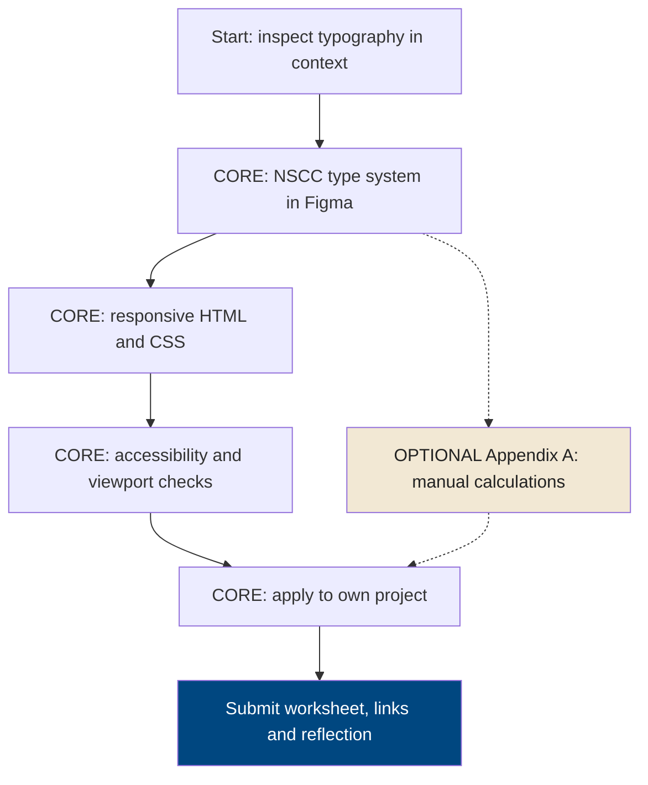
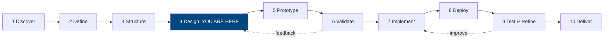
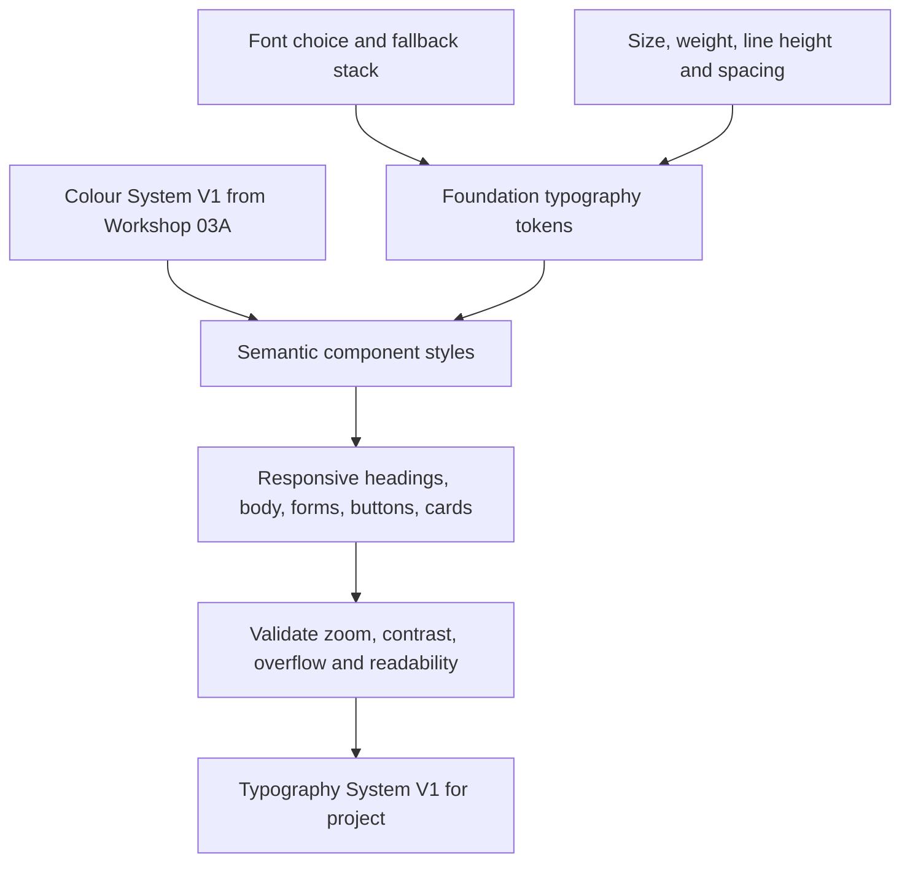
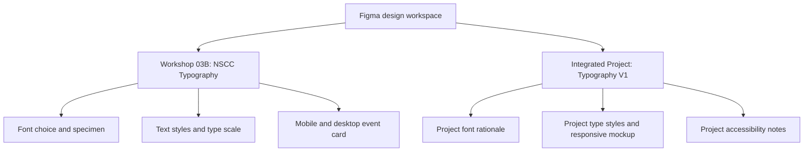
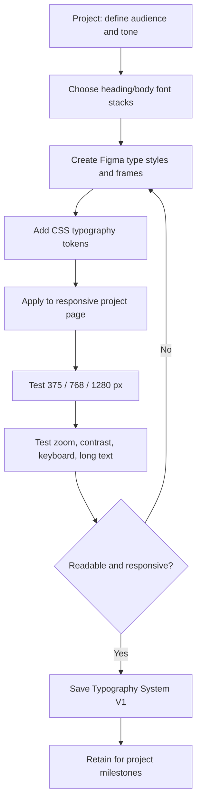
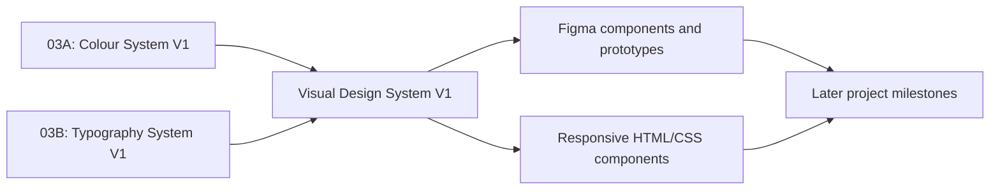

# WEBD 3100 — Workshop 03B
## Complete Typography Design — Type Systems, Responsive Scales & CSS Tokens

**Student Workshop Guide | Fall 2026**  
**Instructor:** Davis Boudreau  
**Assessment:** Workshop 03A + 03B = **one combined 4% evaluation**  
**Core track:** Approximately **3–4 hours**, including independent project application  
**Optional deep dive:** Appendix A, approximately 1–2 additional hours, **not graded**  
**Prerequisite:** Workshop 03A — Complete Colour Design  
**Tools:** Figma, VS Code, browser/DevTools, Live Server, GitHub, Brightspace; Google Fonts or available system fonts (optional)

> **Your goal:** Design, implement, and verify a complete **Typography System V1**. First reproduce the guided NSCC event-management case study; then apply the same skills to your own integrated semester project. Combine Typography System V1 with your existing **Colour System V1** to establish your project's evolving **Visual Design System V1**.

> **Brand note:** The NSCC case study uses *illustrative teaching choices*. The typefaces and examples in this guide are **not claims about official NSCC brand typography**. If a real client provides brand guidelines, follow those requirements.

## Choose your track

| Track | Required? | Activities | Assessment |
|---|---|---|---|
| **Core — practical design and implementation** | **Yes** | Use Figma and browser tools to select fonts, establish a type scale, create responsive tokens, build and test a responsive page, apply to your project | Assessed as part of combined Workshop 03 |
| **Appendix A — typography mathematics** | No | Calculate modular scales, `clamp()` interpolation, line-height ratios and conversion values manually | **Optional; not graded** |

**You must understand what the scale and responsive CSS do**, but you do not have to perform manual arithmetic to earn credit. The appendix is available for deeper study.



## 1. Where are you in the design process?



**Student journey:** Understand → Plan → **Design** → Build → Evaluate → Deliver. You will practise implementation to verify your design, but project milestones remain separate formal evaluations. Typography System V1 is an evolving project artifact, not an additional milestone.

## 2. Why typography is a system

Typography determines how quickly people scan a page, understand priorities, complete forms and use content at different screen widths. A professional typography system coordinates **font families, weights, sizes, line heights, letter spacing, measure, hierarchy, responsiveness and accessibility**. It should work with your Colour System V1, not replace it.

### A visual hierarchy example

<div style="max-width:780px;border:1px solid #cbd5e1;border-radius:14px;padding:clamp(16px,4vw,32px);background:#fff;color:#0f172a;font-family:system-ui,sans-serif;">
  <div style="font-size:12px;font-weight:700;letter-spacing:.1em;text-transform:uppercase;color:#004780;">NSCC EVENTS · TEACHING EXAMPLE</div>
  <div style="font-size:clamp(28px,5vw,44px);line-height:1.12;font-weight:750;margin:12px 0;">Learn, connect and explore</div>
  <div style="font-size:clamp(17px,2.5vw,20px);line-height:1.45;max-width:58ch;color:#334155;">Discover practical workshops and campus activities in a clear, responsive event experience.</div>
  <div style="font-size:14px;line-height:1.6;margin-top:14px;max-width:65ch;">The eyebrow, headline, lead and body have different jobs. Their sizes, spacing and weights work together to communicate meaning.</div>
  <div style="margin-top:18px;"><span style="display:inline-block;background:#004780;color:white;padding:11px 16px;border-radius:8px;font-size:16px;font-weight:650;">Explore events</span></div>
</div>

**Observe:** Which element do you read first? What creates the hierarchy? Which differences are useful on a narrow screen?

## 3. Learning objectives and outcomes

After the **required core track**, you should be able to:

1. Explain the difference between a typeface, font family, font weight, font size, line height, tracking and measure.
2. Choose and justify readable heading and body fonts, including fallbacks and licensing considerations.
3. Define a consistent typography hierarchy for headings, body text, navigation, labels, buttons and supporting text.
4. Create text styles and variables in Figma and map them to CSS tokens.
5. Build responsive, accessible typography using relative units and `clamp()` where appropriate.
6. Implement responsive page layout with **CSS Grid for two-dimensional sections/cards** and **Flexbox for one-dimensional navigation/actions**.
7. Check readability at mobile, tablet and desktop widths, plus 200% browser zoom and long-content conditions.
8. Integrate your typography tokens with Workshop 03A colour tokens and light/dark themes.
9. Produce **Typography System V1** for your own integrated project and explain your design decisions.

## 4. Prior knowledge and setup

You should already have your **Colour System V1** Figma page and CSS files (`tokens.css`, `base.css`, `components.css`) from Workshop 03A. If not, use the NSCC teaching palette as a temporary starting point. Do not abandon your own project colour system.

**Figma:** Open your existing design workspace. Create pages named **`Workshop 03B — NSCC Typography`** and **`Integrated Project — Typography V1`**. Ensure the file is shared with `davis.boudreau@nscc.ca` (**Can view** at minimum). Do not create a disconnected file unless directed.

**VS Code:** Work in a separate `workshop-03b-nscc` folder or branch so you can compare the NSCC case study with your own project. Open with Live Server. Keep all code committed and pushed to GitHub.

## 5. Concepts and theory — visual reference

### 5.1 Typeface, family and font

- **Typeface / family:** A coordinated design, such as `Inter`, `Georgia` or `Arial`.
- **Font / style:** A particular weight or style within a family, such as regular, semibold or italic.
- **Font stack:** A preferred font followed by fallbacks: `"Inter", system-ui, Arial, sans-serif`.
- **Weight:** CSS commonly uses `400` (regular), `600` (semibold) and `700` (bold). Only request weights the font actually supports.
- **Line height:** Vertical spacing between lines; `line-height: 1.5` scales with the font size.
- **Tracking / letter spacing:** Space between letters. Use sparingly; do not force tight tracking on body text.
- **Measure:** Line length; `max-width: 65ch` is a useful starting point for readable body text, not a universal rule.

### 5.2 Common type roles

| Role | Job | Suggested starting treatment (not a requirement) |
|---|---|---|
| Display / hero | Establish the main message | Large, bold, tight-but-readable line height |
| H1 | Page heading | One clear primary heading per page context |
| H2 / H3 | Section structure | Consistent descending hierarchy |
| Lead | Introduce a section | Slightly larger than body |
| Body | Main reading content | Readable size, line height ~1.5–1.7 |
| Small / meta | Dates, captions, supporting details | Avoid unreadably small text |
| UI label | Forms and controls | Clear, legible, consistent |
| Button / navigation | Actions and wayfinding | Adequate size, contrast and tap area |

### 5.3 Font selection: choose for the job

| Design consideration | Ask yourself |
|---|---|
| Readability | Are letterforms distinct at body size? |
| Tone | Does the font match the project's audience and purpose? |
| Pairing | Can one versatile family handle both headings and body? If using two, do they work together? |
| Performance | Can a system font work? If using web fonts, are weights and downloads limited? |
| Language | Does the font support the characters your content needs? |
| Accessibility | Does text remain clear at zoom and on mobile? |
| Licensing | Are you permitted to embed or redistribute this font? |

**Pragmatic rule:** Begin with one good family and a small set of weights. Add a second family only when it solves a real design problem. Avoid more than two font families for this exercise.

### 5.4 Relative units and responsive typography

| CSS unit | Best use | Note |
|---|---|---|
| `rem` | Font sizes and spacing | Relative to root font size; respects user settings |
| `em` | Component-relative relationships | Relative to element or parent depending on property |
| `ch` | Readable line length | Approximate width of the `0` glyph |
| `%` | Flexible widths | Avoid fixed page widths |
| `clamp(min, preferred, max)` | Fluid type/spacing | Set sensible lower and upper bounds |
| `vw` | Fluid portion inside `clamp()` | Do not use `vw` alone for essential text |

**Accessibility note:** A viewport-based fluid font expression must still allow meaningful text resizing. Test browser zoom and text-only resizing; avoid implementations that effectively prevent users from enlarging text. Body text can remain `1rem` while display headings use carefully tested fluid sizing.

## 6. Typography design-system architecture



**Foundation tokens** describe values (`--font-sans`, `--text-lg`, `--leading-body`). **Semantic/component tokens** describe their use (`--font-heading`, `--text-card-title`, `--text-body`). This keeps typography consistent even when you refine the design later.

---
# PART A — REQUIRED CORE TRACK: GUIDED NSCC CASE STUDY

## 7. Task A1 — Typography critique (10–15 minutes)

**What:** Examine the sample hierarchy above and one real website. **Why:** Typography is a design decision, not just CSS syntax.

1. Open a website you use regularly. Find a page with a headline, navigation, body text and buttons.
2. Identify its probable heading/body families, approximate sizes, weights and line heights (browser DevTools → Inspect → Computed can help).
3. Observe one effective choice and one possible improvement.
4. Record the URL and observations in **Student Submission Template — A1**.

**Checkpoint:** You can name at least four typography roles and explain how they differ.

## 8. Task A2 — Choose the NSCC teaching typography (15–20 minutes)

Use the following **illustrative teaching choice** for a reproducible case study:

| Token | Case-study value | Why |
|---|---|---|
| Heading family | `system-ui, -apple-system, "Segoe UI", Arial, sans-serif` | Fast, reliable, readable |
| Body family | Same system stack | Simple and consistent |
| Regular | `400` | Body copy |
| Medium | `500` | Labels and navigation |
| Semibold | `600` | Buttons and card titles |
| Bold | `700` | Page and section headings |

**Try a second option in Figma:** Compare this system stack with one suitable freely licensed web font, if available. You do not have to install a font or depend on a network connection to complete the case study. Record which you choose and why.

### Visual weight comparison

<div style="display:grid;grid-template-columns:repeat(auto-fit,minmax(min(100%,220px),1fr));gap:12px;max-width:850px;">
  <div style="background:#f8fafc;color:#0f172a;padding:16px;border:1px solid #cbd5e1;border-radius:10px;font-family:system-ui,sans-serif;"><div style="font-size:13px;">Regular 400</div><div style="font-size:22px;font-weight:400;">Discover events</div></div>
  <div style="background:#f8fafc;color:#0f172a;padding:16px;border:1px solid #cbd5e1;border-radius:10px;font-family:system-ui,sans-serif;"><div style="font-size:13px;">Semibold 600</div><div style="font-size:22px;font-weight:600;">Discover events</div></div>
  <div style="background:#f8fafc;color:#0f172a;padding:16px;border:1px solid #cbd5e1;border-radius:10px;font-family:system-ui,sans-serif;"><div style="font-size:13px;">Bold 700</div><div style="font-size:22px;font-weight:700;">Discover events</div></div>
</div>

## 9. Task A3 — Build the Figma typography specimen (25–30 minutes)

1. Open **`Workshop 03B — NSCC Typography`**.
2. Add two frames: **Mobile 375 px** and **Desktop 1280 px**. Use Auto Layout so content reflows when a frame changes width.
3. Create text samples for **Display, H1, H2, H3, Lead, Body, Small, Button, Form Label**.
4. Use the suggested scale below as a starting point. You may adjust sizes when the design benefits; document changes.
5. Create named Figma text styles (or equivalent typography styles) such as `Type/Display`, `Type/H1`, `Type/Body`, `Type/Small` and `Type/Button`. Where available, use variables for numeric size/spacing values; text styles remain the primary tool for font properties.
6. Apply **Colour System V1** tokens for text and backgrounds. Verify legibility in light and dark examples.
7. Build a small responsive event card with heading, date, description and action.
8. Share or confirm your Figma file is viewable by the instructor. Record the link.

### Starting typography scale

| Role | Mobile | Desktop | Line height | Weight |
|---|---:|---:|---:|---:|
| Display | 2rem | 3rem | 1.1–1.2 | 700 |
| H1 | 1.75rem | 2.5rem | 1.15–1.25 | 700 |
| H2 | 1.5rem | 2rem | 1.2–1.3 | 700 |
| H3 | 1.25rem | 1.5rem | 1.25–1.35 | 600 |
| Lead | 1.125rem | 1.25rem | 1.4–1.5 | 400 |
| Body | 1rem | 1rem | 1.6 | 400 |
| Small | 0.875rem | 0.875rem | 1.5 | 400 |
| Button | 1rem | 1rem | 1.25 | 600 |

**The table is a starting system, not an automatic WCAG certification.** Maintain sufficient contrast, clear hierarchy, readable line length and comfortable spacing.

### Figma frame organization



**Checkpoint:** Your Figma typography hierarchy is visible at both frame sizes; text does not overflow its frame.

## 10. Task A4 — Create a responsive VS Code project (40–50 minutes)

**What:** Translate Figma choices into semantic HTML and reusable CSS. **Why:** Design tokens prevent one-off font sizes from spreading across pages.

### Step 1 — Create the files

```text
workshop-03b-nscc/
├── index.html
├── css/
│   ├── tokens.css
│   ├── base.css
│   └── components.css
└── README.md
```

### Step 2 — Add `index.html`

```html
<!doctype html>
<html lang="en" data-theme="light">
<head>
  <meta charset="utf-8">
  <meta name="viewport" content="width=device-width, initial-scale=1">
  <title>NSCC Events — Typography Case Study</title>
  <link rel="stylesheet" href="css/tokens.css">
  <link rel="stylesheet" href="css/base.css">
  <link rel="stylesheet" href="css/components.css">
</head>
<body>
  <a class="skip-link" href="#main">Skip to main content</a>
  <header class="site-header">
    <div class="container header-layout">
      <a class="site-brand" href="index.html">NSCC Events</a>
      <nav aria-label="Main navigation">
        <ul class="nav-list">
          <li><a href="#events">Events</a></li>
          <li><a href="#about">About</a></li>
        </ul>
      </nav>
    </div>
  </header>
  <main id="main">
    <section class="hero container" aria-labelledby="page-title">
      <p class="eyebrow">Community learning</p>
      <h1 id="page-title">Learn, connect and explore</h1>
      <p class="lead">Discover hands-on workshops and campus activities.
        Explore opportunities that fit your interests.</p>
      <a class="button" href="#events">Browse events</a>
    </section>
    <section class="container section" id="events" aria-labelledby="events-title">
      <h2 id="events-title">Upcoming events</h2>
      <div class="event-grid">
        <article class="event-card">
          <p class="eyebrow">October · Workshop</p>
          <h3>Build your first website</h3>
          <p>Explore layout, content and accessible web design.</p>
          <a href="#about">Event details</a>
        </article>
        <article class="event-card">
          <p class="eyebrow">November · Open house</p>
          <h3>Explore technology programs</h3>
          <p>Meet people, ask questions and discover possibilities.</p>
          <a href="#about">Event details</a>
        </article>
      </div>
    </section>
    <section class="container section" id="about" aria-labelledby="about-title">
      <h2 id="about-title">About these events</h2>
      <p class="body-copy">This is a fictional teaching page. Its content is designed
        to demonstrate typography, readable line length and responsive layout.</p>
    </section>
  </main>
  <footer class="site-footer"><div class="container">WEBD 3100 teaching example</div></footer>
</body>
</html>
```

### Step 3 — Add `css/tokens.css`

**Important:** Keep the **same colour values you developed in Workshop 03A** when you apply this to your own project. These case-study values are temporary illustrative tokens.

```css
:root {
  /* Workshop 03A — colour system (teaching values) */
  --color-background: #ffffff;
  --color-surface: #f8fafc;
  --color-text: #0f172a;
  --color-muted: #334155;
  --color-border: #cbd5e1;
  --color-primary: #004780;
  --color-on-primary: #ffffff;

  /* Workshop 03B — typography foundations */
  --font-sans: system-ui, -apple-system, "Segoe UI", Arial, sans-serif;
  --font-heading: var(--font-sans);
  --font-body: var(--font-sans);
  --weight-regular: 400;
  --weight-medium: 500;
  --weight-semibold: 600;
  --weight-bold: 700;

  --text-small: 0.875rem;
  --text-body: 1rem;
  --text-lead: clamp(1.125rem, 1.05rem + 0.3vw, 1.25rem);
  --text-h3: clamp(1.25rem, 1.1rem + 0.6vw, 1.5rem);
  --text-h2: clamp(1.5rem, 1.2rem + 1.2vw, 2rem);
  --text-h1: clamp(1.75rem, 1.3rem + 1.8vw, 2.5rem);
  --text-display: clamp(2rem, 1.4rem + 2.4vw, 3rem);
  --leading-tight: 1.15;
  --leading-heading: 1.25;
  --leading-body: 1.6;
  --measure: 65ch;
  --space-section: clamp(2rem, 1rem + 4vw, 4rem);
}
[data-theme="dark"] {
  --color-background: #0b1220;
  --color-surface: #162235;
  --color-text: #f1f5f9;
  --color-muted: #cbd5e1;
  --color-border: #52627a;
  --color-primary: #99c7eb;
  --color-on-primary: #0b1220;
}
```

### Step 4 — Add `css/base.css`

```css
*, *::before, *::after { box-sizing: border-box; }
html { scroll-behavior: smooth; }
body {
  margin: 0;
  background: var(--color-background);
  color: var(--color-text);
  font: var(--weight-regular) var(--text-body)/var(--leading-body) var(--font-body);
}
.container { width: min(100% - 2rem, 72rem); margin-inline: auto; }
h1, h2, h3 { font-family: var(--font-heading); line-height: var(--leading-heading); }
h1 { font-size: var(--text-display); line-height: var(--leading-tight); }
h2 { font-size: var(--text-h2); }
h3 { font-size: var(--text-h3); }
p { margin-block: 0 1rem; }
a { color: inherit; text-underline-offset: 0.2em; }
a:focus-visible { outline: 3px solid currentColor; outline-offset: 3px; }
.body-copy { max-width: var(--measure); }
.lead { font-size: var(--text-lead); line-height: 1.5; max-width: 58ch; }
.eyebrow {
  font-size: var(--text-small); font-weight: var(--weight-bold);
  letter-spacing: 0.06em; text-transform: uppercase;
  color: var(--color-muted);
}
.skip-link { position: absolute; left: 1rem; top: -5rem; background: var(--color-surface); padding: .75rem; }
.skip-link:focus { top: .5rem; z-index: 10; }
```

### Step 5 — Add `css/components.css`

```css
.site-header { border-bottom: 1px solid var(--color-border); }
.header-layout {
  display: flex; flex-wrap: wrap; align-items: center;
  justify-content: space-between; gap: 0.75rem 1.5rem; padding-block: 1rem;
}
.site-brand { font-size: 1.125rem; font-weight: var(--weight-bold); text-decoration: none; }
.nav-list { display: flex; flex-wrap: wrap; gap: .5rem 1.25rem; margin: 0; padding: 0; list-style: none; }
.nav-list a { font-weight: var(--weight-medium); }
.hero { padding-block: var(--space-section); }
.hero h1 { max-width: 16ch; margin: 0 0 1rem; overflow-wrap: break-word; }
.button {
  display: inline-flex; align-items: center; justify-content: center;
  min-height: 44px; padding: .75rem 1.25rem; border-radius: .5rem;
  background: var(--color-primary); color: var(--color-on-primary);
  font-size: var(--text-body); font-weight: var(--weight-semibold);
  line-height: 1.25; text-decoration: none;
}
.section { padding-block: 0 var(--space-section); }
.event-grid {
  display: grid; grid-template-columns: repeat(auto-fit, minmax(min(100%, 17rem), 1fr));
  gap: 1rem;
}
.event-card { min-width: 0; padding: 1.5rem; background: var(--color-surface); border: 1px solid var(--color-border); border-radius: .75rem; }
.event-card h3 { margin-block: .4rem .8rem; overflow-wrap: anywhere; }
.event-card a { font-weight: var(--weight-semibold); }
.site-footer { border-top: 1px solid var(--color-border); padding-block: 1.5rem; font-size: var(--text-small); }
@media (max-width: 35rem) {
  .header-layout { align-items: flex-start; }
  .nav-list { gap: .5rem 1rem; }
}
@media (prefers-reduced-motion: reduce) { html { scroll-behavior: auto; } }
```

**Why these layout systems?** `display: grid` is used for the two-dimensional event-card layout. `display: flex` is used for one-dimensional navigation and button alignment. The page uses fluid containers, flexible wrapping and relative text sizes. No fixed-width page is required.

### Step 6 — Run, inspect and experiment

1. Save all files. Right-click `index.html` → **Open with Live Server**.
2. Confirm the page loads with its navigation, hero, cards and footer.
3. Open browser DevTools (F12), select responsive device mode, and inspect **375 px**, **768 px**, and **1280 px**.
4. Check that navigation wraps, cards reflow, headings remain legible, and there is **no page-level horizontal scrolling**.
5. Set browser zoom to **200%**. Check that content remains available and does not overlap or clip. Test keyboard Tab navigation.
6. Change the root HTML attribute to `data-theme="dark"` and refresh. Compare text contrast and hierarchy; then test `light` again.
7. Change `--text-h2` or `--leading-body` in `tokens.css`, refresh and observe every component that uses that token. Restore your chosen value.
8. Replace a short card title with a long title to check wrapping and overflow.
9. Record one improvement in the worksheet and take screenshots.

**Checkpoint:** A single token change updates multiple components, and both themes work across all three viewports.

## 11. Task A5 — Typography accessibility audit (15–20 minutes)

Use this checklist to evaluate **actual rendered content**, not only design mockups:

| Test | What to inspect | Pass evidence |
|---|---|---|
| Contrast | Normal text/background in light and dark themes | WCAG AA **4.5:1** for normal text; **3:1** for large text |
| Zoom | Browser zoom at 200% | Text remains readable; no lost content or controls |
| Reflow | Narrow viewport around 320–375 px | No unnecessary two-dimensional scrolling for ordinary page content |
| Line length | Paragraphs on desktop | Comfortable measure, e.g. around 60–70 characters |
| Line height | Multi-line body text | Comfortable reading; no collisions |
| Hierarchy | H1/H2/H3 and labels | Visual hierarchy matches semantic HTML |
| Links | Underlines/focus indication | Links distinguishable and keyboard focus visible |
| Theme | Light and dark | Text, links and buttons retain sufficient contrast |
| Long text | Long title or translated copy | No clipping or broken layout |

**WCAG references:** [Understanding Contrast (Minimum)](https://www.w3.org/WAI/WCAG22/Understanding/contrast-minimum.html), [Resize Text](https://www.w3.org/WAI/WCAG22/Understanding/resize-text.html), [Reflow](https://www.w3.org/WAI/WCAG22/Understanding/reflow.html). Avoid treating any single font-size table as proof of accessibility.

Record **at least four** results in the student worksheet: light body contrast, dark body contrast, mobile/reflow, and zoom. Record one correction if needed; if everything passes, document a deliberate improvement or a stress-test finding.

---
# PART B — REQUIRED CORE TRACK: YOUR INTEGRATED PROJECT

## 12. Task B1 — Write a brief typography strategy (10–15 minutes)

Return to your own semester project and existing **Colour System V1**. Write down:

- The project's purpose, audience and content needs.
- The tone you want typography to communicate (e.g. calm, technical, welcoming, editorial).
- Your chosen heading and body font stacks and why they fit.
- The weights you will actually use (aim for 2–3 initially).
- Whether you will use a system stack or licensed web fonts; note performance and fallback implications.

**Checkpoint:** You can justify your type choices without saying only that they “look good.”

## 13. Task B2 — Create your project's Figma Typography System V1 (20–25 minutes)

1. Open `Integrated Project — Typography V1` in your existing shared Figma workspace.
2. Create a labelled **type specimen** with your selected fonts, weights and use cases.
3. Define text styles for Display/H1/H2/H3/Lead/Body/Small/Button/Label as relevant to your project.
4. Create **375 px and 1280 px** frames with Auto Layout and representative *project content* (not the NSCC text).
5. Apply your project colour tokens to demonstrate the typography in **light and dark** themes.
6. Record font sources, fallback stack and any licensing notes.
7. Compare your two frame sizes. Refine any wrapping, spacing or hierarchy problems.

### Visual comparison: scale and measure

<div style="display:grid;grid-template-columns:repeat(auto-fit,minmax(min(100%,250px),1fr));gap:12px;max-width:900px;">
  <div style="border:1px solid #cbd5e1;border-radius:12px;padding:16px;background:#fff;color:#0f172a;font-family:system-ui,sans-serif;"><div style="font-size:12px;font-weight:700;color:#004780;">GOOD READING MEASURE</div><div style="font-size:22px;line-height:1.2;font-weight:700;margin:10px 0;">Readable event details</div><div style="font-size:16px;line-height:1.6;max-width:33ch;">A comfortable line length and generous line height help readers scan and understand the content.</div></div>
  <div style="border:1px solid #cbd5e1;border-radius:12px;padding:16px;background:#fff;color:#0f172a;font-family:system-ui,sans-serif;"><div style="font-size:12px;font-weight:700;color:#004780;">REVIEW THIS EXAMPLE</div><div style="font-size:22px;line-height:1;font-weight:700;margin:10px 0;">Crowded event details</div><div style="font-size:13px;line-height:1.05;">Small text with tight line spacing makes a dense paragraph harder to read, even when the words are correct.</div></div>
</div>

**Checkpoint:** Your Figma type styles have names and roles, and your sample interface remains readable in both frames.

## 14. Task B3 — Implement your project's typography tokens (20–30 minutes)

1. Open your **existing project repository**, not the NSCC case-study repository.
2. Keep your `tokens.css` colour tokens from Workshop 03A. **Add typography foundations and semantic roles** to the same design-system architecture.
3. Adapt the NSCC sample tokens; do not blindly copy its brand or font choices.
4. Apply your type styles to at least **one meaningful project page** containing a header/navigation, hero or page heading, body content, and one card/form or call-to-action.
5. Use semantic HTML (`h1`, `h2`, `p`, `label`, `button`/`a` as appropriate).
6. Use CSS Grid and Flexbox according to the layout's needs. Keep mobile-first reflow and fluid sizing.
7. Test light/dark colour combinations inherited from Workshop 03A.

**Example semantic mapping:**

```css
:root {
  --font-heading: var(--font-sans);
  --font-body: var(--font-sans);
  --text-page-title: var(--text-display);
  --text-section-title: var(--text-h2);
  --text-card-title: var(--text-h3);
  --text-paragraph: var(--text-body);
}
.page-title { font: var(--weight-bold) var(--text-page-title)/1.15 var(--font-heading); }
.card-title { font: var(--weight-semibold) var(--text-card-title)/1.25 var(--font-heading); }
.card-copy { font: var(--weight-regular) var(--text-paragraph)/var(--leading-body) var(--font-body); max-width: var(--measure); }
```

**Note:** CSS custom properties are inherited. Defining semantic typography roles makes it easier to update the visual system without changing every component selector.

## 15. Task B4 — Validate and document your project (15–20 minutes)

- Inspect the project at **375 px, 768 px and 1280 px**, plus **200% zoom**.
- Test long headings, paragraph wrapping, navigation wrapping, and keyboard focus.
- Check normal text contrast in both themes against your actual project background colours.
- Record at least **one issue and your response**, or one stress test and a justified refinement.
- Save mobile and desktop screenshots; link to the Figma page and GitHub repository/commit.
- Name the result **`Typography System V1`**. Keep it available for future formal **project milestone evaluations**.



## 16. Bridge to the complete Visual Design System

**Workshop 03A + Workshop 03B** create a shared foundation:



Your colour tokens control **what colours mean**; your typography tokens control **how content is presented and prioritized**. Later workshops will refine structure, prototypes, accessibility and implementation. **Project milestone assessments are separate formal evaluations**; the workshop itself is practice and evidence gathering.

## 17. Checkpoints and verification

| Checkpoint | NSCC case study | Own project |
|---|---|---|
| Font selection and rationale | System font stack tested | Justified family/fallbacks |
| Hierarchy | Display through button/label | Project-specific hierarchy |
| Figma | Named text styles and two frames | Typography V1 page and two frames |
| CSS | Typography tokens + responsive page | Tokens integrated with 03A colours |
| Responsive | 375 / 768 / 1280 px | 375 / 768 / 1280 px |
| Accessibility | Both themes, 200% zoom, long text | Both themes, 200% zoom, long text |
| Evidence | Screenshots, repo, Figma link | Screenshots, repo, Figma link |

## 18. Reflection — complete individually

Answer these in the **Student Submission Template** and submit your required reflection through Brightspace as directed:

1. How does typography establish hierarchy without relying only on colour?
2. Why did you select your project's heading and body fonts? What are their fallback fonts?
3. What is the difference between `rem`, `ch` and `clamp()` in your design?
4. Which responsive or accessibility test caused you to change your typography system?
5. How do Typography System V1 and Colour System V1 work together?
6. What will you refine before the next formal project milestone?

## 19. Submission guidelines

**Required:** Complete the student submission template (Parts A–C), provide NSCC and project Figma evidence, provide GitHub technical evidence, include screenshots or links demonstrating responsive typography and theme tests, and submit your individual reflection to Brightspace.

**Standard student deliverables workflow:** **Complete Workshop → Complete Worksheet → Complete Reflection → Commit/Push Technical Evidence → Submit Worksheet to Brightspace**.

**Evaluation criteria:** A — Attendance; P — Participation; T — Task Progress; F — Focus & Professional Conduct; R — Reflection/Exit Evidence. Workshop 03A and 03B share a **single 4% assessment**; no new evaluation or milestone is created.

### Completion checklist

- [ ] NSCC typography critique and font choice completed.
- [ ] NSCC Figma text styles and mobile/desktop examples created.
- [ ] NSCC responsive HTML/CSS page works in both themes.
- [ ] NSCC viewport, zoom and contrast checks documented.
- [ ] Project typography strategy and font rationale written.
- [ ] Project Typography System V1 Figma page created.
- [ ] Project typography tokens integrated with Colour System V1.
- [ ] Project responsive implementation tested and documented.
- [ ] Figma shared with instructor; GitHub commit pushed.
- [ ] Student worksheet and required reflection submitted to Brightspace.
- [ ] Optional Appendix A **not required and not graded**.

---
# APPENDIX A — OPTIONAL DEEP DIVE (NOT GRADED)

**Skip this appendix without penalty.** These exercises are for students who want to understand the numerical foundations of type scales and fluid typography. **Do not submit manual calculations for marks.**

## A1. Modular type scale

A modular scale multiplies a starting size by a ratio:

\[
  s_n = s_0 \times r^n
\]

Example: start with `16px`, ratio `1.25`:

| Step | Calculation | Approximate size |
|---|---|---:|
| 0 | `16 × 1.25⁰` | 16px |
| 1 | `16 × 1.25¹` | 20px |
| 2 | `16 × 1.25²` | 25px |
| 3 | `16 × 1.25³` | 31.25px |
| 4 | `16 × 1.25⁴` | 39.06px |

A modular scale is a **starting point**, not a requirement to use every size. A real UI needs practical roles and visual judgment.

**Optional worksheet:** Choose a base size and ratio. Calculate four steps and decide which, if any, suit body, H3, H2 and H1.

| Step | Base × ratio^step | Result | Potential role |
|---|---|---|---|
| 0 | | | |
| 1 | | | |
| 2 | | | |
| 3 | | | |

## A2. `rem` conversion

With a `16px` root size, `24px ÷ 16px = 1.5rem`. **Do not force a fixed 16px root size** just to make calculations easy; users may choose a different default font size.

| Desired approximate size | Divide by 16 | rem |
|---|---|---|
| 16px | 16 / 16 | 1rem |
| 20px | 20 / 16 | 1.25rem |
| 24px | 24 / 16 | 1.5rem |
| 32px | 32 / 16 | 2rem |

## A3. How `clamp()` works

`clamp(minimum, preferred, maximum)` selects the preferred value when it falls between the limits; otherwise it uses the nearest limit.

```css
--text-h1: clamp(1.75rem, 1.3rem + 1.8vw, 2.5rem);
```

At a **375px viewport**, `1.8vw ≈ 6.75px ≈ 0.422rem` (assuming a 16px root), so preferred is approximately `1.722rem`; the minimum of `1.75rem` wins. At **1280px**, `1.8vw ≈ 23.04px ≈ 1.44rem`, so preferred is `2.74rem`; the maximum of `2.5rem` wins.

**Optional worksheet:** Explain which value wins at widths 375, 768 and 1280 px. Repeat after changing the minimum or maximum. Check your predictions in browser DevTools.

## A4. Line height as a ratio

If body text is `16px` and unitless `line-height: 1.6`, the nominal line box is `16 × 1.6 = 25.6px`. This is not the same as a guaranteed measured gap between visible glyphs; fonts have their own metrics.

**Optional experiment:** Compare line heights 1.2, 1.5 and 1.7 on a multi-line paragraph at 375px and 1280px. Record what changes.

## A5. Advanced exploration

- Compare variable fonts with static weights and observe any file-size/performance differences.
- Test a font with numerals, punctuation, accented characters and long words.
- Compare a two-family pairing with a one-family system. Which is clearer and more consistent?
- Investigate whether your fluid headings still resize effectively under browser zoom and text-only zoom.

**Appendix A is optional and not graded.**

---
**End of Workshop 03B — Complete Typography Design.**
