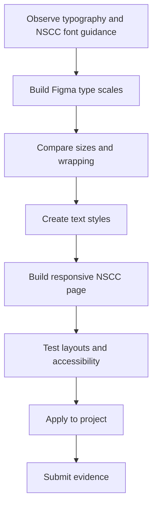
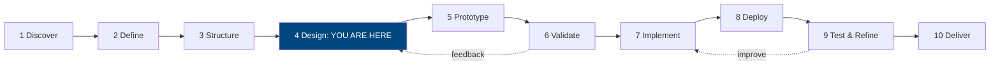
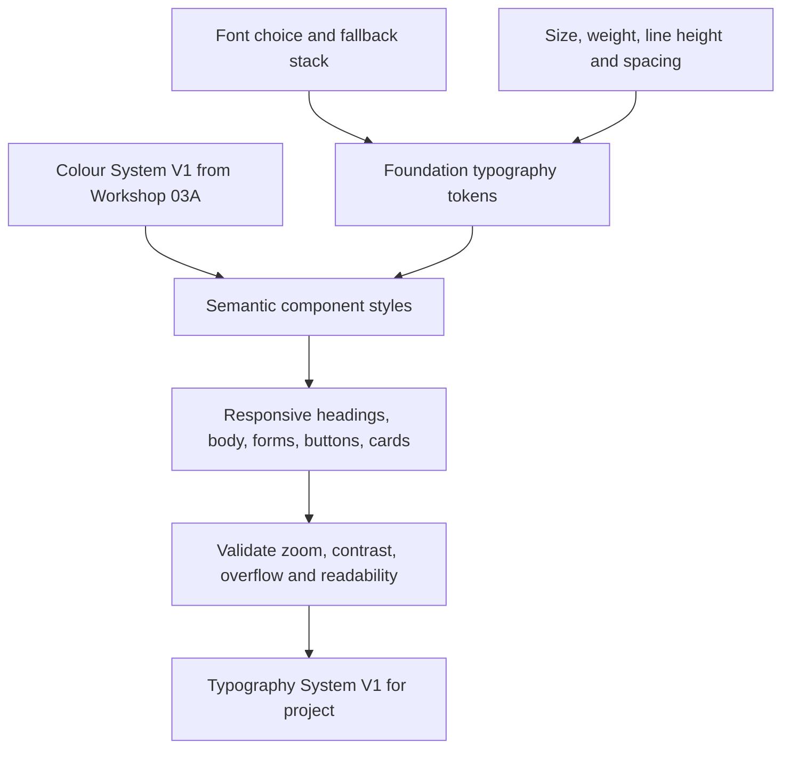
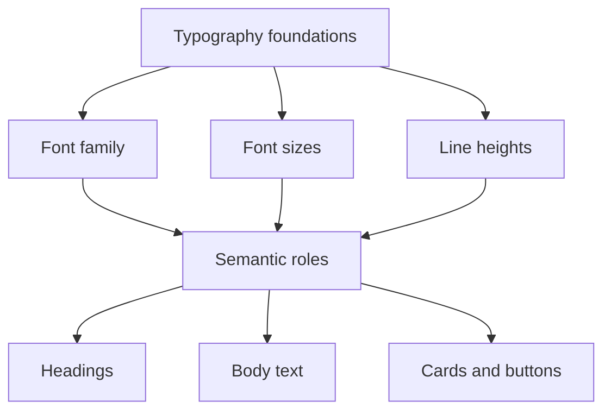
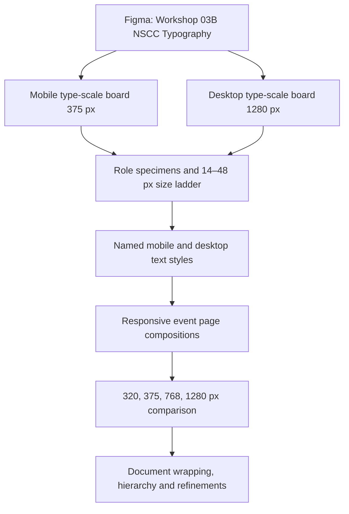
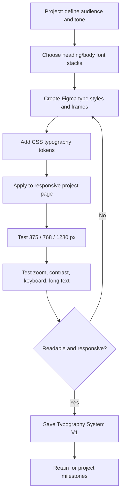
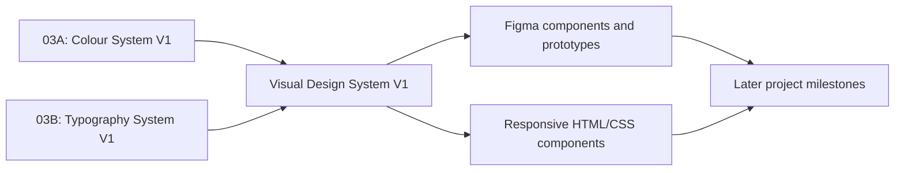

# WEBD 3100 — Workshop 03B
## Complete Typography Design — Type Systems, Responsive Scales & CSS Tokens

**Student Workshop Guide | Fall 2026**  
**Instructor:** Davis Boudreau  
**Assessment:** Workshop 03A + 03B = **one combined 4% evaluation**  
**Student time:** Approximately **3–4 hours**, including the guided NSCC case study and project application  
**Prerequisite:** Workshop 03A — Complete Colour Design  
**Tools:** Figma, VS Code, browser/DevTools, Live Server, GitHub, Brightspace; Arial is the accessible NSCC case-study fallback

> **Your goal:** Design, implement, and verify a complete **Typography System V1**. First reproduce the guided NSCC event-management case study; then apply the same skills to your own integrated semester project. Combine Typography System V1 with your existing **Colour System V1** to establish your project's evolving **Visual Design System V1**.

> **NSCC typography and licensing:** NSCC uses **Greycliff** (a licensed typeface) and **Arial** as an alternative. **Use Arial for the student NSCC case study** unless NSCC has explicitly supplied an authorized Greycliff installation and permitted its educational use. Do not download, redistribute, bundle, or embed licensed font files without permission. The scale values in this guide are instructional examples, not official NSCC type specifications.

## One guided learning pathway

This is **one required, practical workshop**. You will **compare typography sizes in Figma at real mobile and desktop frame widths**, then implement the same typography in responsive HTML/CSS. No separate optional track or manual mathematics worksheet is required. You should understand the purpose of a type scale, relative sizing and fluid CSS, but the focus is on **seeing, choosing, testing and documenting** a usable design system.



**Completion goal:** A documented **Typography System V1** with comparable mobile/desktop type scales, usable Figma text styles, and working responsive CSS for both the NSCC example and your own project.

## 1. Where are you in the design process?



**Student journey:** Understand → Plan → **Design** → Build → Evaluate → Deliver. You will practise implementation to verify your design, but project milestones remain separate formal evaluations. Typography System V1 is an evolving project artifact, not an additional milestone.

## 2. Why typography is a system

Typography determines how quickly people scan a page, understand priorities, complete forms and use content at different screen widths. A professional typography system coordinates **font families, weights, sizes, line heights, letter spacing, measure, hierarchy, responsiveness and accessibility**. It should work with your Colour System V1, not replace it.

### A visual hierarchy example

<div style="max-width:780px;border:1px solid #cbd5e1;border-radius:14px;padding:clamp(16px,4vw,32px);background:#fff;color:#0f172a;font-family:Arial,Helvetica,sans-serif;">
  <div style="font-size:12px;font-weight:700;letter-spacing:.1em;text-transform:uppercase;color:#004780;">NSCC EVENTS · TEACHING EXAMPLE</div>
  <div style="font-size:clamp(28px,5vw,44px);line-height:1.12;font-weight:750;margin:12px 0;">Learn, connect and explore</div>
  <div style="font-size:clamp(17px,2.5vw,20px);line-height:1.45;max-width:58ch;color:#334155;">Discover practical workshops and campus activities in a clear, responsive event experience.</div>
  <div style="font-size:14px;line-height:1.6;margin-top:14px;max-width:65ch;">The eyebrow, headline, lead and body have different jobs. Their sizes, spacing and weights work together to communicate meaning.</div>
  <div style="margin-top:18px;"><span style="display:inline-block;background:#004780;color:white;padding:11px 16px;border-radius:8px;font-size:16px;font-weight:650;">Explore events</span></div>
</div>

**Observe:** Which element do you read first? What creates the hierarchy? Which differences are useful on a narrow screen?

## 3. Learning objectives and outcomes

After this **single-track workshop**, you should be able to:

1. Explain the difference between a typeface, font family, font weight, font size, line height, tracking and measure.
2. Choose and justify readable heading and body fonts, including fallbacks and licensing considerations.
3. Define a consistent typography hierarchy for headings, body text, navigation, labels, buttons and supporting text.
4. Create text styles and variables in Figma and map them to CSS tokens.
5. Build responsive, accessible typography using relative units and `clamp()` where appropriate.
6. Implement responsive page layout with **CSS Grid for two-dimensional sections/cards** and **Flexbox for one-dimensional navigation/actions**.
7. Check readability at mobile, tablet and desktop widths, plus 200% browser zoom and long-content conditions.
8. Integrate your typography tokens with Workshop 03A colour tokens and light/dark themes.
9. Produce **Typography System V1** for your own integrated project and explain your design decisions.

## 4. Prior knowledge and setup

You should already have your **Colour System V1** Figma page and CSS files (`tokens.css`, `base.css`, `components.css`) from Workshop 03A. If not, use the NSCC teaching palette as a temporary starting point. Do not abandon your own project colour system.

**Figma:** Open your existing design workspace. Create pages named **`Workshop 03B — NSCC Typography`** and **`Integrated Project — Typography V1`**. Ensure the file is shared with `davis.boudreau@nscc.ca` (**Can view** at minimum). Do not create a disconnected file unless directed.

**VS Code:** Work in a separate `workshop-03b-nscc` folder or branch so you can compare the NSCC case study with your own project. Open with Live Server. Keep all code committed and pushed to GitHub.

## 5. Concepts and theory — visual reference

### 5.1 Typeface, family and font

- **Typeface / family:** A coordinated design, such as `Inter`, `Georgia` or `Arial`.
- **Font / style:** A particular weight or style within a family, such as regular, semibold or italic.
- **Font stack:** A preferred font followed by fallbacks: `"Inter", system-ui, Arial, sans-serif`.
- **Weight:** CSS commonly uses `400` (regular), `600` (semibold) and `700` (bold). Only request weights the font actually supports.
- **Line height:** Vertical spacing between lines; `line-height: 1.5` scales with the font size.
- **Tracking / letter spacing:** Space between letters. Use sparingly; do not force tight tracking on body text.
- **Measure:** Line length; `max-width: 65ch` is a useful starting point for readable body text, not a universal rule.

### 5.2 Common type roles

| Role | Job | Suggested starting treatment (not a requirement) |
|---|---|---|
| Display / hero | Establish the main message | Large, bold, tight-but-readable line height |
| H1 | Page heading | One clear primary heading per page context |
| H2 / H3 | Section structure | Consistent descending hierarchy |
| Lead | Introduce a section | Slightly larger than body |
| Body | Main reading content | Readable size, line height ~1.5–1.7 |
| Small / meta | Dates, captions, supporting details | Avoid unreadably small text |
| UI label | Forms and controls | Clear, legible, consistent |
| Button / navigation | Actions and wayfinding | Adequate size, contrast and tap area |

### 5.3 Font selection: choose for the job

| Design consideration | Ask yourself |
|---|---|
| Readability | Are letterforms distinct at body size? |
| Tone | Does the font match the project's audience and purpose? |
| Pairing | Can one versatile family handle both headings and body? If using two, do they work together? |
| Performance | Can a system font work? If using web fonts, are weights and downloads limited? |
| Language | Does the font support the characters your content needs? |
| Accessibility | Does text remain clear at zoom and on mobile? |
| Licensing | Are you permitted to embed or redistribute this font? |

**Pragmatic rule:** Begin with one good family and a small set of weights. Add a second family only when it solves a real design problem. Avoid more than two font families for this exercise.

### 5.4 Serif versus sans-serif — understand the difference

A **serif** typeface has small finishing strokes at the ends of many letters. A **sans-serif** typeface does not (the French word *sans* means *without*). Neither category is automatically more accessible: font quality, size, spacing, contrast and reading context matter more than a blanket rule.

<div style="display:grid;grid-template-columns:repeat(auto-fit,minmax(min(100%,260px),1fr));gap:14px;max-width:920px;">
  <div style="padding:20px;background:#f8fafc;color:#172033;border:1px solid #cbd5e1;border-radius:12px;min-width:0;"><div style="font:700 12px Arial,sans-serif;letter-spacing:.08em;color:#004780;">SERIF · GEORGIA</div><div style="font:700 clamp(27px,4vw,38px) Georgia,serif;margin:12px 0 8px;">Explore the campus</div><div style="font:16px/1.55 Georgia,serif;">Serifs are visible on many letter endings. They can support an editorial, literary or traditional tone.</div></div>
  <div style="padding:20px;background:#f8fafc;color:#172033;border:1px solid #cbd5e1;border-radius:12px;min-width:0;"><div style="font:700 12px Arial,sans-serif;letter-spacing:.08em;color:#004780;">SANS-SERIF · ARIAL</div><div style="font:700 clamp(27px,4vw,38px) Arial,sans-serif;margin:12px 0 8px;">Explore the campus</div><div style="font:16px/1.55 Arial,sans-serif;">Sans-serif letterforms omit those finishing strokes. Arial is the alternative font for this NSCC case study.</div></div>
</div>

| Category | Examples | Common design uses | What to test |
|---|---|---|---|
| Serif | Georgia, Times New Roman | Editorial content, expressive headings, long-form reading | Small-screen legibility, available weights, tone |
| Sans-serif | Arial, Helvetica, Verdana | Interfaces, navigation, labels, body text | Character distinction, width, fallback behaviour |
| Monospace | Consolas, Courier New | Code, technical values | Avoid using for all ordinary page text |

**NSCC context:** Greycliff is licensed; Arial is the supplied alternative. **Do not treat Greycliff as a freely available font.** Use Arial for the guided NSCC work. For your own project, choose a serif, sans-serif or intentional pairing, and document why it fits your audience.

**Code example — explicit fallbacks:**

```css
/* Each list ends with a generic font family. */
:root {
  --font-ui: Arial, Helvetica, sans-serif;
  --font-editorial: Georgia, "Times New Roman", serif;
  --font-code: Consolas, "Courier New", monospace;
}

body { font-family: var(--font-ui); }
.article-quote { font-family: var(--font-editorial); }
code, pre { font-family: var(--font-code); }
```

**Figma micro-experiment (5 minutes, within Task A2):** Set the same 30-word paragraph in Arial 16 px and Georgia 16 px inside separate **335 px-wide text boxes**. Compare line breaks and reading feel. Label both specimens `Serif` or `Sans-serif`. Keep Arial for the actual NSCC case-study implementation.

### 5.5 Relative units and responsive typography

| CSS unit | Best use | Note |
|---|---|---|
| `rem` | Font sizes and spacing | Relative to root font size; respects user settings |
| `em` | Component-relative relationships | Relative to element or parent depending on property |
| `ch` | Readable line length | Approximate width of the `0` glyph |
| `%` | Flexible widths | Avoid fixed page widths |
| `clamp(min, preferred, max)` | Fluid type/spacing | Set sensible lower and upper bounds |
| `vw` | Fluid portion inside `clamp()` | Do not use `vw` alone for essential text |

**Accessibility note:** A viewport-based fluid font expression must still allow meaningful text resizing. Test browser zoom and text-only resizing; avoid implementations that effectively prevent users from enlarging text. Body text can remain `1rem` while display headings use carefully tested fluid sizing.

## 6. Typography design-system architecture



**Code example — the design-system layers:**

```css
/* 1. Foundation values */
:root {
  --font-sans: Arial, Helvetica, sans-serif;
  --font-serif: Georgia, "Times New Roman", serif;
  --size-body: 1rem;
  --size-title: clamp(2rem, 1.5rem + 2vw, 3rem);
  --leading-body: 1.6;
}

/* 2. Semantic roles */
:root {
  /* Semantic alias: heading components use the chosen sans-serif family. */
  --font-heading: var(--font-sans);
  --font-body: var(--font-sans);
}

/* 3. Component usage */
body { font-family: var(--font-body); font-size: var(--size-body); line-height: var(--leading-body); }
h1 { font-family: var(--font-heading); font-size: var(--size-title); line-height: 1.15; }
```

### Two levels of typography tokens

**Foundation tokens — define reusable design values:**

- `--font-sans` — the sans-serif font stack.
- `--text-lg` — a reusable large text size.
- `--leading-body` — the default body-text line height.

**Semantic and component tokens — explain where values are used:**

- `--font-heading` — the typeface used for headings.
- `--text-card-title` — the size assigned to card titles.
- `--text-body` — the size assigned to body content.

**Why separate them?** You can change a foundation value without rewriting every component. Semantic tokens keep each component's purpose clear.




---
# PART A — GUIDED NSCC CASE STUDY

## 7. Task A1 — Typography critique (10–15 minutes)

**What:** Examine the sample hierarchy above and one real website. **Why:** Typography is a design decision, not just CSS syntax.

1. Open a website you use regularly. Find a page with a headline, navigation, body text and buttons.
2. Identify its probable heading/body families, approximate sizes, weights and line heights (browser DevTools → Inspect → Computed can help).
3. Observe one effective choice and one possible improvement.
4. Record the URL and observations in **Student Submission Template — A1**.

**Checkpoint:** You can name at least four typography roles and explain how they differ.

## 8. Task A2 — Choose the NSCC teaching typography (15–20 minutes)

Use the following **NSCC-aligned accessible fallback** for a reproducible case study:

| Token | Case-study value | Why |
|---|---|---|
| Heading family | `Arial, Helvetica, sans-serif` | NSCC alternative; broadly available |
| Body family | Same system stack | Simple and consistent |
| Regular | `400` | Body copy |
| Medium | `500` | Labels and navigation |
| Semibold | `600` | Buttons and card titles |
| Bold | `700` | Page and section headings |

**Brand context:** Greycliff is NSCC’s licensed typeface; **Arial is its alternative**. Use **Arial** for this case study so every student can reproduce the result without requiring licensed font files. In your project, you may select a different appropriately licensed font and explain the choice.

### Visual weight comparison

<div style="display:grid;grid-template-columns:repeat(auto-fit,minmax(min(100%,220px),1fr));gap:12px;max-width:850px;">
  <div style="background:#f8fafc;color:#0f172a;padding:16px;border:1px solid #cbd5e1;border-radius:10px;font-family:Arial,Helvetica,sans-serif;"><div style="font-size:13px;">Regular 400</div><div style="font-size:22px;font-weight:400;">Discover events</div></div>
  <div style="background:#f8fafc;color:#0f172a;padding:16px;border:1px solid #cbd5e1;border-radius:10px;font-family:Arial,Helvetica,sans-serif;"><div style="font-size:13px;">Semibold 600</div><div style="font-size:22px;font-weight:600;">Discover events</div></div>
  <div style="background:#f8fafc;color:#0f172a;padding:16px;border:1px solid #cbd5e1;border-radius:10px;font-family:Arial,Helvetica,sans-serif;"><div style="font-size:13px;">Bold 700</div><div style="font-size:22px;font-weight:700;">Discover events</div></div>
</div>

## 9. Task A3 — Build and compare typography scales in Figma (40–50 minutes)

**Your main design activity:** Create **two full typography scale boards**, one for mobile and one for desktop, so you can **see the range of sizes** and compare their effect in the space available. Do not create an isolated list of font sizes without showing how the text behaves inside real page widths.

### Step 1 — Create your Figma workspace

Use Figma's **Frame** tool (`F`) to create a `Mobile 375` frame (width 375 px) and a `Desktop 1280` frame (width 1280 px). Create a labelled section inside each frame; use Auto Layout where practical so text can wrap naturally. The goal is to compare the **same content** at different viewport widths.

```text
Workshop 03B — NSCC Typography (Figma page)
├── Typeface comparison
│   ├── Serif: Georgia / 16 px / 335 px text box
│   └── Sans-serif: Arial / 16 px / 335 px text box
├── Mobile scale board — 375 px
│   ├── Display → H1 → H2 → H3
│   └── Lead → Body → Small → UI label
└── Desktop scale board — 1280 px
    ├── Display → H1 → H2 → H3
    └── Lead → Body → Small → UI label
```

1. Open your existing course Figma file and create a page named **`Workshop 03B — NSCC Typography`**.
2. Create two top-level frames, **`NSCC / Type Scale / Mobile 375`** (width **375 px**) and **`NSCC / Type Scale / Desktop 1280`** (width **1280 px**). Height may grow with content.
3. Use **Auto Layout (vertical)** on each frame; choose **16 px** horizontal padding for mobile and **48 px** for desktop, with **16–24 px** gaps between specimens.
4. Apply the background and text colours from Workshop 03A. Set every specimen's font family to **Arial**. Do **not** attempt to source an unlicensed Greycliff font.
5. Add a small header explaining: `Typeface: Arial (NSCC alternative) | Frame: Mobile 375` or `Desktop 1280`.

### Step 2 — Build a complete type-scale comparison

Create one **row per role**: Display, H1, H2, H3, Lead, Body, Small, Button and Form Label. Each row must include **role**, **font size in px**, **weight**, **line height**, and a **real text sample**. Use the **same words** on both boards to make comparisons meaningful.

| Role | Mobile 375 px | Desktop 1280 px | Weight | Suggested line height |
|---|---:|---:|---:|---:|
| Display | 32 px | 48 px | 700 | 1.1–1.2 |
| H1 | 28 px | 40 px | 700 | 1.15–1.25 |
| H2 | 24 px | 32 px | 700 | 1.2–1.3 |
| H3 | 20 px | 24 px | 700 | 1.25–1.35 |
| Lead | 18 px | 20 px | 400 | 1.4–1.5 |
| Body | 16 px | 16 px | 400 | 1.5–1.7 |
| Small / meta | 14 px | 14 px | 400 | 1.5 |
| Button | 16 px | 16 px | 700 | 1.25 |
| Form label | 16 px | 16 px | 400–700 | 1.4 |

**Why these values?** The mobile range is intentionally more compact (14–32 px), while the desktop display/heading range expands (14–48 px). Body text remains 16 px at both widths for readability. These are **teaching starting points**, not NSCC brand specifications or WCAG guarantees.

### Visual: the same hierarchy at different screen widths

<div style="display:grid;grid-template-columns:repeat(auto-fit,minmax(min(100%,280px),1fr));gap:16px;max-width:960px;align-items:start;">
 <div style="background:#fff;color:#0f172a;border:2px solid #004780;border-radius:14px;padding:16px;font-family:Arial,Helvetica,sans-serif;max-width:375px;">
  <div style="font-size:12px;color:#004780;font-weight:700;">MOBILE · 375 PX</div>
  <div style="font-size:32px;line-height:1.14;font-weight:700;margin:12px 0;">Explore campus events</div>
  <div style="font-size:24px;line-height:1.25;font-weight:700;margin-bottom:10px;">Upcoming workshops</div>
  <div style="font-size:18px;line-height:1.45;margin-bottom:10px;">Discover hands-on learning.</div>
  <div style="font-size:16px;line-height:1.6;">Find events, connect with people and plan your next experience.</div>
  <div style="font-size:14px;line-height:1.5;color:#475569;margin-top:10px;">Saturday · Campus activity</div>
 </div>
 <div style="background:#fff;color:#0f172a;border:2px solid #004780;border-radius:14px;padding:24px;font-family:Arial,Helvetica,sans-serif;">
  <div style="font-size:12px;color:#004780;font-weight:700;">DESKTOP · 1280 PX (SCALED PREVIEW)</div>
  <div style="font-size:48px;line-height:1.14;font-weight:700;margin:12px 0;">Explore campus events</div>
  <div style="font-size:32px;line-height:1.25;font-weight:700;margin-bottom:10px;">Upcoming workshops</div>
  <div style="font-size:20px;line-height:1.45;margin-bottom:10px;">Discover hands-on learning.</div>
  <div style="font-size:16px;line-height:1.6;max-width:60ch;">Find events, connect with people and plan your next experience.</div>
  <div style="font-size:14px;line-height:1.5;color:#475569;margin-top:10px;">Saturday · Campus activity</div>
 </div>
</div>

*The desktop sample above is shown in a flexible document column; your Figma frame must be a true 1280 px wide.*

### Step 3 — Add a size ladder to each board

Build a vertical **size ladder** with a repeated label, `Typography scale`, at **14, 16, 18, 20, 24, 28, 32, 40 and 48 px**. Put the numerical value beside each sample. Highlight which sizes are **used** at each breakpoint and mark the others as reference sizes. This makes the **range, progression and visual jumps** easy to see.

<div style="display:grid;grid-template-columns:repeat(auto-fit,minmax(min(100%,260px),1fr));gap:12px;max-width:960px;">
 <div style="background:#f8fafc;color:#0f172a;padding:16px;border:1px solid #cbd5e1;border-radius:12px;font-family:Arial,Helvetica,sans-serif;">
  <div style="font-size:12px;font-weight:700;color:#004780;margin-bottom:12px;">SIZE LADDER · SMALL → LARGE</div>
  <div style="font-size:14px;margin:8px 0;">14 px — Typography scale</div>
  <div style="font-size:16px;margin:8px 0;">16 px — Typography scale</div>
  <div style="font-size:18px;margin:8px 0;">18 px — Typography scale</div>
  <div style="font-size:20px;margin:8px 0;">20 px — Typography scale</div>
  <div style="font-size:24px;margin:8px 0;">24 px — Typography scale</div>
  <div style="font-size:28px;margin:8px 0;">28 px — Typography scale</div>
  <div style="font-size:32px;margin:8px 0;">32 px — Typography scale</div>
  <div style="font-size:40px;line-height:1.2;margin:8px 0;">40 px — Typography</div>
  <div style="font-size:48px;line-height:1.15;margin:8px 0;">48 px — Type</div>
 </div>
</div>

### Step 4 — Compare line wrapping, measure and scale

1. Copy the **same event headline** into both frames. Use the respective **Display** sizes.
2. Place the headline inside a content container that fits the frame (do not stretch mobile text beyond the mobile viewport).
3. Count its lines on mobile versus desktop. Does a large heading create awkward wrapping on mobile?
4. Repeat with **Body** text at 16 px and `1.6` line height. Constrain long-form text to approximately `60–70ch` on desktop.
5. Duplicate the mobile frame and test **320 px** width. Duplicate the desktop frame and test **768 px** width. Use Auto Layout and appropriate resizing constraints to inspect reflow.
6. Record one adjustment that improves hierarchy or readability. **Do not shrink body text just to fit a layout.**

### Step 5 — Create reusable Figma text styles

Create and name styles: `NSCC/Type/Display`, `NSCC/Type/H1`, `NSCC/Type/H2`, `NSCC/Type/H3`, `NSCC/Type/Lead`, `NSCC/Type/Body`, `NSCC/Type/Small`, `NSCC/Type/Button`, `NSCC/Type/Label`. Because mobile and desktop sizes differ, use clear variants such as `NSCC/Mobile/H1` and `NSCC/Desktop/H1` where needed. Figma text styles are the source of truth for typeface, size, weight, line height and letter spacing; use numeric variables where your Figma setup supports them.

### Step 6 — Build two real responsive page compositions

1. In the **375 px** frame, create an event page with **header, navigation, hero heading, lead paragraph, two event cards and footer**. Use vertical Auto Layout for narrow screens.
2. In the **1280 px** frame, create the same page with a comfortable content max-width, responsive navigation and a **two-column event-card grid**.
3. Use your Workshop 03A colours and verify text contrast in both light and dark variants.
4. Confirm the instructor can view the file: share with **`davis.boudreau@nscc.ca`** (at least **Can view**, unless instructed otherwise).

### Figma task structure



**Checkpoint:** Your Figma file visibly demonstrates **the scale range and size progression**, not just a finished page. You can explain **why a display heading changes between mobile and desktop while body text remains readable**.

## 10. Task A4 — Create a responsive VS Code project (40–50 minutes)

**What:** Translate Figma choices into semantic HTML and reusable CSS. **Why:** Design tokens prevent one-off font sizes from spreading across pages.

### Step 1 — Create the files

```text
workshop-03b-nscc/
├── index.html
├── css/
│   ├── tokens.css
│   ├── base.css
│   └── components.css
└── README.md
```

### Step 2 — Add `index.html`

```html
<!doctype html>
<html lang="en" data-theme="light">
<head>
  <meta charset="utf-8">
  <meta name="viewport" content="width=device-width, initial-scale=1">
  <title>NSCC Events — Typography Case Study</title>
  <link rel="stylesheet" href="css/tokens.css">
  <link rel="stylesheet" href="css/base.css">
  <link rel="stylesheet" href="css/components.css">
</head>
<body>
  <a class="skip-link" href="#main">Skip to main content</a>
  <header class="site-header">
    <div class="container header-layout">
      <a class="site-brand" href="index.html">NSCC Events</a>
      <nav aria-label="Main navigation">
        <ul class="nav-list">
          <li><a href="#events">Events</a></li>
          <li><a href="#about">About</a></li>
        </ul>
      </nav>
    </div>
  </header>
  <main id="main">
    <section class="hero container" aria-labelledby="page-title">
      <p class="eyebrow">Community learning</p>
      <h1 id="page-title">Learn, connect and explore</h1>
      <p class="lead">Discover hands-on workshops and campus activities.
        Explore opportunities that fit your interests.</p>
      <a class="button" href="#events">Browse events</a>
    </section>
    <section class="container section" id="events" aria-labelledby="events-title">
      <h2 id="events-title">Upcoming events</h2>
      <div class="event-grid">
        <article class="event-card">
          <p class="eyebrow">October · Workshop</p>
          <h3>Build your first website</h3>
          <p>Explore layout, content and accessible web design.</p>
          <a href="#about">Event details</a>
        </article>
        <article class="event-card">
          <p class="eyebrow">November · Open house</p>
          <h3>Explore technology programs</h3>
          <p>Meet people, ask questions and discover possibilities.</p>
          <a href="#about">Event details</a>
        </article>
      </div>
    </section>
    <section class="container section" id="about" aria-labelledby="about-title">
      <h2 id="about-title">About these events</h2>
      <p class="body-copy">This is a fictional teaching page. Its content is designed
        to demonstrate typography, readable line length and responsive layout.</p>
    </section>
  </main>
  <footer class="site-footer"><div class="container">WEBD 3100 teaching example</div></footer>
</body>
</html>
```

### Step 3 — Add `css/tokens.css`

**CSS refresher:** A comment starts with `/*` and ends with `*/`. Browsers ignore comments; developers use them to explain intent, organize sections and document design decisions. Read the comments in each example before changing the values.

```css
/* This is a CSS comment. It explains why a rule exists. */
/* Comments can also span
   multiple lines. */
```


**Important:** Keep the **same colour values you developed in Workshop 03A** when you apply this to your own project. These case-study values are temporary illustrative tokens.

```css
/* Responsive typography: use scalable sizes and readable line lengths. */
:root {
  /* Workshop 03A — colour system (teaching values) */
  --color-background: #ffffff;
  --color-surface: #f8fafc;
  --color-text: #0f172a;
  --color-muted: #334155;
  --color-border: #cbd5e1;
  --color-primary: #004780;
  --color-on-primary: #ffffff;

  /* Workshop 03B — typography foundations */
  --font-sans: Arial, Helvetica, sans-serif;
  /* Semantic alias: heading components use the chosen sans-serif family. */
  --font-heading: var(--font-sans);
  --font-body: var(--font-sans);
  --weight-regular: 400;
  --weight-medium: 500;
  --weight-semibold: 600;
  --weight-bold: 700;

  --text-small: 0.875rem;
  --text-body: 1rem;
  --text-lead: clamp(1.125rem, 1.05rem + 0.3vw, 1.25rem);
  --text-h3: clamp(1.25rem, 1.1rem + 0.6vw, 1.5rem);
  --text-h2: clamp(1.5rem, 1.2rem + 1.2vw, 2rem);
  --text-h1: clamp(1.75rem, 1.3rem + 1.8vw, 2.5rem);
  /* clamp(minimum, fluid preferred size, maximum) prevents extremes. */
  --text-display: clamp(2rem, 1.4rem + 2.4vw, 3rem);
  --leading-tight: 1.15;
  --leading-heading: 1.25;
  --leading-body: 1.6;
  /* ch approximates character width; this caps paragraph line length. */
  --measure: 65ch;
  --space-section: clamp(2rem, 1rem + 4vw, 4rem);
}
[data-theme="dark"] {
  --color-background: #0b1220;
  --color-surface: #162235;
  --color-text: #f1f5f9;
  --color-muted: #cbd5e1;
  --color-border: #52627a;
  --color-primary: #99c7eb;
  --color-on-primary: #0b1220;
}
```

### Step 4 — Add `css/base.css`

```css
/* Design tokens: reuse the colour system from Workshop 03A. */
*, *::before, *::after { box-sizing: border-box; }
html { scroll-behavior: smooth; }
body {
  margin: 0;
  background: var(--color-background);
  color: var(--color-text);
  font: var(--weight-regular) var(--text-body)/var(--leading-body) var(--font-body);
}
.container { width: min(100% - 2rem, 72rem); margin-inline: auto; }
h1, h2, h3 { font-family: var(--font-heading); line-height: var(--leading-heading); }
h1 { font-size: var(--text-display); line-height: var(--leading-tight); }
h2 { font-size: var(--text-h2); }
h3 { font-size: var(--text-h3); }
p { margin-block: 0 1rem; }
a { color: inherit; text-underline-offset: 0.2em; }
a:focus-visible { outline: 3px solid currentColor; outline-offset: 3px; }
.body-copy { max-width: var(--measure); }
.lead { font-size: var(--text-lead); line-height: 1.5; max-width: 58ch; }
.eyebrow {
  font-size: var(--text-small); font-weight: var(--weight-bold);
  letter-spacing: 0.06em; text-transform: uppercase;
  color: var(--color-muted);
}
.skip-link { position: absolute; left: 1rem; top: -5rem; background: var(--color-surface); padding: .75rem; }
.skip-link:focus { top: .5rem; z-index: 10; }
```

### Step 5 — Add `css/components.css`

```css
/* Base styles: reset layout defaults and establish accessible type. */
.site-header { border-bottom: 1px solid var(--color-border); }
.header-layout {
  /* Flexbox arranges items along a row and allows wrapping. */
  display: flex; flex-wrap: wrap; align-items: center;
  justify-content: space-between; gap: 0.75rem 1.5rem; padding-block: 1rem;
}
.site-brand { font-size: 1.125rem; font-weight: var(--weight-bold); text-decoration: none; }
.nav-list { display: flex; flex-wrap: wrap; gap: .5rem 1.25rem; margin: 0; padding: 0; list-style: none; }
.nav-list a { font-weight: var(--weight-medium); }
.hero { padding-block: var(--space-section); }
.hero h1 { max-width: 16ch; margin: 0 0 1rem; overflow-wrap: break-word; }
.button {
  display: inline-flex; align-items: center; justify-content: center;
  min-height: 44px; padding: .75rem 1.25rem; border-radius: .5rem;
  background: var(--color-primary); color: var(--color-on-primary);
  font-size: var(--text-body); font-weight: var(--weight-semibold);
  line-height: 1.25; text-decoration: none;
}
.section { padding-block: 0 var(--space-section); }
.event-grid {
  /* Grid automatically distributes cards into responsive columns. */
  display: grid; grid-template-columns: repeat(auto-fit, minmax(min(100%, 17rem), 1fr));
  gap: 1rem;
}
.event-card { min-width: 0; padding: 1.5rem; background: var(--color-surface); border: 1px solid var(--color-border); border-radius: .75rem; }
.event-card h3 { margin-block: .4rem .8rem; overflow-wrap: anywhere; }
.event-card a { font-weight: var(--weight-semibold); }
.site-footer { border-top: 1px solid var(--color-border); padding-block: 1.5rem; font-size: var(--text-small); }
@media (max-width: 35rem) {
  .header-layout { align-items: flex-start; }
  .nav-list { gap: .5rem 1rem; }
}
@media (prefers-reduced-motion: reduce) { html { scroll-behavior: auto; } }
```

**Why these layout systems?** `display: grid` is used for the two-dimensional event-card layout. `display: flex` is used for one-dimensional navigation and button alignment. The page uses fluid containers, flexible wrapping and relative text sizes. No fixed-width page is required.

### Step 6 — Run, inspect and experiment

**Code example — responsive layout and readable type:**

```css
/* Mobile-first: one column by default. */
.event-grid {
  display: grid;
  grid-template-columns: minmax(0, 1fr);
  gap: 1rem;
}

.event-card { min-width: 0; }
.event-card p { max-width: 65ch; overflow-wrap: anywhere; }

/* Two columns only when space is available. */
@media (min-width: 48rem) {
  .event-grid { grid-template-columns: repeat(2, minmax(0, 1fr)); }
}

/* Larger layouts can use three columns. */
@media (min-width: 75rem) {
  .event-grid { grid-template-columns: repeat(3, minmax(0, 1fr)); }
}
```

**Code example — semantic HTML for typography testing:**

```html
<section class="events" aria-labelledby="events-heading">
  <h2 id="events-heading">Upcoming events</h2>
  <div class="event-grid">
    <article class="event-card">
      <h3>Design workshop</h3>
      <p>Build a consistent, accessible visual system.</p>
      <a href="#event-details">View event details</a>
    </article>
  </div>
</section>
```

Resize the browser to **375, 768 and 1280 px**. Observe heading wrapping, card widths and horizontal overflow; test both colour themes from Workshop 03A.


1. Save all files. Right-click `index.html` → **Open with Live Server**.
2. Confirm the page loads with its navigation, hero, cards and footer.
3. Open browser DevTools (F12), select responsive device mode, and inspect **375 px**, **768 px**, and **1280 px**.
4. Check that navigation wraps, cards reflow, headings remain legible, and there is **no page-level horizontal scrolling**.
5. Set browser zoom to **200%**. Check that content remains available and does not overlap or clip. Test keyboard Tab navigation.
6. Change the root HTML attribute to `data-theme="dark"` and refresh. Compare text contrast and hierarchy; then test `light` again.
7. Change `--text-h2` or `--leading-body` in `tokens.css`, refresh and observe every component that uses that token. Restore your chosen value.
8. Replace a short card title with a long title to check wrapping and overflow.
9. Record one improvement in the worksheet and take screenshots.

**Checkpoint:** A single token change updates multiple components, and both themes work across all three viewports.

## 11. Task A5 — Typography accessibility audit (15–20 minutes)

Use this checklist to evaluate **actual rendered content**, not only design mockups:

| Test | What to inspect | Pass evidence |
|---|---|---|
| Contrast | Normal text/background in light and dark themes | WCAG AA **4.5:1** for normal text; **3:1** for large text |
| Zoom | Browser zoom at 200% | Text remains readable; no lost content or controls |
| Reflow | Narrow viewport around 320–375 px | No unnecessary two-dimensional scrolling for ordinary page content |
| Line length | Paragraphs on desktop | Comfortable measure, e.g. around 60–70 characters |
| Line height | Multi-line body text | Comfortable reading; no collisions |
| Hierarchy | H1/H2/H3 and labels | Visual hierarchy matches semantic HTML |
| Links | Underlines/focus indication | Links distinguishable and keyboard focus visible |
| Theme | Light and dark | Text, links and buttons retain sufficient contrast |
| Long text | Long title or translated copy | No clipping or broken layout |

**WCAG references:** [Understanding Contrast (Minimum)](https://www.w3.org/WAI/WCAG22/Understanding/contrast-minimum.html), [Resize Text](https://www.w3.org/WAI/WCAG22/Understanding/resize-text.html), [Reflow](https://www.w3.org/WAI/WCAG22/Understanding/reflow.html). Avoid treating any single font-size table as proof of accessibility.

Record **at least four** results in the student worksheet: light body contrast, dark body contrast, mobile/reflow, and zoom. Record one correction if needed; if everything passes, document a deliberate improvement or a stress-test finding.

---
# PART B — APPLY TO YOUR INTEGRATED PROJECT

## 12. Task B1 — Write a brief typography strategy (10–15 minutes)

Return to your own semester project and existing **Colour System V1**. Write down:

- The project's purpose, audience and content needs.
- The tone you want typography to communicate (e.g. calm, technical, welcoming, editorial).
- Your chosen heading and body font stacks and why they fit.
- The weights you will actually use (aim for 2–3 initially).
- Whether you will use a system stack or licensed web fonts; note performance and fallback implications.

**Checkpoint:** You can justify your type choices without saying only that they “look good.”

## 13. Task B2 — Create your project's Figma Typography System V1 (20–25 minutes)

**Required:** Repeat the NSCC type-scale process for your **own project**. Create `Project / Type Scale / Mobile 375` and `Project / Type Scale / Desktop 1280`, with **the same nine roles, labelled pixel sizes, weight and line height, a size ladder, named styles, and matching responsive page compositions**. Choose a legally usable typeface appropriate to your audience; explain whether one family or a heading/body pairing is justified. Your project does **not** have to use Arial.

**Compare and record:** (1) smallest and largest sizes used, (2) mobile/desktop headline wrapping, (3) body line length, (4) changes between screen sizes, and (5) one refinement made after review.


1. Open `Integrated Project — Typography V1` in your existing shared Figma workspace.
2. Create a labelled **type specimen** with your selected fonts, weights and use cases.
3. Define text styles for Display/H1/H2/H3/Lead/Body/Small/Button/Label as relevant to your project.
4. Create **375 px and 1280 px** frames with Auto Layout and representative *project content* (not the NSCC text).
5. Apply your project colour tokens to demonstrate the typography in **light and dark** themes.
6. Record font sources, fallback stack and any licensing notes.
7. Compare your two frame sizes. Refine any wrapping, spacing or hierarchy problems.

### Visual comparison: scale and measure

<div style="display:grid;grid-template-columns:repeat(auto-fit,minmax(min(100%,250px),1fr));gap:12px;max-width:900px;">
  <div style="border:1px solid #cbd5e1;border-radius:12px;padding:16px;background:#fff;color:#0f172a;font-family:Arial,Helvetica,sans-serif;"><div style="font-size:12px;font-weight:700;color:#004780;">GOOD READING MEASURE</div><div style="font-size:22px;line-height:1.2;font-weight:700;margin:10px 0;">Readable event details</div><div style="font-size:16px;line-height:1.6;max-width:33ch;">A comfortable line length and generous line height help readers scan and understand the content.</div></div>
  <div style="border:1px solid #cbd5e1;border-radius:12px;padding:16px;background:#fff;color:#0f172a;font-family:Arial,Helvetica,sans-serif;"><div style="font-size:12px;font-weight:700;color:#004780;">REVIEW THIS EXAMPLE</div><div style="font-size:22px;line-height:1;font-weight:700;margin:10px 0;">Crowded event details</div><div style="font-size:13px;line-height:1.05;">Small text with tight line spacing makes a dense paragraph harder to read, even when the words are correct.</div></div>
</div>

**Checkpoint:** Your Figma type styles have names and roles, and your sample interface remains readable in both frames.

## 14. Task B3 — Implement your project's typography tokens (20–30 minutes)

1. Open your **existing project repository**, not the NSCC case-study repository.
2. Keep your `tokens.css` colour tokens from Workshop 03A. **Add typography foundations and semantic roles** to the same design-system architecture.
3. Adapt the NSCC sample tokens; do not blindly copy its brand or font choices.
4. Apply your type styles to at least **one meaningful project page** containing a header/navigation, hero or page heading, body content, and one card/form or call-to-action.
5. Use semantic HTML (`h1`, `h2`, `p`, `label`, `button`/`a` as appropriate).
6. Use CSS Grid and Flexbox according to the layout's needs. Keep mobile-first reflow and fluid sizing.
7. Test light/dark colour combinations inherited from Workshop 03A.

**Example semantic mapping:**

```css
/* Responsive enhancement: start with a mobile layout, then add columns. */
:root {
  /* Semantic alias: heading components use the chosen sans-serif family. */
  --font-heading: var(--font-sans);
  --font-body: var(--font-sans);
  --text-page-title: var(--text-display);
  --text-section-title: var(--text-h2);
  --text-card-title: var(--text-h3);
  --text-paragraph: var(--text-body);
}
.page-title { font: var(--weight-bold) var(--text-page-title)/1.15 var(--font-heading); }
.card-title { font: var(--weight-semibold) var(--text-card-title)/1.25 var(--font-heading); }
.card-copy { font: var(--weight-regular) var(--text-paragraph)/var(--leading-body) var(--font-body); max-width: var(--measure); }
```

**Note:** CSS custom properties are inherited. Defining semantic typography roles makes it easier to update the visual system without changing every component selector.

## 15. Task B4 — Validate and document your project (15–20 minutes)

- Inspect the project at **375 px, 768 px and 1280 px**, plus **200% zoom**.
- Test long headings, paragraph wrapping, navigation wrapping, and keyboard focus.
- Check normal text contrast in both themes against your actual project background colours.
- Record at least **one issue and your response**, or one stress test and a justified refinement.
- Save mobile and desktop screenshots; link to the Figma page and GitHub repository/commit.
- Name the result **`Typography System V1`**. Keep it available for future formal **project milestone evaluations**.



## 16. Bridge to the complete Visual Design System

**Workshop 03A + Workshop 03B** create a shared foundation:



Your colour tokens control **what colours mean**; your typography tokens control **how content is presented and prioritized**. Later workshops will refine structure, prototypes, accessibility and implementation. **Project milestone assessments are separate formal evaluations**; the workshop itself is practice and evidence gathering.

## 17. Checkpoints and verification

| Checkpoint | NSCC case study | Own project |
|---|---|---|
| Font selection and rationale | System font stack tested | Justified family/fallbacks |
| Hierarchy | Display through button/label | Project-specific hierarchy |
| Figma | Named text styles and two frames | Typography V1 page and two frames |
| CSS | Typography tokens + responsive page | Tokens integrated with 03A colours |
| Responsive | 375 / 768 / 1280 px | 375 / 768 / 1280 px |
| Accessibility | Both themes, 200% zoom, long text | Both themes, 200% zoom, long text |
| Evidence | Screenshots, repo, Figma link | Screenshots, repo, Figma link |

## 18. Reflection — complete individually

In your reflection, also explain **whether you chose serif or sans-serif typography for your own project**, what you observed in the Figma comparison, and how the choice affects mobile readability and brand tone.


Answer these in the **Student Submission Template** and submit your required reflection through Brightspace as directed:

1. How does typography establish hierarchy without relying only on colour?
2. Why did you select your project's heading and body fonts? What are their fallback fonts?
3. What is the difference between `rem`, `ch` and `clamp()` in your design?
4. Which responsive or accessibility test caused you to change your typography system?
5. How do Typography System V1 and Colour System V1 work together?
6. What will you refine before the next formal project milestone?

## 19. Submission guidelines

**Required:** Complete the student submission template (Parts A–C), provide NSCC and project Figma evidence, provide GitHub technical evidence, include screenshots or links demonstrating responsive typography and theme tests, and submit your individual reflection to Brightspace.

**Standard student deliverables workflow:** **Complete Workshop → Complete Worksheet → Complete Reflection → Commit/Push Technical Evidence → Submit Worksheet to Brightspace**.

**Evaluation criteria:** A — Attendance; P — Participation; T — Task Progress; F — Focus & Professional Conduct; R — Reflection/Exit Evidence. Workshop 03A and 03B share a **single 4% assessment**; no new evaluation or milestone is created.

### Completion checklist

- [ ] NSCC typography critique and font choice completed.
- [ ] NSCC Figma text styles and mobile/desktop examples created.
- [ ] NSCC responsive HTML/CSS page works in both themes.
- [ ] NSCC viewport, zoom and contrast checks documented.
- [ ] Project typography strategy and font rationale written.
- [ ] Project Typography System V1 Figma page created.
- [ ] Project typography tokens integrated with Colour System V1.
- [ ] Project responsive implementation tested and documented.
- [ ] Figma shared with instructor; GitHub commit pushed.
- [ ] Student worksheet and required reflection submitted to Brightspace.
- [ ] Mobile and desktop **type-scale boards**, labelled size ladders, and matching responsive project compositions are included.

---

## 20. Final hand-off to the visual design system

Before Workshop 04, confirm your project has **Colour System V1 + Typography System V1**, including mobile/desktop Figma comparisons and matching CSS tokens. These are **working design artifacts**, to be refined as your information architecture, wireframes and project milestones develop. Workshop 03A + 03B remain **one combined 4% workshop evaluation**; later project milestones are assessed separately.

**Student deliverables:** Complete Workshop → Complete Worksheet → Complete Reflection → Commit/Push Technical Evidence → Submit Worksheet to Brightspace.
