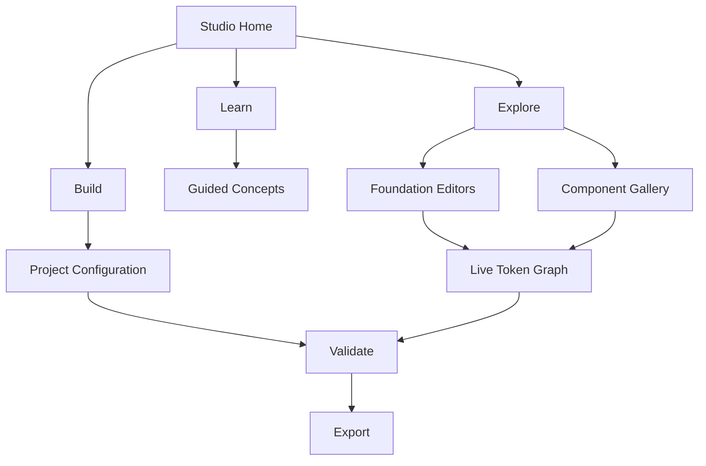
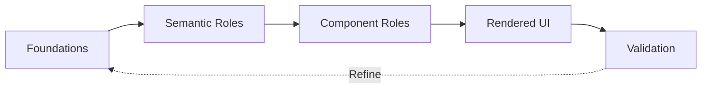
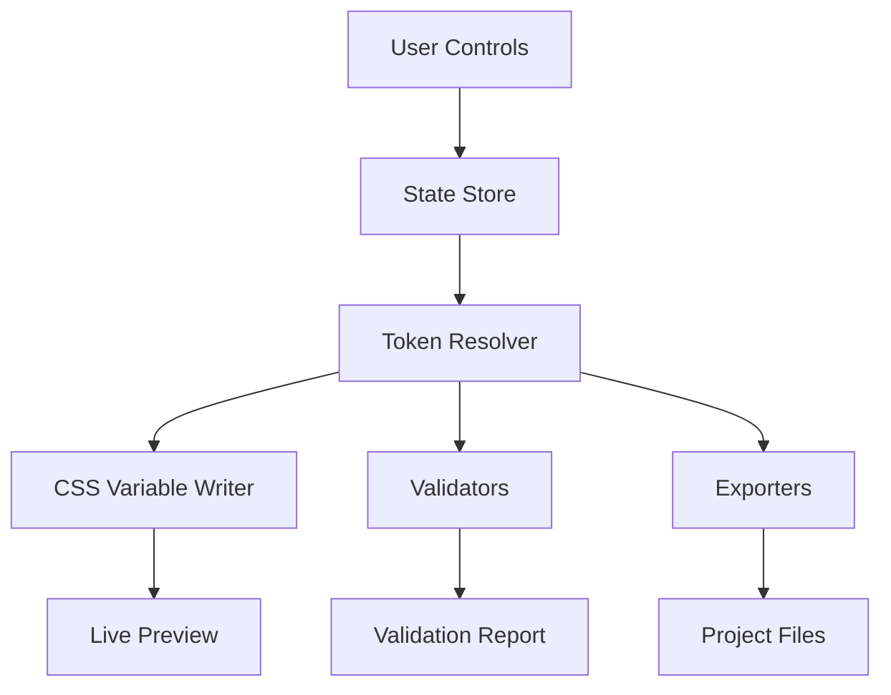
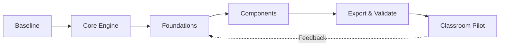

# Design System Studio — Complete Development Plan

**Working title:** Design System Studio — CSS Foundations & Components  
**Version:** Development Plan 1.0 · 12 October 2026  
**Audience:** WEBD 3100 students, instructors, independent web developers  
**Status:** Proposed roadmap; existing CSS Design System Lab is the V1 proof of concept  
**Delivery:** Static-first, mobile-first, browser-based; deployable to GitHub Pages and distributable through Brightspace

> **Product promise:** Explore a design decision, understand its CSS, see it across real components and viewports, validate its accessibility, and export a documented starting point for a project.

## 1. Executive summary

Design System Studio evolves the current single-page CSS Design System Lab into an independent educational design-system workbench. It complements Figma rather than replacing it. Its primary output is a coherent, documented set of design tokens, responsive HTML/CSS examples, and validation evidence—not a proprietary CSS framework or a finished student website.

The Studio supports three interconnected workflows:

1. **Learn:** Read concise theory, inspect commented CSS, follow guided exercises and identify token relationships.
2. **Explore:** Modify colour, typography, spacing, radii and themes; observe changes in components and responsive layouts.
3. **Build:** Save project settings, review accessibility, export CSS/JSON/HTML and apply them to a student project.

### 1.1 What makes it distinct

- **Traceability:** Foundation token → semantic token → component rule → rendered result.
- **Visual comparison:** Light/dark themes, mobile/tablet/desktop, typography ladders, component states and before/after changes.
- **Teachability:** Commented CSS, worked examples, checkpoints, definitions and explanations of *why* a technique is used.
- **Portability:** No account, backend, build process, external font or network connection required for the core experience.
- **Project ownership:** Students can export standards-based code and continue development independently.

### 1.2 Scope boundaries

**In scope:** Token authoring, visualization, guided learning, component examples, contrast calculations, responsive previews, local project files, export and documentation.

**Not in scope for initial releases:** Cloud accounts, multiuser collaboration, a Figma plugin, a full component framework, AI-generated final designs, production certification, or automated WCAG conformance claims.

## 2. Educational alignment

### 2.1 WEBD 3100 alignment

| Learning activity | Studio capability | Student evidence |
|---|---|---|
| Workshop 03A — Colour | Colour ramps (RGB Mix/OKLCH), palette roles, semantic tokens, light/dark themes | Colour System V1, contrast decisions, exported colour tokens |
| Workshop 03B — Typography | Font families, serif/sans-serif comparison, type ladders, responsive `clamp()`, leading and reading width | Mobile and desktop Figma type-scale boards; Typography System V1 |
| Workshop 04 — Structure | Containers, grids, flex, content hierarchy and responsive breakpoints | Responsive layout comparisons |
| Workshop 05 — UI Prototyping | Cards, forms, buttons, feedback and state explorer | Annotated component states |
| Workshop 06 — Figma to Code | Token mapping and commented CSS export | Figma-to-CSS comparison and code evidence |
| Workshop 07 — Accessibility | Contrast, focus, reflow, text resizing and non-colour feedback | Accessibility test log |
| Integrated semester project | Project-specific configuration and export | Evolving Visual Design System V1 and later revisions |

**Assessment boundary:** Workshop 03A and 03B remain one combined 4% workshop assessment. Formal integrated-project milestones are evaluated separately. Studio use supports existing evaluations; it does not add a new grade.

### 2.2 Guided case study and independent project

1. **Guided NSCC-inspired example:** Default primary `#004780`; Arial is the available alternative to NSCC's licensed Greycliff. Illustrative supporting palettes are not official brand specifications.
2. **Independent project:** Students choose and justify their own brand, font stacks, scales, colours, components and responsive behaviours.
3. **Evidence:** Save screenshots/Figma links, test results, exported files and a short decision log.

### 2.3 Learning principles

- Self-guided, step-by-step, with instructor acting as facilitator.
- Every code example uses semantic HTML, commented CSS and a mobile-first responsive layout.
- Prefer accessible native controls over custom JavaScript widgets.
- Show **what a generator is doing**, even when arithmetic is not required.
- Use lists and short Mermaid labels; keep detailed explanation outside diagrams.
- Follow the established student workflow: Complete Workshop → Complete Worksheet → Complete Reflection → Commit/Push Technical Evidence → Submit Worksheet to Brightspace.

## 3. Product structure and information architecture



### 3.1 Global interface

- **Header:** Product title, project name, current theme, mode switch and save/export.
- **Navigation:** Overview; Colour; Typography; Spacing & Surfaces; Components; Responsive; Accessibility; Tokens; Export.
- **Inspector:** Selected element, foundation/semantic/component token path, computed CSS and copy action.
- **Live preview:** Interactive UI with light/dark/system themes and viewport presets.
- **Learning panel:** Concept, commented code, explanation, checkpoint and relevant workshop reference.
- **Status region:** Unsaved changes, validation warnings and export status; accessible announcements.

### 3.2 Modes

| Mode | Primary purpose | Controls and outputs |
|---|---|---|
| Learn | Understand design-system concepts | Examples, definitions, code comments, checkpoints |
| Explore | Experiment safely | Sliders, pickers, presets, undo/reset, visual comparison |
| Build | Produce project assets | Named configuration, validation, JSON/CSS/HTML export |

Modes share the same token model; they do **not** create separate incompatible systems.

## 4. Token architecture

### 4.1 Layers

1. **Foundation tokens:** Literal colour scales, font stacks, type sizes, spacing, radii, shadows, breakpoints.
2. **Semantic tokens:** Purpose-specific roles such as `--color-text`, `--color-surface`, `--color-primary`, `--text-body`.
3. **Component tokens:** Context-specific assignments such as `--button-primary-bg`, `--card-radius`, `--input-border-focus`.
4. **Rendered components:** Actual elements using component/semantic tokens; values respond to theme and viewport.



### 4.2 Example CSS contract

```css
/* FOUNDATION: reusable colour and typography values. */
:root {
  --blue-500: #004780;
  --neutral-0: #ffffff;
  --neutral-950: #0f172a;
  --font-sans: Arial, Helvetica, sans-serif;
  --text-body-size: 1rem;
  --text-display-size: clamp(2rem, 1.3rem + 2.5vw, 3.25rem);
  --leading-body: 1.6; /* Unitless line height follows font size. */
  --space-4: 1rem;
  --radius-md: .75rem;

  /* SEMANTIC: assign purpose to foundation values. */
  --color-primary: var(--blue-500);
  --color-on-primary: var(--neutral-0);
  --color-background: var(--neutral-0);
  --color-text: var(--neutral-950);
  --font-body: var(--font-sans);
  --text-body: var(--text-body-size);
  --text-display: var(--text-display-size);

  /* COMPONENT: assign semantic values to specific UI parts. */
  --button-primary-bg: var(--color-primary);
  --button-primary-text: var(--color-on-primary);
  --button-radius: var(--radius-md);
}

/* THEME: override semantic roles rather than rewriting components. */
[data-theme="dark"] {
  --color-background: #0b1220;
  --color-text: #f8fafc;
  --color-primary: #99c7eb;
  --color-on-primary: #071827;
}

/* COMPONENT: responsive and theme-aware by construction. */
.button-primary {
  display: inline-flex;
  align-items: center;
  justify-content: center;
  min-height: 2.75rem;
  padding: .7rem var(--space-4);
  border: 0;
  border-radius: var(--button-radius);
  background: var(--button-primary-bg);
  color: var(--button-primary-text);
  font: inherit;
}
```

### 4.3 Token data model

```json
{
  "schemaVersion": "1.0.0",
  "project": { "name": "NSCC Guided Case Study" },
  "foundations": {
    "colors": { "blue": { "500": "#004780" } },
    "typography": { "fontSans": "Arial, Helvetica, sans-serif", "baseRem": 1 },
    "spacing": { "4": "1rem" },
    "radii": { "md": "0.75rem" }
  },
  "themes": {
    "light": { "colorPrimary": "{colors.blue.500}", "colorOnPrimary": "#ffffff" },
    "dark": { "colorPrimary": "#99c7eb", "colorOnPrimary": "#071827" }
  }
}
```

**Rules:** Validate all imported keys and values; do not execute imported code. Reject unknown schema versions unless a supported migration exists. Resolve aliases with cycle detection and report missing references. Preserve readable human-authored token names.

## 5. Feature specifications

### 5.1 Colour system builder

**Inputs:** HEX, generation method (RGB Mix or OKLCH), primary/secondary/accent families, neutrals, feedback roles, light/dark mapping.

**Behaviours:**

1. Display the source HEX and calculated RGB/OKLCH coordinates.
2. Generate labelled ramps with original anchor preserved.
3. Explain RGB channel mixing versus perceptual OKLCH adjustments.
4. Permit individual swatch overrides and named semantic assignments.
5. Preview text/background pairs and interactive components.
6. Check calculated contrast; warn rather than silently substitute colours.
7. Export foundation scales and semantic light/dark CSS variables.

**Acceptance:** Same inputs produce deterministic ramps; anchor remains unchanged; invalid HEX yields an actionable error; both themes preview; colour is never the sole feedback cue.

### 5.2 Typography scale builder

**Inputs:** Font stack (default Arial), serif/sans-serif comparison, base size, ratio, min/max sizes, line-height, letter spacing and reading width.

**Behaviours:**

1. Show a 14–48 px labelled type ladder and actual rendered specimens.
2. Compare **375 px mobile** and **1280 px desktop** frames; offer 768 px tablet.
3. Show display, H1–H3, lead, body, small, label, navigation and button roles.
4. Generate responsive `clamp()` tokens; explain minimum, fluid expression and maximum.
5. Demonstrate `rem`, `ch`, unitless leading and font fallbacks.
6. Allow students to record Figma style names and map them to CSS tokens.
7. Test text wrapping, 200% zoom and long content.

**Typeface note:** NSCC uses licensed Greycliff; do not bundle or distribute it. Arial is the default guided-case-study fallback. Project users are responsible for their own font licences.

### 5.3 Spacing, surfaces and elevation

- Spacing scale preview with actual pixel/rem measures.
- Surface hierarchy: background, surface, elevated surface and muted surface.
- Border colours, widths, focus outlines, radius scale and shadows.
- Layout container widths, reading measures and consistent gutters.
- Side-by-side examples showing how spacing changes visual rhythm.

### 5.4 Component state explorer

**Components:** Buttons, links, cards, navigation, badges, alerts, inputs, select, checkbox, radio, textarea, tabs (if implemented accessibly), and a sample responsive event listing.

**States where meaningful:** Default, hover, focus-visible, active/pressed, selected, disabled, invalid, success, warning, loading.

**For every component:** Live example; semantic HTML; commented CSS; token dependency list; keyboard guidance; light/dark and mobile/desktop tests.

### 5.5 Responsive laboratory

- Presets: 375 px, 768 px, 1280 px; adjustable custom width within available screen.
- Responsive *embedded preview* must faithfully represent the selected viewport; use a sandboxed iframe or equivalent isolated preview for CSS media queries, rather than merely shrinking a containing `div`.
- Demonstrate Grid (`minmax`, `auto-fit`), Flexbox, container queries, fluid type, wrapping and no horizontal overflow.
- Preview content length variation and 200% zoom; preserve keyboard access.

### 5.6 Accessibility workbench

- Contrast calculations for actual foreground/background colour pairs: 4.5:1 for normal text, 3:1 for large text under WCAG 2.x AA.
- Non-text UI contrast and focus visibility checks as distinct tests; do not mislabel all 3:1 tests as large-text tests.
- Keyboard-only operation; visible focus; labelled form controls; meaningful status messages.
- Text resize, 320 CSS-pixel reflow, reduced motion and non-colour status cues.
- Explain that automated checks are **partial evidence**, not a complete WCAG audit.
- Export a checklist with results, dates and unresolved issues.

### 5.7 Token inspector and before/after comparison

1. Click a rendered component.
2. Highlight the CSS property and component token controlling it.
3. Follow aliases to semantic and foundation values.
4. Display computed value and current theme.
5. Edit a source token and compare previous/current appearance.
6. Copy a minimal commented CSS snippet.

### 5.8 Project management and export

- New/open/duplicate/reset project configuration.
- Local JSON download/upload; optionally local browser persistence with clear opt-in and reset.
- Exports: `tokens.json`, `tokens.css`, `base.css`, `components.css`, `index.html` sample, `README.md`, and `validation-report.md`.
- Provide a ZIP download only when client-side packaging is implemented and tested; otherwise individual files.
- Generated CSS must be human-readable, commented, standards-based and free of runtime Studio dependencies.
- Import/export round-trip must preserve equivalent token values and theme roles.

## 6. Technical architecture

### 6.1 Recommended stack

**V2–V3:** Semantic HTML5, CSS custom properties, modern CSS Grid/Flexbox, vanilla JavaScript ES modules; no backend. **V4:** Continue static-first; add a small build pipeline only if complexity and tests justify it. Avoid unnecessary dependencies.



### 6.2 Proposed repository

```text
design-system-studio/
├── index.html                  # App shell, semantic navigation
├── README.md                   # Setup, pedagogy, licensing
├── docs/
│   ├── DEVELOPMENT_PLAN.md
│   ├── token-schema.md
│   ├── accessibility-checklist.md
│   └── workshop-mapping.md
├── css/
│   ├── tokens.css              # Foundation/semantic/component tokens
│   ├── base.css                # Reset, typography, focus, responsive base
│   ├── layout.css              # Grid/Flexbox layouts
│   └── components.css          # Reusable Studio UI
├── js/
│   ├── app.js                  # Bootstrap and events
│   ├── state.js                # Immutable project state and history
│   ├── tokens.js               # Alias resolution and validation
│   ├── color.js                # RGB Mix, OKLCH, contrast
│   ├── typography.js           # Scale/clamp calculations
│   ├── preview.js              # Isolated viewport preview
│   ├── inspector.js            # Token dependency inspection
│   ├── export.js               # CSS/JSON/HTML generation
│   └── storage.js              # Optional local persistence
├── presets/
│   ├── nscc-inspired.json
│   └── neutral-starter.json
└── tests/
    ├── tokens.test.js
    ├── color.test.js
    ├── typography.test.js
    ├── export.test.js
    └── accessibility-checklist.md
```

### 6.3 State and security

- Maintain one canonical project state; derive previews and exports from it.
- Validate import size, schema, token names, HEX strings and numeric ranges.
- Use `textContent` for user-provided labels; avoid inserting imported HTML into the Studio DOM.
- Isolate any user HTML preview; do not execute arbitrary uploaded JavaScript.
- Treat JSON imports as untrusted data; reject CSS injection and dangerous URLs.
- Support keyboard operation, reduced motion and high zoom in the Studio interface itself.
- Prefer offline operation; clearly disclose any optional external resource use.

## 7. Delivery roadmap and milestones

**Planning estimates are relative effort, not fixed calendar commitments.** One developer working part-time may take longer; validate after V2 discovery.

| Phase | Scope | Indicative effort | Exit criteria |
|---|---|---|---|
| **V1 — Existing proof of concept** | Colour/type/surface/component showcase, themes, computed token inspector | Existing | Baseline documented; issues catalogued |
| **V2 — Interactive foundations** | Editable colour builder, typography scale builder, spacing/radius controls, shared state, basic import/export | 3–5 weeks | Student can configure and export a complete foundation + semantic token set |
| **V3 — Components & validation** | Component states, dependency inspector, isolated viewport previews, contrast and keyboard checklist | 4–6 weeks | Student can trace tokens, test components and record evidence |
| **V4 — Project workflow** | Named projects, presets, JSON round-trip, multi-file exports, tutorials, validation report | 3–5 weeks | Student can transfer a project design system into VS Code and Figma workflow |
| **V5 — Optional extensions** | Compare versions, guided exercises, additional components, optional Figma-friendly mappings | Prioritized later | Driven by classroom feedback, not assumed |

### 7.1 Milestone breakdown

**M0 — Discovery and baseline**
- Inventory V1 CSS tokens, components, current limitations and accessibility gaps.
- Confirm naming conventions, token schema and licensing boundaries.
- Select representative NSCC case-study and independent-project test scenarios.

**M1 — Core engine**
- Define canonical state schema, token alias resolver, theme model, undo/reset and validation errors.
- Add deterministic unit tests for colour conversion, alias resolution and CSS serialization.

**M2 — Foundation editors**
- Add colour families, typography ladder, spacing/radius/elevation controls.
- Add computed previews, clear controls, explanatory code and responsive specimens.

**M3 — Component and viewport lab**
- Build component gallery and states; link each component to token dependencies.
- Implement actual isolated mobile/tablet/desktop preview and overflow tests.

**M4 — Validation and export**
- Add contrast, keyboard and responsive checklists.
- Export documented CSS, JSON, HTML and README; test round-trip and deployment.

**M5 — Classroom pilot**
- Pilot with WS03A/WS03B tasks, gather student time-on-task and confusion points.
- Revise onboarding, defaults, error messages, accessibility and workshop guidance.



## 8. Prioritized backlog

| ID | Priority | User story | Acceptance signal |
|---|---|---|---|
| DS-01 | P0 | As a student, I can edit a primary colour and see theme-aware UI update. | Valid HEX changes relevant tokens and previews; invalid input is explained |
| DS-02 | P0 | I can compare RGB Mix and OKLCH ramps and see what changed. | Both modes deterministic, anchored and labelled |
| DS-03 | P0 | I can build a type ladder and compare 375/1280 px specimens. | Role names, sizes, wrapping and computed CSS shown |
| DS-04 | P0 | I can export commented token CSS and JSON. | Files parse and work without the Studio |
| DS-05 | P0 | I can operate core controls by keyboard. | Visible focus, labels, no keyboard trap |
| DS-06 | P1 | I can inspect a component's token chain. | Chain displays component → semantic → foundation |
| DS-07 | P1 | I can test contrast pairs and record failures. | Ratios calculated; warnings not silently auto-fixed |
| DS-08 | P1 | I can view actual mobile/tablet/desktop layout. | Media queries respond to selected preview width |
| DS-09 | P1 | I can save and reopen a project configuration. | JSON import/export round-trip passes |
| DS-10 | P1 | I can explore hover/focus/disabled/invalid states. | State gallery with code and keyboard notes |
| DS-11 | P2 | I can compare before and after token changes. | Diff of tokens and visible comparison |
| DS-12 | P2 | I can follow a guided WS03A/03B lesson in the Studio. | Checkpoints map to workshop evidence |

## 9. Quality and testing strategy

### 9.1 Functional testing

- Unit tests: HEX parsing, RGB/OKLCH conversion, ramp anchor, contrast, `clamp()` values, alias cycles, serialization.
- Integration tests: editing tokens updates preview, inspector and exported CSS consistently.
- Import/export: schema rejection, safe import, deterministic CSS, equivalent round-trip.
- Responsive: 320, 375, 768, 1280 px; long labels; zoom and landscape.
- Browser: current Chrome, Edge, Firefox and Safari; document any unsupported features.

### 9.2 Accessibility testing

- Keyboard-only task completion and focus order.
- Screen reader spot checks of headings, navigation, forms, status and validation.
- Contrast checks in both themes; do not assume the colour generator ensures accessible pairings.
- Text resize to 200%, reflow to 320 CSS px, reduced motion and colour-blindness-independent meaning.
- Check that the **Studio itself**, not only exported components, is accessible.

### 9.3 Classroom acceptance scenarios

1. A student completes the guided NSCC colour example without installing software.
2. A student creates a mobile/desktop typography scale and documents Figma mappings.
3. A student changes one foundation token and explains three affected components.
4. A student identifies a contrast failure and fixes the correct semantic token.
5. A student exports files, opens them in VS Code and views them using Live Server.
6. A student imports saved JSON and sees equivalent tokens and theme behaviour.

## 10. Definition of done

A feature is complete only when:

- [ ] The interaction works with mouse, touch and keyboard.
- [ ] Controls are labelled and errors are understandable.
- [ ] Both light and dark themes are tested.
- [ ] Mobile, tablet and desktop layouts are verified.
- [ ] Code examples include meaningful instructional CSS comments.
- [ ] Token names and explanations match the documentation.
- [ ] Output is standards-based, readable and independent of the Studio runtime.
- [ ] Relevant automated tests and manual accessibility checks pass.
- [ ] The related student checkpoint and instructor guidance are updated.

## 11. Risks, decisions and mitigations

| Risk | Impact | Mitigation |
|---|---|---|
| Scope grows into a framework or Figma replacement | Delays learning outcomes | Protect the Studio's explore/understand/export focus |
| Generated palettes are visually attractive but inaccessible | Misleading student confidence | Pair-specific contrast checks and visible warnings |
| Too many editable options overwhelm novices | High cognitive load | Learn/Explore/Build modes, presets and progressive disclosure |
| Responsive preview does not trigger media queries | Incorrect teaching demonstration | Use isolated iframe with controlled viewport width |
| Greycliff licensing restrictions | Redistribution risk | Default to Arial; do not package licensed fonts |
| Imported project data injects HTML/CSS | Security and integrity risk | Strict schema validation and safe DOM rendering |
| Browser support differs for advanced CSS | Inconsistent classroom results | Feature detection, fallbacks and browser test matrix |
| Student time expands beyond workshops | Course pacing risk | Timebox required exercises; optional depth in Studio, not required assessment |

## 12. Governance and documentation

- **Product owner / curriculum lead:** Instructor sets learning goals, vocabulary, workshop alignment and acceptance criteria.
- **Maintainer:** Owns implementation, issues, tests, release notes and accessible documentation.
- **Student feedback:** Captured as usability findings, not automatically promoted into requirements.
- **Versioning:** SemVer for Studio releases; explicit schema versions for token exports.
- **Documentation:** Getting started, glossary, design-token reference, CSS comment guide, accessibility caveats, export guide, Figma mapping and release notes.
- **Licensing:** Choose an open-source code licence before public distribution; verify third-party packages/assets separately. Do not redistribute proprietary fonts or official marks without permission.

## 13. Suggested first implementation sprint

**Sprint goal:** Turn the static prototype into an editable, exportable foundations workbench.

1. Extract existing tokens and themes into a canonical state object.
2. Add primary colour HEX control with validation and reset.
3. Integrate RGB Mix and OKLCH ramp generation with explanatory labels.
4. Add typography base-size and ratio controls with 375/1280 px comparison.
5. Render components from the same resolved token state.
6. Export `tokens.json` and a commented `tokens.css`.
7. Test keyboard access, 375 px reflow, light/dark contrast and JSON round-trip.

**Sprint demo:** A student changes primary colour and type scale, sees a responsive event card and button update, inspects the token chain, and exports readable CSS that works in a separate HTML page.

## 14. Success measures

- **Task completion:** Students can complete core guided tasks without instructor intervention.
- **Conceptual understanding:** Students can distinguish foundation, semantic and component tokens.
- **Transfer:** Exported CSS is used successfully in independent projects.
- **Accessibility:** Students identify and remediate deliberately introduced issues.
- **Usability:** Students can find the relevant token and understand the effect of changing it.
- **Maintainability:** Token schema, test suite and export formats remain documented and stable.

## 15. Immediate next decisions

1. Confirm the working product name and initial audience beyond WEBD 3100.
2. Freeze the V2 token naming conventions and JSON schema.
3. Decide whether V2 starts from the current single HTML file or a small ES-module refactor (recommended: refactor without adding a build dependency).
4. Choose the minimum supported browser versions and the open-source licence.
5. Pilot V2 first against Workshop 03A and 03B before expanding into advanced components.

---

**Companion artifact:** `Design_System_Studio_Development_Plan.html` is a standalone, responsive HTML version of this development plan with interactive roadmap filters, progress checkboxes, a miniature live token demonstration and printable sections. The full original CSS Design System Lab remains a separate prototype; the development-plan HTML does not replace it.
